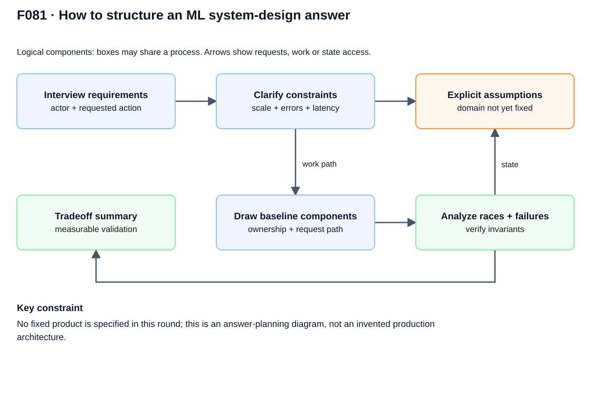
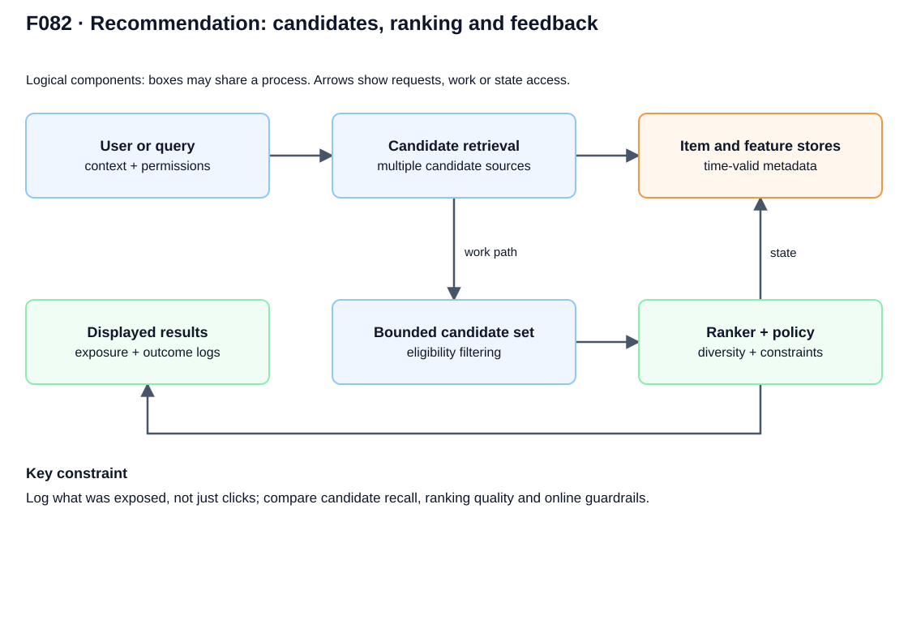
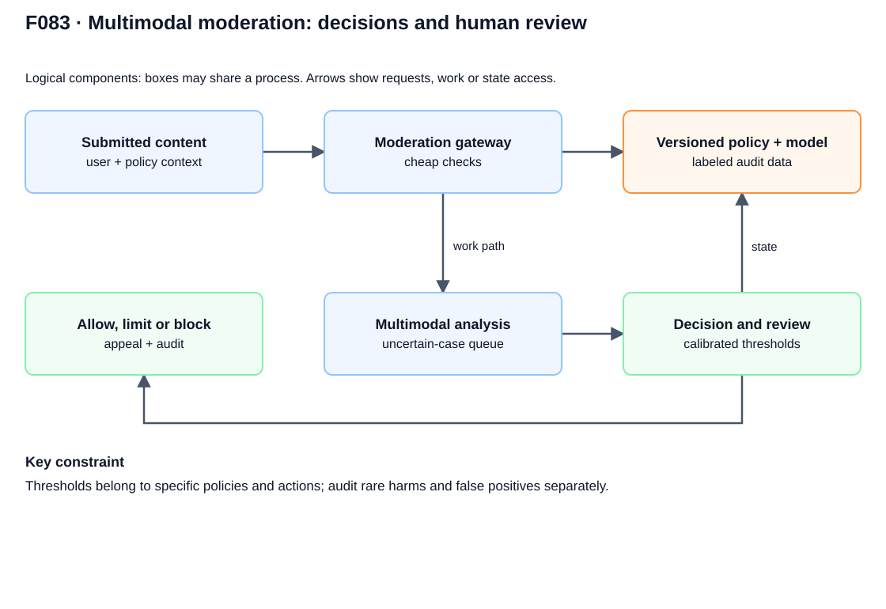
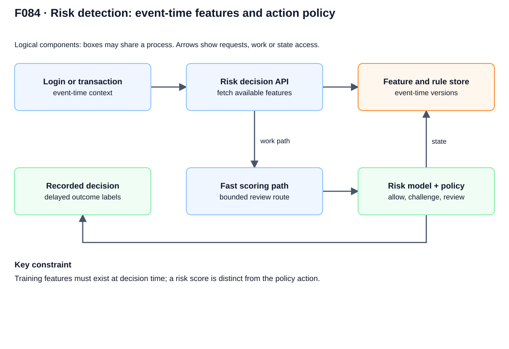
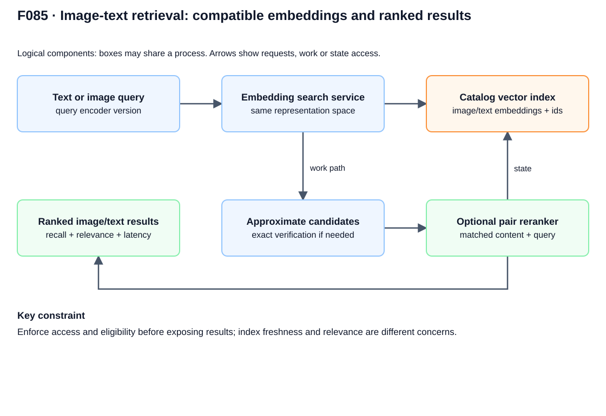
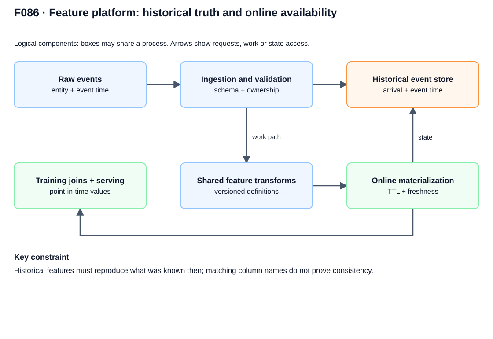
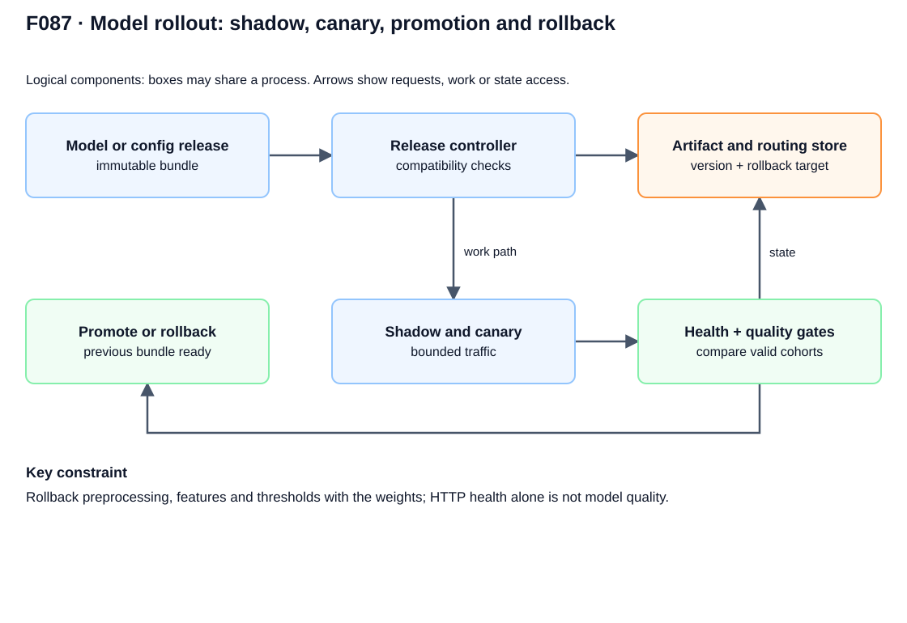
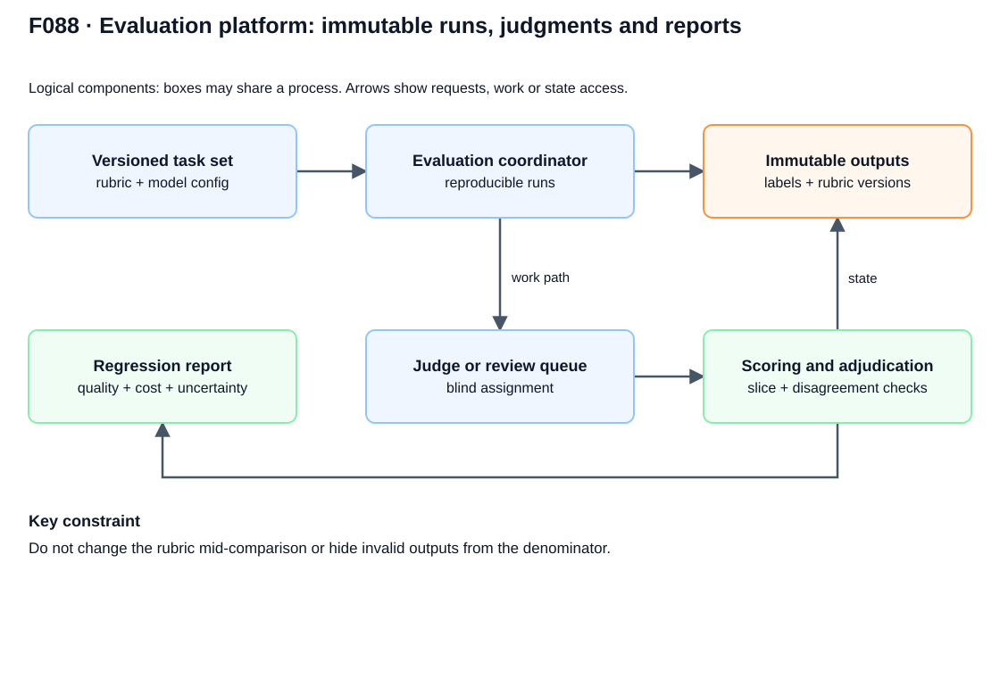
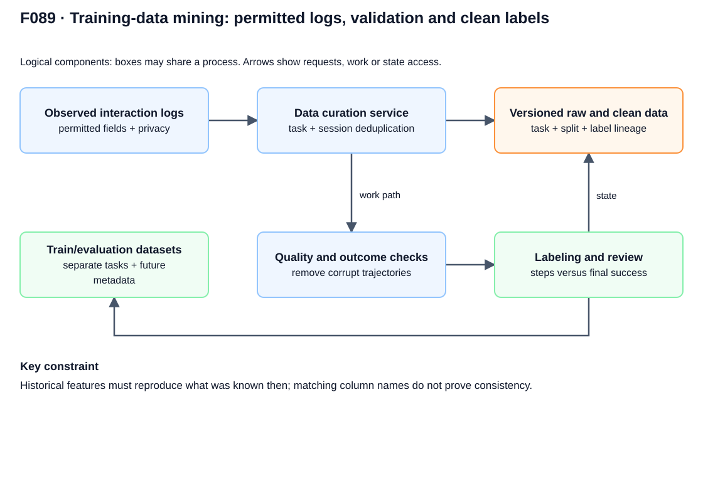
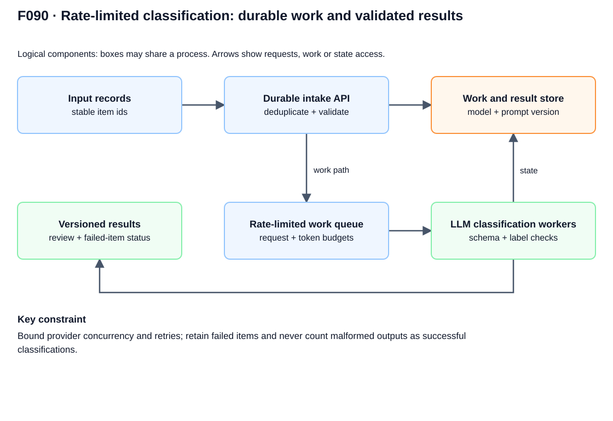

# ML system design: explain the whole system

<span class="practice-page"></span>

**Priority: very important.** A complete design connects the user's decision to data, labels, models, serving, feedback and recovery. Each answer below includes a diagram and a concrete example. The boxes are logical responsibilities; they need not all be separate network services.

[Chapter guide](README.md) · [RAG and agents](08_rag_and_agents.md) · [Diagram index](SYSTEM_DESIGN_DIAGRAMS.md)

The [small Python examples](ml_system_examples.py) run offline. Numerical traffic and cost values below are illustrative assumptions, not measurements or universal production settings.

<a id="f081"></a>

## F081. Structure an ML system-design answer

### Start from the decision, not a list of technologies

Suppose the interviewer says “design spam detection.” Ask what happens after the score: does the system block delivery, put mail in a spam folder or send it to human review? Those actions have different latency requirements and error costs. Accidentally discarding a legitimate password-reset message is different from placing it in a recoverable folder.

Clarify the actor, input, output, prediction time, traffic, latency target and cost of each error. State assumptions when details are missing. Define what the model predicts and what policy uses that prediction. Then present a baseline, explain the difficult constraint, and show how the system will be measured and recovered after failure.



[Open the architecture at full size](diagrams/F081_ml_design_process.svg).

Use this speaking order: **goal → data and labels → baseline and metrics → serving → feedback and failure handling → tradeoffs**. Draw the online request path separately from offline training. Mark the authoritative data and the versions that must stay compatible.

A capacity estimate makes assumptions visible. If there are $R$ peak requests per second and a representative service time $S$, the average in-service concurrency is about $RS$. Provision headroom rather than assume every slot can run at 100% utilization. Queueing, tail latency and batching still need measurement.

```python
import math

def capacity_estimate(daily_requests, peak_multiplier, service_seconds, target_utilization=0.7):
    if daily_requests < 0 or peak_multiplier < 1 or service_seconds < 0:
        raise ValueError("invalid traffic or service-time assumption")
    if not 0 < target_utilization <= 1:
        raise ValueError("utilization must be in (0, 1]")
    peak_per_second = daily_requests / 86400 * peak_multiplier
    # Assumes one concurrent request per slot and that service_seconds is representative.
    slots = math.ceil(peak_per_second * service_seconds / target_utilization)
    return {"peak_rps": peak_per_second, "worker_slots": slots}
```

```python
estimate = capacity_estimate(8_640_000, peak_multiplier=5, service_seconds=0.02)
assert estimate == {"peak_rps": 500.0, "worker_slots": 15}
```

This assumes 100 average requests/second, a fivefold peak, 20 ms service time, one concurrent request per worker slot and 70% target utilization. It does not say that 15 GPUs are required; the slot is whatever execution unit the measured service supports.

Finish by tracing one request and one failure. If a feature store times out, say whether you use a validated fallback, defer the decision or fail closed under the product policy. Show what is logged, how outcomes become labels, and how an incompatible model release is rolled back. A diagram is useful because its arrows expose these dependencies, not because it contains many boxes.

<a id="f082"></a>

## F082. Design a recommendation system from candidates to ranking

### The problem and the baseline

A video app may have millions of items but only ten visible recommendation slots. Scoring every item with a large model on every request is wasteful. First retrieve a smaller pool using cheap complementary methods; then spend more computation ranking those candidates.



[Open the architecture at full size](diagrams/F082_recommendation.svg).

A concrete baseline combines recently popular items, user-history similarity and content-based matches. Remove unavailable, already-consumed or disallowed items under the product's rules. Fetch user, item and context features, score relevance or expected value, and apply policy, diversity and freshness constraints. Return a stable paginated result and log which items were actually exposed.

For example, retrieve 1,000 candidates, rank them to 100, apply final constraints and show 10. These counts are assumptions to test. Candidate retrieval recall limits what later models can achieve: an excellent ranker cannot show a useful item that never entered the candidate set.

Build training rows from exposures and their later outcomes. A displayed-but-unclicked item can be a negative under a stated observation window; an unexposed item is not an observed rejection. Join features as they were known at exposure time. Account for position bias, delayed outcomes and the feedback loop created by the previous recommender.

Evaluate candidate recall, ranking metrics and online user outcomes separately. A higher click rate may encourage low-quality or repetitive content, so include retention, satisfaction and product guardrails. Use user/entity-aware and time-aware splits to avoid putting the same near-duplicate behavior in training and test.

New items need content features or controlled exposure before they have interaction history. New users need an honest cold-start fallback, such as contextual popularity or stated preferences. If a real-time feature service fails, fall back to a compatible precomputed model or list; do not feed untested missing values to the normal ranker. Monitor fallback rate, feature freshness, latency, candidate coverage and exposure distribution.

<a id="f083"></a>

## F083. Design multimodal harmful-content detection

### Turn a score into a policy action

The product receives text, images, audio or video. Define the harm categories and the action for each: allow, restrict distribution, hold for review or block. The consequences of a false positive and false negative vary by category, so one aggregate accuracy number is inadequate.



[Open the architecture at full size](diagrams/F083_moderation.svg).

Start with lightweight known-hash, text or metadata checks, followed by stronger per-modality and cross-modal models where useful. OCR and audio transcripts can reveal text that a caption-only system misses; the combination of a harmless image and a harmful caption may require joint interpretation. Separate pre-publication checks from slower asynchronous review and re-evaluation.

Use thresholds calibrated for the action and policy version. High-confidence severe violations may be blocked under the defined policy; uncertain cases can be held or restricted and sent to review. Store the model version, policy version, reason and appeal status so a decision can be audited and corrected.

Review is a capacity-constrained system. If 10 reviewers each resolve 20 items/hour, capacity is 200/hour. Sending 300/hour creates a backlog of 100/hour before accounting for breaks or retries. Prioritize by expected harm, uncertainty and age; add admission or degraded-mode rules rather than assume the queue will drain itself.

Evaluate per-category precision/recall, false positives on benign content, subgroup and language slices, appeal reversals, time-to-action and review workload. Sample allowed content as well as flagged content for audits. Otherwise the feedback data overrepresents what the model already considered suspicious.

When a model or policy changes, version the decision rules and decide which old content must be reviewed again. If inference fails, the fallback depends on the publication risk and product contract; explicitly choose defer, limited distribution or another policy. Log safe diagnostic metadata while protecting private media. Human review improves ambiguous decisions only when guidelines, quality checks and disagreement handling are also defined.

<a id="f084"></a>

## F084. Design fraud or account-takeover detection

### Define the event and the decision time

For a suspicious login, the system must decide whether to allow access, request a stronger authentication step or send the case to review. For a transaction, it may approve, challenge, defer or reject. Specify one event and a latency budget before choosing a model.



[Open the architecture at full size](diagrams/F084_risk_detection.svg).

Collect features that exist at that moment: recent failed logins, device familiarity, unusual location changes, account age and transaction velocity under the permitted data policy. Separate event time from when information actually became available. A chargeback or investigator finding recorded next week cannot be used to predict today's event in a realistic historical test.

Start with simple rules and a calibrated supervised baseline. The model estimates risk; a policy chooses an action based on cost, uncertainty and review capacity. In a simplified two-action example, rejecting a legitimate event costs $C_{\rm FP}$ and allowing fraud costs $C_{\rm FN}$. Under those assumptions, reject when

$$
p(\text{fraud}\mid x)C_{\rm FN}>(1-p(\text{fraud}\mid x))C_{\rm FP}.
$$

Real systems include challenges, variable amounts, adversarial behavior and capacity limits, so that formula explains the tradeoff rather than supplies a universal threshold. A low-friction challenge can be better than a hard block when risk is uncertain.

Train and evaluate with time-based splits and mature labels. Account for delayed fraud discovery and selective labels: blocked events may never reveal whether they would have been fraudulent. Monitor precision/recall, loss prevented under valid attribution, legitimate-user friction, subgroup errors, drift and review volume.

Record the decision id, feature/model/policy versions and eventual outcome. Protect sensitive features and audit access. For feature-service failure, use an explicitly evaluated fallback or additional verification; do not silently treat unknown device history as safe. Attackers adapt to visible boundaries, so refresh evaluation slices and investigate changes in attack patterns, not just aggregate model scores.

<a id="f085"></a>

## F085. Design image-text retrieval

### What is being retrieved?

A user writes “red running shoe” and wants matching images, or uploads an image and wants related text. A dual encoder maps the two modalities into a compatible vector space. Catalog embeddings can be computed offline; the query embedding is computed at request time.



[Open the architecture at full size](diagrams/F085_image_text.svg).

Build cleaned matched image-caption or image-description pairs. Deduplicate near-identical images and split by product/entity and time where appropriate, so a copied image in test does not make memorization look like generalization. Inspect alternative valid matches: a different photo of the same item may be positive, not a negative merely because its row id differs.

Normalize embeddings and use cosine similarity or a consistently defined dot-product model. Contrastive training makes a true pair score above in-batch negatives in each direction. The [InfoNCE answer](05_core_ml_coding.md#f047) includes both a NumPy explanation and a differentiable PyTorch implementation, so the training loss can be studied and run directly.

Precompute catalog vectors with an encoder version and build an exact-search baseline before introducing approximate nearest-neighbor search. At serving time, enforce item eligibility and access, retrieve candidates, optionally rerank image/text pairs with a stronger joint model, and return results. Measure candidate recall and final relevance separately.

For example, finding at least one useful image among the top ten can be measured as a hit rate; retrieving all labeled relevant images among ten is a different recall definition. State which metric is being used and evaluate rare product categories, small text details, compositional descriptions, latency and memory cost.

When the encoder changes, rebuild or migrate the catalog index and route queries to compatible vectors. Do not mix old item embeddings with a new incompatible query encoder and assume equal dimensions imply equal meaning. If a reranker is unavailable, return the validated retrieval baseline under a defined quality fallback. If candidate recall is low, increasing reranker size alone cannot repair missing items.

<a id="f086"></a>

## F086. Design a feature platform with online/offline consistency

### The problem is information timing

Training reads historical data in bulk. Live inference needs a small feature vector quickly. Both must implement the same meaning, but “same column name” is insufficient. A seven-day transaction count used on Monday cannot include a transaction first observed on Tuesday, even if its event timestamp says Sunday.



[Open the architecture at full size](diagrams/F086_features.svg).

Store entity keys, event time, availability time, transformation version, owner and freshness contract. A historical query selects only events in the intended window that were available by prediction time. Late corrections require an explicit policy: historical truth can differ from what the system could know then.

This small example uses numeric timestamps to make the rule visible. It assumes one deduplicated row per event:

```python
def known_event_count(events, entity, prediction_time, window):
    """Times are comparable numbers; events have stable IDs and one row per event."""
    if window <= 0:
        raise ValueError("window must be positive")
    return sum(event["entity"] == entity
               and prediction_time - window < event["event_time"] <= prediction_time
               and event["available_time"] <= prediction_time for event in events)
```

```python
events = [
    {"entity": "u1", "event_time": 90, "available_time": 95},
    {"entity": "u1", "event_time": 91, "available_time": 105},
]
assert known_event_count(events, "u1", prediction_time=100, window=20) == 1
```

Both events occurred inside the window, but the second was not yet available. Counting both would leak future information into the historical feature.

Define transformations once where practical, then test historical recomputation against recorded online feature snapshots. Materialize current values in a serving store with predictable lookup latency and TTL/freshness metadata. Backfills write versioned results and must not replace newer live state with older data accidentally.

Monitor null rates, feature distributions, arrival lag, online/offline differences and transformation compatibility. On a missing or stale feature, use the model bundle's documented default or a tested fallback. Deploy the model with its required feature schema and definitions. A fast feature lookup returning a value with the wrong historical meaning is still a correctness failure.

<a id="f087"></a>

## F087. Design an online model rollout with rollback

### What exactly is being released?

A release is a bundle: model weights, preprocessing, feature definitions, label mapping, thresholds and runtime configuration. Store an immutable version and compatibility contract. Rolling back only weights can make things worse if the previous model cannot read the new features.



[Open the architecture at full size](diagrams/F087_rollout.svg).

First validate the artifact and run fixed regression checks. Use shadow traffic to observe predictions and resource cost without allowing the new model to control user-visible actions. Then send a small stable cohort to the canary and compare operational and quality guardrails against control.

A deterministic assignment avoids moving the same user between variants on every request. This example uses a stable digest rather than Python's process-dependent `hash()`:

```python
import hashlib

def canary_assignment(entity_id, release_id, percent):
    if not 0 <= percent <= 100:
        raise ValueError("percent must be between 0 and 100")
    key = f"{release_id}:{entity_id}".encode()
    bucket = int.from_bytes(hashlib.sha256(key).digest()[:8], "big") % 10000
    return "canary" if bucket < percent * 100 else "control"
```

```python
first = canary_assignment("user-123", "release-7", percent=5)
assert first == canary_assignment("user-123", "release-7", percent=5)
assert canary_assignment("user-123", "release-7", percent=0) == "control"
```

Keep cohort assignment fixed during a comparison. If a mutable release id or rollout percentage changes, define the intended migration explicitly. User-level bucketing is an example; the right unit may instead be account, organization or marketplace.

Automatically stop or roll back on clear operational failures such as errors, incompatible schemas or severe latency regression. For quality signals with delayed labels, use sufficiently mature windows; a short healthy latency graph does not establish better predictions. Include business guardrails so a higher click rate does not hide worse long-term outcomes.

Maintain routing to the previous compatible bundle and test the rollback path before the release. Record release id on predictions, features and exposure logs. If the service cannot load the canary model, fail back under the routing policy instead of serving arbitrary partially loaded artifacts. A deployment is reversible only when the earlier dependencies and state remain usable.

<a id="f088"></a>

## F088. Design an LLM evaluation and annotation platform

### Preserve the experiment, not just a final score

Two models can appear different because their questions, rubrics or reviewers changed. The platform must make each comparison reproducible: task version, model configuration, prompt, output, rubric and judgment are separate immutable records.



[Open the architecture at full size](diagrams/F088_evaluation.svg).

Create task schemas and evaluation sets that cover representative traffic and important failure slices. Store expected-answer checks where appropriate, and isolate hidden references from the system being evaluated. Save invalid model outputs too; dropping them artificially improves reported accuracy.

A run service submits bounded generation jobs and records output ids, errors, latency and cost. An annotation service assigns outputs for blinded review using a versioned rubric. Include calibration examples, suitable gold checks and a route for ambiguous or conflicting judgments. Reviewer speed is an operational metric, not a complete measure of label quality.

For subjective writing, specify distinct dimensions such as factual correctness, completeness, evidence support and clarity. Do not collapse every disagreement into one majority label without investigating whether the rubric is unclear. Automated judges can help scale evaluation, but audit their agreement with human reviewers and watch for preference and position biases.

The reporting layer joins runs and judgments under fixed versions, shows aggregate metrics with slice counts and uncertainty, and links back to examples for inspection. Compare like with like: changing a rubric halfway through model A versus B is not an apples-to-apples model comparison. The [agent-evaluation answer](08_rag_and_agents.md#f078) explains repeated trials and task-balanced success.

Access control separates evaluation administration, annotator access and protected user data. Retain an adjudication history rather than overwriting prior judgments. If a scoring job crashes, retry it under the same run id and record the scorer version; avoid duplicate downstream records. Monitor queue age, reviewer disagreement, invalid-output rate and judge drift alongside the leaderboard.

<a id="f089"></a>

## F089. Mine trustworthy training examples from noisy interaction logs

### A successful ending does not make every step a good demonstration

Suppose a UI agent eventually books the correct room, but first clicks several unrelated controls and recovers from errors. Copying the whole trajectory as uniformly good supervision teaches those mistakes too. Logs are observations that need curation, not ready-made ground truth.



[Open the architecture at full size](diagrams/F089_trajectory_data.svg).

Define the desired behavior and the observable success test. Retain only allowed input/output/action fields, remove secrets and private data under the dataset policy, and deduplicate repeated sessions or nearly identical tasks. Do not assume hidden reasoning or unrestricted user content is necessary for the learning objective.

Reconstruct event order and environment state. Reject corrupted, truncated or impossible traces. Distinguish final success, valid intermediate actions, recoveries and irrelevant actions. Depending on the training objective, keep a clean successful segment, label recovery behavior separately, or ask a reviewer to annotate which steps genuinely advance the task.

Prevent information leakage when building examples. If a final success flag is available only after the episode, it can supervise evaluation or selection, but cannot become an input feature for a decision that happened earlier. Likewise, a test task must not be a near-duplicate of a retained training session from the same user or document.

Split by task family, user, entity or time according to the intended generalization. Keep a fixed held-out evaluation and compare a small curated dataset against the unfiltered baseline before collecting millions more records. Measure task success, undesirable actions, recovery and data diversity, rather than just training loss or dataset size.

Record task id, environment version, label policy and curation decisions internally so a model failure can be traced and a bad batch removed. A deletion request must propagate into downstream derived datasets under the applicable retention policy. Review uncertain and high-impact examples; choosing only the longest or most confident-looking trajectories can overrepresent noise and easy tasks.

<a id="f090"></a>

## F090. Design a rate-limited LLM classification pipeline

### Separate durable work from execution capacity

The product needs to classify many records through an LLM API. Requests may fail, responses may be malformed, and the provider limits both requests and tokens. A list of concurrent promises is not a durable pipeline.



[Open the architecture at full size](diagrams/F090_classification.svg).

Assign a stable item id and a work key containing the item content version, model, prompt and label schema. Persist accepted work. Workers claim tasks under a lease, acquire provider-wide request/token permits, run calls with deadlines, validate outputs and persist a terminal result before acknowledging the queue message. Failed workers can be retried without creating another logical result record.

For example, a provider cap of 120 requests/minute is an average allowance of 2 requests/second under the specified window. Ten concurrent calls can still exceed that rate if each finishes in 100 ms. **A semaphore limits concurrency, not requests per second or tokens per minute.** Admission must implement the actual provider budgets, shared across workers when required.

### Study the execution part with an offline adapter

This code demonstrates bounded in-flight calls, retry limits, timeouts and label validation. Durable queues and time-based rate admission belong around it in the architecture; the code does not claim to implement them.

```python
import asyncio

async def classify_batch(items, classify, labels, concurrency=2, retries=1, timeout_seconds=1):
    """Execution demo, not a durable queue or a requests-per-second limiter.

A production service persists work and results and acquires a provider-wide
request/token rate permit before each attempt. This bounds only in-flight calls.
"""
    if concurrency < 1 or retries < 0 or timeout_seconds <= 0:
        raise ValueError("invalid execution budget")
    if len({item["id"] for item in items}) != len(items):
        raise ValueError("item IDs must be unique")
    semaphore = asyncio.Semaphore(concurrency)

    async def one(item):
        for attempt in range(retries + 1):
            try:
                async with semaphore:
                    output = await asyncio.wait_for(classify(item["text"]), timeout_seconds)
                if not isinstance(output, dict) or set(output) != {"label"} or not isinstance(output["label"], str) or output["label"] not in labels:
                    return item["id"], {"status": "invalid_output", "result": None}
                return item["id"], {"status": "completed", "result": output}
            except (OSError, TimeoutError, asyncio.TimeoutError):
                if attempt == retries:
                    return item["id"], {"status": "retry_exhausted", "result": None}
                # A real service uses bounded exponential backoff with jitter.
                await asyncio.sleep(0)
        raise AssertionError("unreachable")

    return dict(await asyncio.gather(*(one(item) for item in items)))
```

```python
async def demo_classifier(text):
    return {"label": "positive" if "good" in text else "negative"}

from ml_system_examples import classify_batch
results = asyncio.run(classify_batch(
    [{"id": "a", "text": "good service"}, {"id": "b", "text": "slow service"}],
    demo_classifier, labels={"positive", "negative"}
))
assert results["a"]["result"] == {"label": "positive"}
```

The fixture tests orchestration, not real sentiment quality. In production, retry only transient failures under bounded exponential backoff with jitter; respect retry guidance. A permanently invalid schema result goes to review or a separately budgeted repair path. A timeout after provider execution may still incur cost, even if result storage is idempotent.

Monitor accepted/completed/failed counts, oldest queue age, token and request usage, invalid outputs, retries, spend and end-to-end classification quality. Include invalid and exhausted items in coverage reports. If input arrives faster than the permitted processing rate, add admission, prioritization or a cheaper route; unbounded retry queues cannot solve sustained overload.

## How to practice these answers

For each diagram, explain one normal request, one retry, one stale-data case and one dependency failure. State which store owns the authoritative fact and which outputs are derived views. Then justify the metric, fallback and tradeoff using the product's actual action.

Run the [system examples](ml_system_examples.py) with the accompanying [checks](test_ml_system_examples.py):

```bash
python -m unittest test_ml_system_examples -v
```
