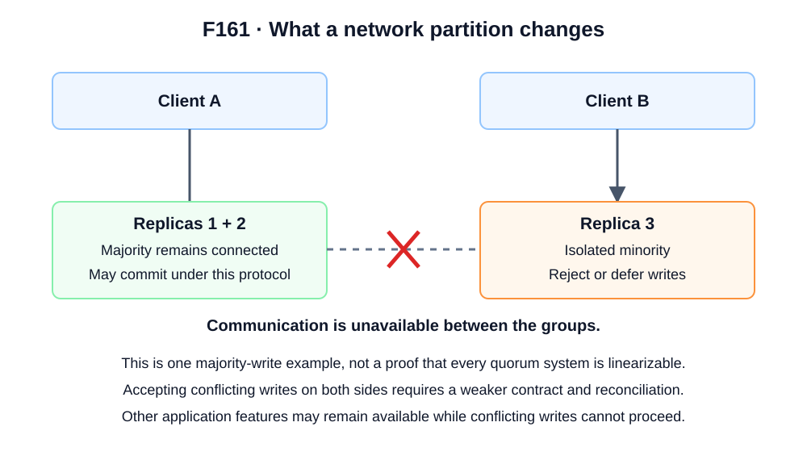
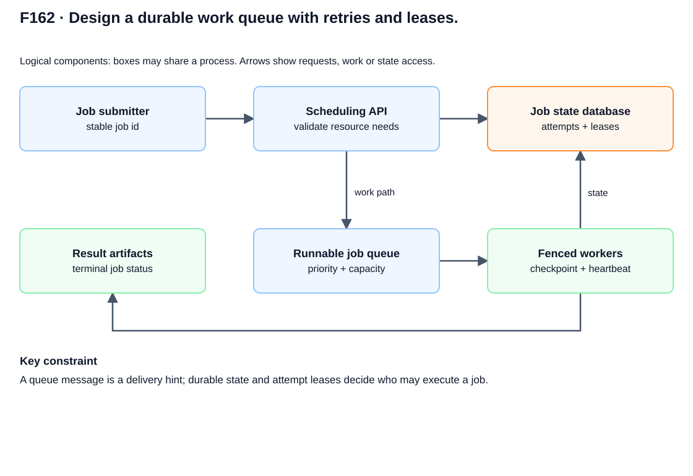
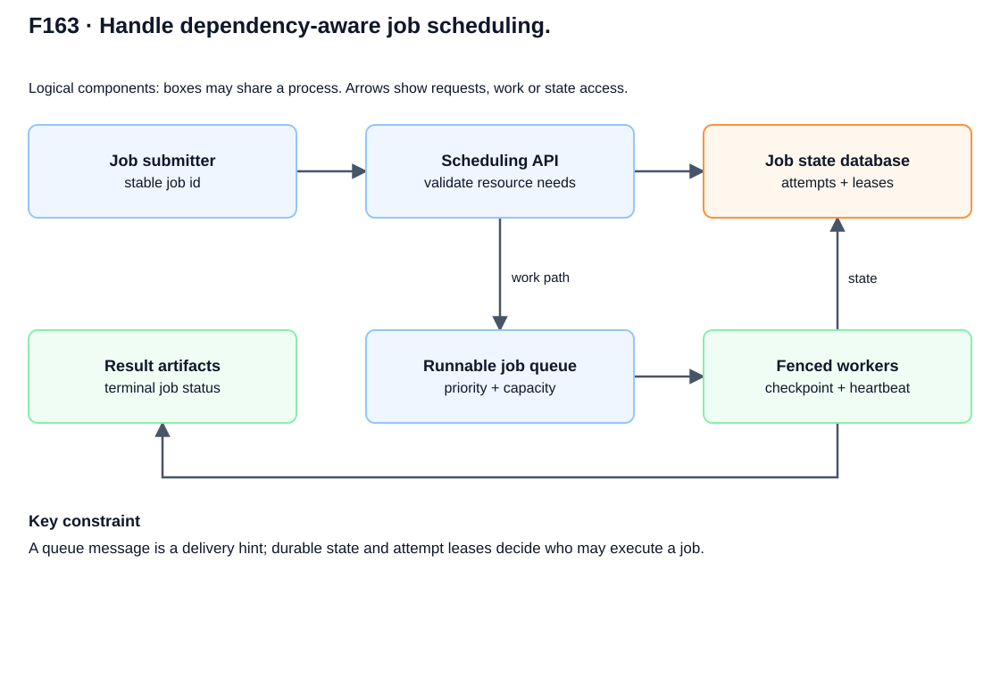
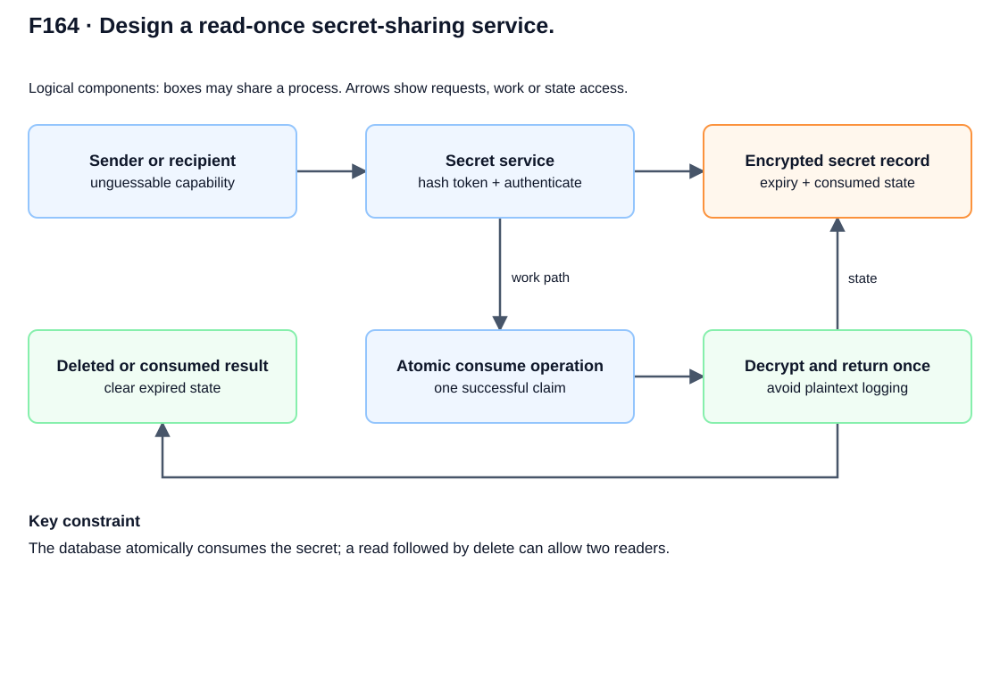
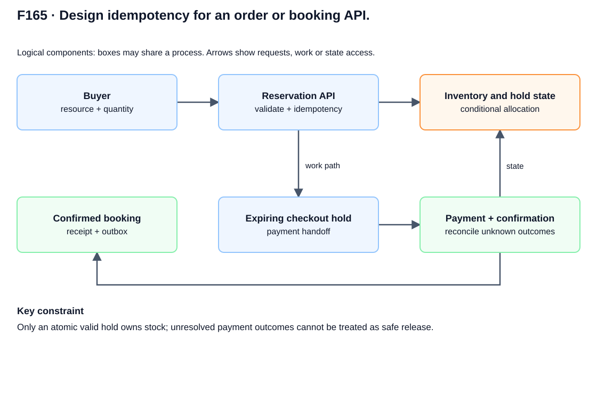
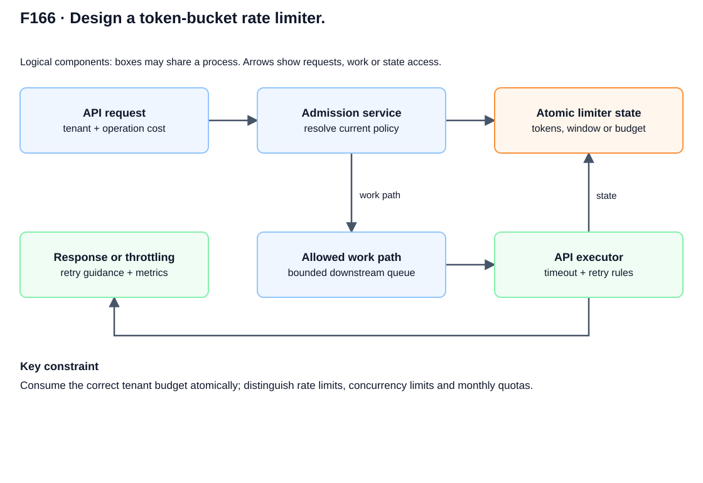
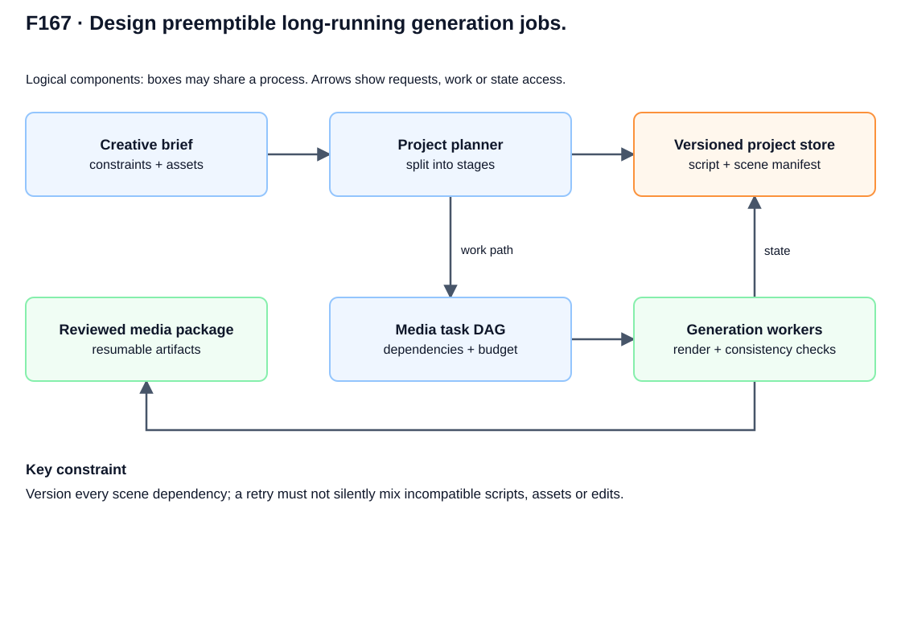
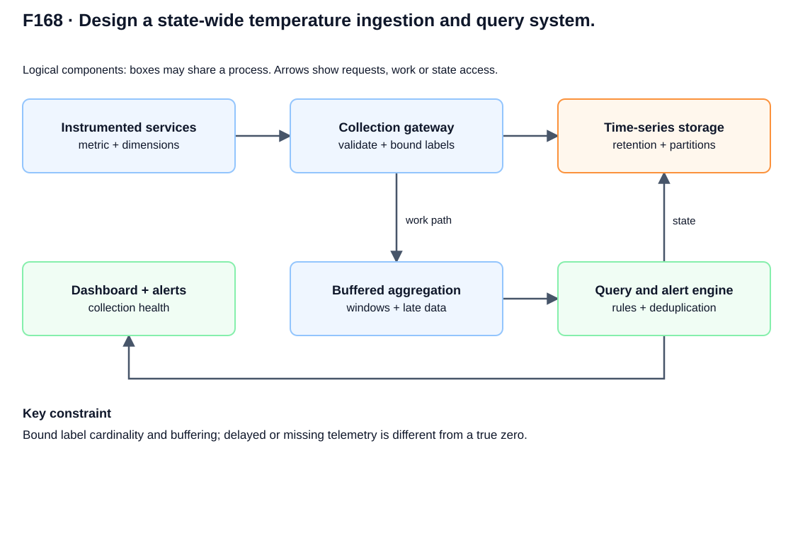
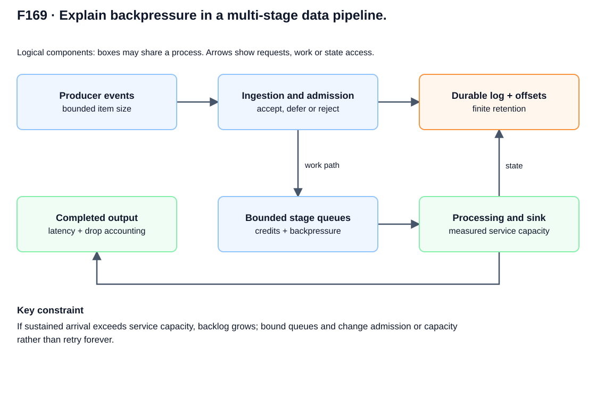
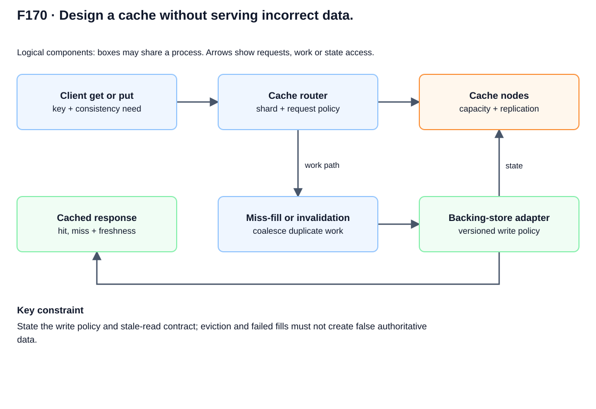

# Distributed systems: complete design answers

<span class="practice-page"></span>

[Chapter guide](README.md) · [Diagram index](SYSTEM_DESIGN_DIAGRAMS.md) · [ML system design](09_ml_system_design.md)

These answers focus on the state transition that makes a design correct. A queue, cache or retry loop is useful only after its authority, failure behavior and recovery rule are clear.

<a id="f161"></a>

## F161. Explain CAP during a real network partition

### What is the actual conflict?

Two replicas cannot communicate, but clients can still reach each side. Suppose both are asked to update the same inventory counter. If each side immediately accepts conflicting writes, the system cannot also promise that all clients see one real-time, single-copy history of that counter. If it preserves that strong history, some otherwise reachable requests must wait or fail.



[Open the diagram at full size](diagrams/F161_design.svg).


CAP's consistency means a strong single-copy behavior, commonly expressed as linearizability; it is not the generic idea that data should be valid. Availability in this statement means every request to a nonfailed participant receives a response meeting the operation's contract, rather than merely showing a fallback web page. A network partition is loss or indefinite delay of communication between groups of participants.

For three replicas with a majority-write protocol, an island containing two may keep committing while the isolated single replica rejects or defers writes. Do not say that “CP means the entire application is down.” Other read paths, cart editing or unrelated shards may remain useful. Nor does using a quorum automatically establish linearizability: leader ownership, read rules and stale-writer fencing must match the promised protocol.

An availability-oriented design can accept updates on both sides, then reconcile. That may be suitable for a shopping wish list whose conflict rule unions items. It is much harder for “sell the last unique seat,” where independent successful allocations violate the product invariant. Choose per operation, not by assigning one slogan to the whole company.

After communication recovers, explain how divergent logs, versions or conflicts are reconciled and what the client observes. During ordinary operation without a partition, latency, replication lag and stronger consistency still trade off; CAP does not imply that every normal request must choose exactly two permanent properties.

<a id="f162"></a>

## F162. Design a durable work queue with retries and leases

### Separate delivery from ownership

A worker can crash after doing useful work but before acknowledging a message. The queue must redeliver, yet blindly repeating the task can duplicate an email, payment or data write. Start with a stable job id, durable state, an attempt number and an idempotent business operation.



[Open the diagram at full size](diagrams/F162_design.svg).


Persist an accepted job before acknowledging submission. A scheduler or queue makes it discoverable. A worker atomically claims a pending or expired job, receives a lease and an increasing attempt/fencing token, and periodically renews ownership while working. Completion updates must match the current attempt; a late result from an older worker cannot overwrite the new owner's result.

The usual delivery contract is at least once. If the task changes the same database as the job row, a transaction can combine the business update and completion marker. If it calls an external provider, use a stable provider operation id and reconcile uncertain outcomes. A lease expiry does not prove the previous worker stopped executing; fencing and effect-level idempotency are still necessary.

For a failed network call, record the outcome as unknown when the effect may already have happened. Retry transient failures with bounded backoff and jitter, move permanent failures to an explicit review state, and cap the total attempts or age. Preserve the last error and operation reference without logging secrets.

Monitor queue age, claim latency, lease renewals, redelivery rate, dead-letter volume and actual end-to-end task completion. Queue depth alone can be misleading when task sizes vary. If producers permanently exceed consumers, add admission, capacity or a cheaper route; infinite retries do not create throughput. Test worker death before execution, after an effect, during renewal and just before completion acknowledgment.

<a id="f163"></a>

## F163. Handle dependency-aware job scheduling

### A task is ready only after its prerequisites truly succeed

For a workflow `extract → transform → load`, starting `load` because the previous task was merely dispatched is incorrect. Model a directed acyclic graph, validate dependencies and cycles at submission, and persist each node's state with its attempt ownership.



[Open the diagram at full size](diagrams/F163_design.svg).


The scheduler finds pending nodes whose prerequisites all succeeded, then atomically moves them to a runnable/claimed state. Multiple schedulers may discover the same ready node, so readiness discovery and successful claim are separate operations. Queue delivery can repeat; a conditional state transition and attempt token decide who owns execution.

This helper illustrates a **readiness snapshot**, not the whole durable scheduler. The graph is assumed to have passed a separate cycle check:

```python
def ready_jobs(dependencies, states):
    """Readiness snapshot for a prevalidated DAG; claiming work is a separate transaction."""
    for parents in dependencies.values():
        if not set(parents) <= dependencies.keys():
            raise ValueError("dependency references an unknown job")
    return sorted(job for job, parents in dependencies.items()
                  if states.get(job) == 'PENDING'
                  and all(states.get(parent) == 'SUCCEEDED' for parent in parents))
```


```python
dependencies = {"extract": [], "transform": ["extract"], "load": ["transform"]}
states = {"extract": "SUCCEEDED", "transform": "PENDING", "load": "PENDING"}
assert ready_jobs(dependencies, states) == ["transform"]
```

If a parent fails permanently, define whether descendants become blocked, canceled, or may follow an explicit alternative branch. Do not leave them pending forever with no explanation. If a parent retries, its duplicate success notification must not decrement a dependency counter twice and release a child too early.

Persist node results and the exact input/output artifact versions passed to children. A resumed workflow must not combine an old parent's outputs with a new incompatible run by accident. For a large graph, keep a durable remaining-dependency count or indexed readiness view, updated idempotently; recomputing the whole graph is only a small-system baseline.

Cancellation and workflow completion need similarly precise rules: stop undispatched nodes, request cancellation from active workers, and report terminal completion only after relevant node outcomes are durable. Monitor blocked nodes, retries, queue delay and resource bottlenecks separately. A correct dependency scheduler can still miss deadlines if it ignores GPU, memory or service quotas.

<a id="f164"></a>

## F164. Design a read-once secret-sharing service

### What does “once” mean?

A sender stores an encrypted secret and receives an unguessable retrieval capability. The first authorized retrieval atomically consumes that record; later requests see consumed or expired status. Two simultaneous GET requests must not both obtain the secret.



[Open the diagram at full size](diagrams/F164_design.svg).


Store a hash of the random capability, encrypted bytes, expiry and lifecycle state. Protect transport and key access, enforce size and request limits, and avoid putting the plaintext in request logs or analytics. The retrieval token should not be predictable from a sequential database id.

The key operation is a conditional consume, performed atomically with retrieving the protected payload under the chosen database transaction semantics. A separate “read, then delete” sequence races: both readers may read before either deletes. Likewise, a replica with stale consumed-state information must not independently authorize another retrieval.

There is a product tradeoff at response loss. If the service consumes the secret and the network drops the response, the intended recipient may never see it. Replaying the payload to the same bearer token can improve delivery but weakens a strict one-retrieval guarantee unless a separate authenticated delivery/session protocol defines what is allowed. State the chosen contract instead of promising both perfect at-most-once access and lossless delivery over an unreliable connection.

Expiry cleanup marks or deletes records that were not consumed in time. Bound retained tombstones and prevent a delayed replica or backup restore from resurrecting an old valid capability. Sender revocation, link previews, browser prefetch and automated security scanners need careful product handling: a supposedly harmless preview must not accidentally consume the secret. A dedicated explicit reveal operation can separate viewing a landing page from the irreversible consume.

Test concurrent retrieval, timeout after consumption, expiry races, guessed tokens and restored-state behavior. Report only minimal status information so an invalid-token endpoint does not become an oracle for discovering stored secrets.

<a id="f165"></a>

## F165. Design idempotency for an order or booking API

### One logical request can have several network attempts

A client submits checkout, the server creates the order, and the response disappears. The client cannot tell whether anything happened. Retrying without a stable request identity can create a second order; refusing all retries makes ordinary network failures unusable.



[Open the diagram at full size](diagrams/F165_design.svg).


The client generates a key for one checkout intent and reuses it for retries. Scope the key to the authenticated actor and operation, store a fingerprint of the normalized request, and enforce uniqueness in the authoritative database. The same key with different contents is a conflict, not a new interpretation of the original request.

Persist an operation record such as `PENDING`, `SUCCEEDED` or a definitive failure, with its stable order id and replayable response information. If the order and operation row share a database, create them in one transaction. Concurrent copies of the request race on the unique constraint; only one creates the logical order. A duplicate can wait briefly or receive the existing pending status.

For external inventory or payment, reuse the same downstream operation id and save provider references. A timeout is unknown until the provider status or a safe replay resolves it. Do not mark it failed merely because your HTTP deadline elapsed, then create a new provider call with a different identity.

Define key retention relative to the client's retry horizon and the provider's idempotency window. Expiring the key too early allows an old request to look new. Keep business-level uniqueness and reconciliation records when the effect remains financially or operationally important.

Return terminal results consistently, make state transitions conditional, and have a worker resume incomplete operations after crashes. Test duplicate concurrent submissions, mismatched payloads, a crash between business commit and response, and external success with lost acknowledgment. Idempotency concerns the effect of repeated execution; it does not by itself guarantee every request succeeds or that an external side effect happens exactly once.

<a id="f166"></a>

## F166. Design a token-bucket rate limiter

### Understand the burst and refill separately

A bucket holds at most $B$ tokens. It refills at $r$ tokens/second, and a request costing $c$ is admitted only if enough tokens exist. A full bucket permits a burst while the long-run budget controls sustained work.

$$
T_{\rm refilled}=\min(B,T_{\rm old}+r\Delta t),\qquad
\text{allow if }T_{\rm refilled}\ge c.
$$



[Open the diagram at full size](diagrams/F166_design.svg).


A readable **single-process** implementation follows. The lock makes refill and consumption atomic between threads sharing this object. The test passes deterministic times; a live server would pass its trusted monotonic clock.

```python
from threading import Lock
import math

class TokenBucket:
    def __init__(self, capacity, refill_per_second, start_time=0.0):
        if not all(math.isfinite(v) for v in (capacity, refill_per_second, start_time)):
            raise ValueError("bucket values must be finite")
        if capacity <= 0 or refill_per_second <= 0:
            raise ValueError("capacity and refill rate must be positive")
        self.capacity = capacity
        self.refill_per_second = refill_per_second
        self.tokens = capacity
        self.last_time = start_time
        self.lock = Lock()

    def allow(self, cost, now):
        # now comes from a trusted monotonic server clock, not a client field.
        if not math.isfinite(cost) or not math.isfinite(now) or cost <= 0:
            raise ValueError("need finite time and a positive finite cost")
        with self.lock:
            if now < self.last_time:
                raise ValueError("clock moved backward")
            elapsed = now - self.last_time
            self.tokens = min(self.capacity, self.tokens + elapsed * self.refill_per_second)
            self.last_time = now
            if self.tokens < cost:
                return False
            self.tokens -= cost
            return True
```


```python
bucket = TokenBucket(capacity=5, refill_per_second=1, start_time=0)
assert bucket.allow(cost=3, now=0)
assert not bucket.allow(cost=3, now=0)
assert bucket.allow(cost=3, now=1)  # one new token refilled
```

For multiple service instances, independent in-memory buckets multiply the effective budget. Use an atomic shared-state operation, such as a carefully defined script/transaction, or allocate disjoint quotas to owners whose total stays within the global limit. A distributed design also needs a clock and failover policy; local mutexes do not solve that problem.

Choose the key—tenant, user, endpoint or resource—and count actual operation cost where relevant. Monthly quotas and maximum concurrent requests are different controls. Decide whether a storage failure rejects traffic or uses a bounded emergency allowance, and expose retry guidance. Test simultaneous consumers, long idle periods, time anomalies, expensive requests and key eviction. Never trust a client-supplied timestamp or user id to choose the budget.

<a id="f167"></a>

## F167. Design preemptible long-running generation jobs

### A generation job is durable progress, not one long HTTP call

A thirty-minute generation task can lose almost all its work if a machine disappears at minute 29. Accept the task with a stable job id, persist its input and model/configuration versions, and expose progress independently of the request connection.



[Open the diagram at full size](diagrams/F167_design.svg).


Track states such as queued, running, checkpointing, paused, completed, canceled and failed. A scheduler places compatible jobs according to GPU memory, priority, deadlines and fairness. When reclaiming resources, first determine whether the workload supports a valid checkpoint. Some models can resume from intermediate state; others require recomputation from a documented boundary.

A useful checkpoint includes the input/configuration identity, completed artifact manifest, model version and necessary execution/random state. For a staged video workflow it may be a set of completed scene artifacts; for token generation, partial output and decoding state must remain consistent. Do not claim every internal tensor can be serialized cheaply or restored on incompatible hardware.

Persist a checkpoint durably and verify its manifest before reporting the task as safely paused. Use a new fenced attempt when resuming so a delayed old worker cannot publish over the newer result. Final publication is one idempotent transition: readers see a complete verified output, not an arbitrary mixture of partial versions.

Priority alone can starve long jobs if short high-priority work arrives continuously. Add fair shares, aging, reserved capacity or limits on preemption frequency. Measure useful progress, checkpoint overhead and wasted recomputation rather than just GPU utilization. A system that reports busy accelerators while repeatedly discarding nearly finished jobs is inefficient.

Test failure during checkpoint upload, resource loss before a checkpoint, cancellation after partial publication and duplicate completion messages. Return honest partial/recomputed progress. If the client already observed streamed output, the resume protocol must preserve its committed prefix or explicitly start a new output version.

<a id="f168"></a>

## F168. Design state-wide temperature ingestion and queries

### Define what a reading means

Sensors report a device id, event time, sequence or event id, value, unit and quality metadata. A dashboard may need the latest temperature by location, historical ranges and alerts. Those are different query patterns and may use different materialized views over one durable event history.



[Open the diagram at full size](diagrams/F168_design.svg).


Authenticate devices and validate units, plausible schema and bounded payload size. Route events to a durable partitioned stream, commonly by device id when per-device order is useful. Persist raw events for replay, then update latest-value and time-window aggregates. A late old reading must not overwrite a newer latest value; compare device sequence or a defined event-time/version rule.

For illustration, 100,000 sensors reporting once a minute produce about 1,667 events/second on average. At 100 bytes/event, that is 14.4 GB/day before replicas, indexes and protocol overhead. Plan for reporting bursts, reconnect replay, retention and a stated peak multiplier rather than average rate alone.

Use event-time windows with a policy for late and duplicate data. A five-minute average should say whether late readings revise past results or are counted in a separate correction view. Latest-value queries should expose freshness: no reading for ten minutes is not the same as a measured temperature of zero.

A query service reads indexed time-series data or materialized aggregates, applies location/device filters and bounds the number of returned points for long ranges. Alerts keep state and cooldown rules so replayed readings do not produce duplicate notifications. Device clock problems, calibration changes and missing-location metadata are data-quality issues as well as infrastructure issues.

Monitor ingest lag, rejected readings, duplicate rate, clock skew, stale devices, storage growth and query latency. If an aggregation worker fails, resume from a saved stream position and make sink updates replay-safe. Keep retention long enough for the promised replay/recovery window; a stream is not an infinite buffer.

<a id="f169"></a>

## F169. Explain backpressure in a multi-stage data pipeline

### The queue grows when work arrives faster than it leaves

If a producer emits 1,000 items/second and a downstream stage sustains only 800, the backlog grows by 200 items/second. A queue holding 10,000 items fills in about 50 seconds at that excess rate. Buffering buys recovery time; it does not repair a permanent capacity mismatch.



[Open the diagram at full size](diagrams/F169_design.svg).


Backpressure communicates the bottleneck upstream. A pull-based consumer can stop fetching while its buffers are full. A streaming protocol can reduce credits. An API can reject or defer new work with explicit retry guidance. Choose the mechanism and what happens if the upstream sender cannot slow down.

For essential durable events, persist within a bounded retention contract and stop accepting more than storage and processing can protect. For replaceable telemetry, sampling or coalescing may be acceptable if the product explicitly permits loss. Never silently apply a lossy policy to payments or unique business events merely because it helps throughput.

Cap queues, in-flight work, per-item size and retries. A concurrency limit protects memory and connections, but not necessarily requests/second or tokens/minute. Exponential backoff with jitter helps transient failures; synchronized retries can otherwise increase load exactly when the sink is least healthy.

Measure arrival and service rates, queue age, oldest unprocessed work, buffer usage, rejection/drop count and end-to-end deadlines at each stage. Depth alone is insufficient when items have variable processing costs. Adding consumers helps only until another shared resource—database writes, provider quota or partition ordering—becomes the bottleneck.

Recovery should drain backlog without starving fresh critical traffic or causing a second overload. Apply priorities and bounded catch-up rates. Test a slow sink, a complete sink outage, bursty reconnects and poison messages that repeatedly fail. The [classification pipeline](09_ml_system_design.md#f090) separates durable work, rate admission and concurrent execution for this reason.

<a id="f170"></a>

## F170. Design a cache without serving incorrect data

### Name the contract before choosing TTL

A cache stores a derived value, not necessarily the authoritative fact. Decide which stale reads are acceptable, whether a user must see their own write, and which updates or permission revocations must take effect promptly. “We use a five-minute TTL” does not answer those questions.



[Open the diagram at full size](diagrams/F170_design.svg).


For cache-aside reads, check the cache, load missing data from the backing store, and publish the result under a key containing the relevant identity/version. On a write, update the authority and invalidate or update the cache according to a documented policy. Handle the race where an older slow read refills after a newer write: version checks, generation tokens or ordered updates must prevent an old value from replacing a known newer value.

A read-your-write requirement can carry the minimum version the client already observed. If a cached entry is older, fetch or wait for a suitable authoritative value. Do not assume global strong consistency is achieved merely because the cache is fast and replicated.

Authorization-sensitive results need user or genuinely shareable permission-scope keys and current revocation handling. Two users asking the same question are not automatically entitled to the same cached evidence. Model, prompt and document versions also matter for cached LLM results.

Coalesce concurrent misses so a popular expired key does not send thousands of identical requests to the backing service. Bound fill work and use expiry jitter. If serving stale data during failure is allowed, mark and cap staleness; otherwise fail or use the explicit fallback. Negative caches need short, considered lifetimes so a newly created record is not hidden indefinitely.

Test stale refill after write, simultaneous misses, cache-node failure, permission changes, deletion and eviction during an in-flight read. Monitor hit rate together with stale-response rate, fill latency, failed invalidations and load on the backing store. A high hit rate is not success if the returned values violate the product contract.
