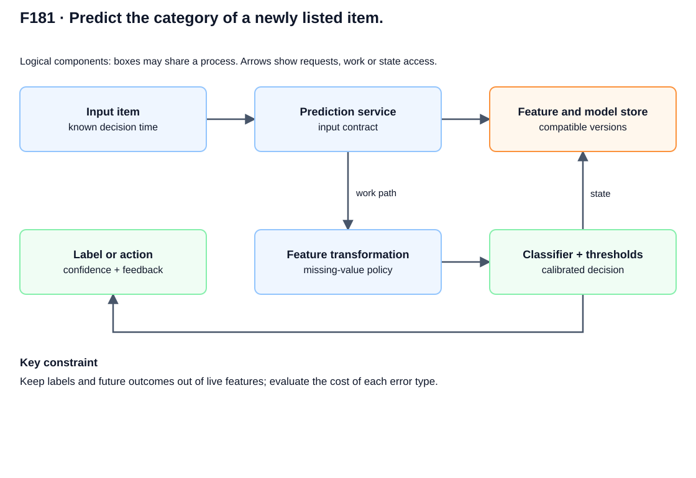
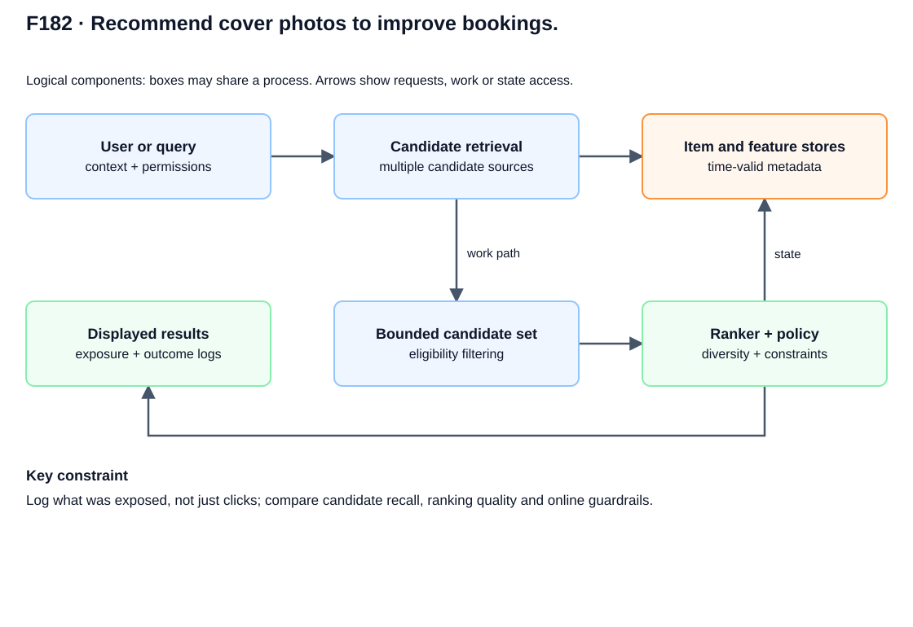
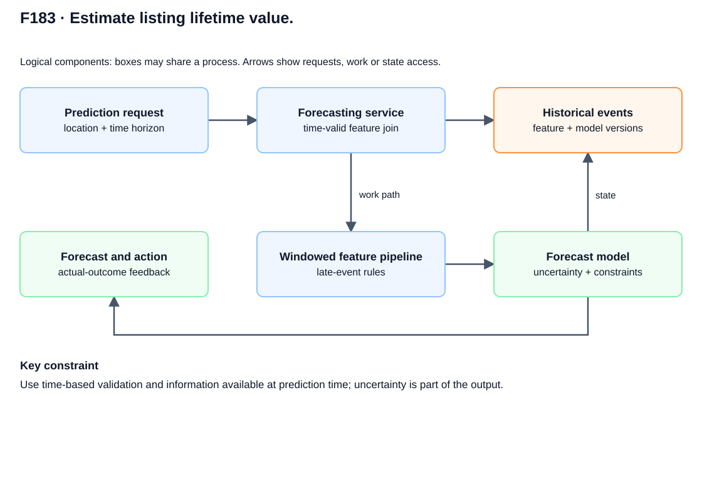
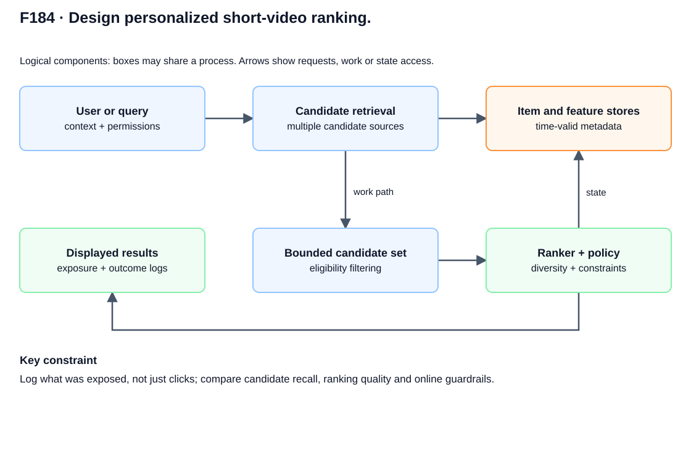
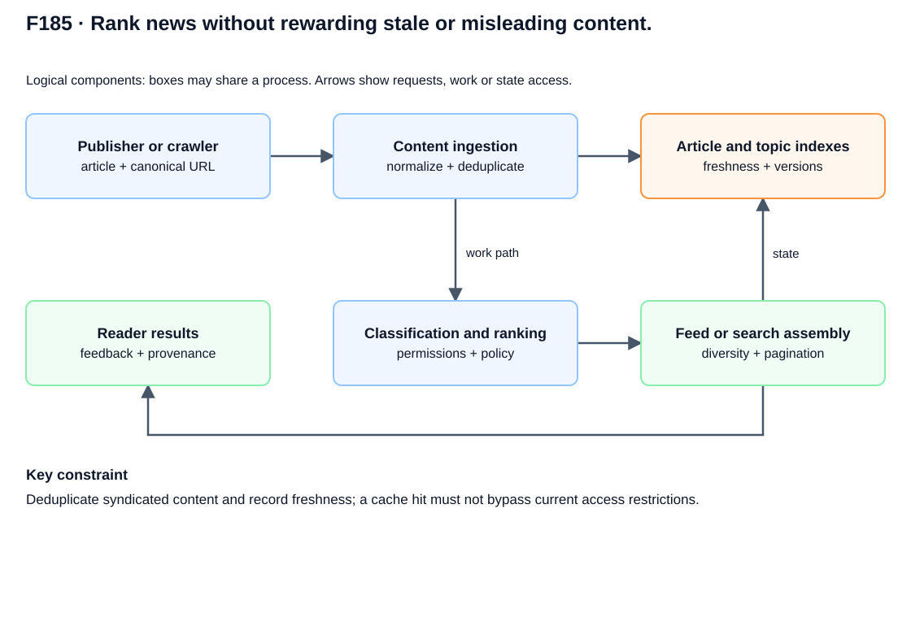
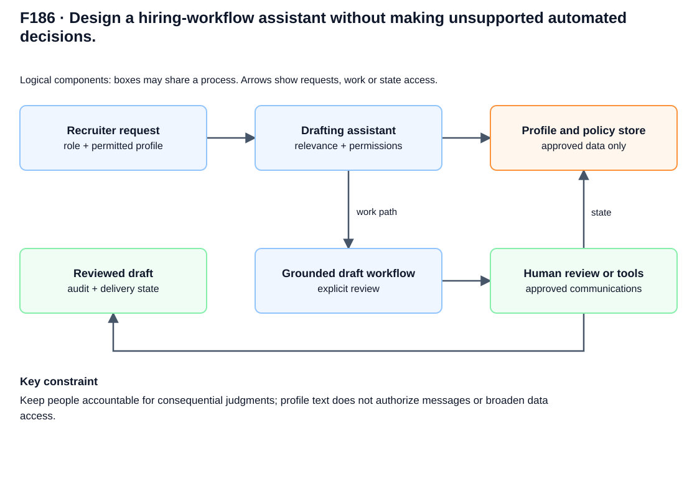
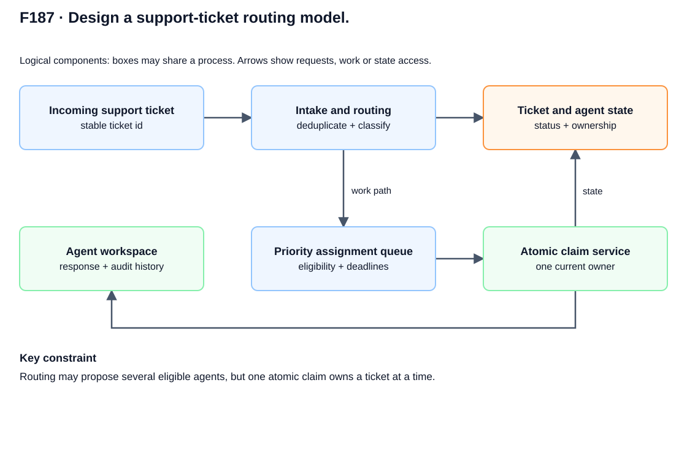
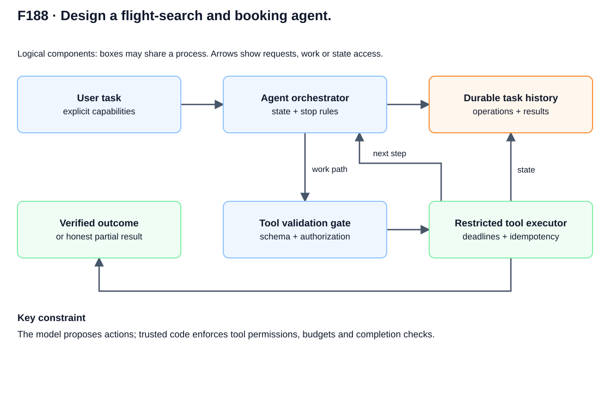
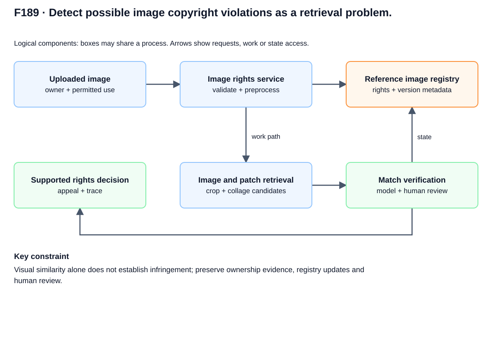
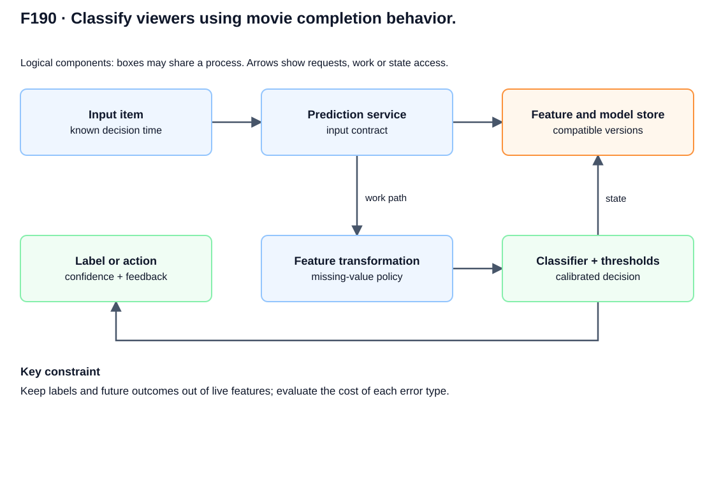

# Product ML cases: complete design answers

[Chapter guide](README.md) · [Diagram index](SYSTEM_DESIGN_DIAGRAMS.md) · [ML system design](09_ml_system_design.md)

Each case starts with the real decision, defines labels and features, and follows a concrete serving and feedback path. A model score is one input to a product policy, not a substitute for defining the action and its constraints.

## F181. Predict the category of a newly listed item

### Define the taxonomy and the action

A seller uploads a title, description and images. The system suggests or assigns a category in a versioned hierarchy. Clarify whether one category is required, multiple labels are allowed, or an uncertain item may be sent for seller confirmation or human review.

[Open the diagram at full size](diagrams/F181_design.svg).

Begin with cleaned product text and a simple text classifier before adding a multimodal model. Store the taxonomy version with each label; merging or splitting categories changes the prediction target. Historical seller labels are useful but noisy, so audit ambiguous and high-value examples and identify labels created by an earlier model.

Features may include title, description, images and allowed structured attributes available when the item is listed. Do not use later clicks, returns or manually corrected categories as input features for a prediction made at creation time. Group duplicate products or seller templates when splitting data so near copies do not inflate test scores.

Measure top-1/top-k accuracy, per-category recall, hierarchy-aware mistakes and abstention/review coverage. Confusing two neighboring clothing subcategories is different from placing a regulated item in an unrelated safe category. Tune actions to the error cost and available review capacity, rather than force the highest-scoring label on every item.

At serving time validate the input, load a compatible model/taxonomy bundle, return the proposed category with confidence and preserve the evidence/version needed for review. Record seller acceptance or correction, but audit that feedback because the UI can encourage users to accept poor defaults. For new categories with few examples, use reviewed prototypes or staged rollout and explicitly measure coverage; old-model confidence does not prove competence on a changed taxonomy.

## F182. Recommend cover photos to improve bookings

### Separate attractive photos from incremental product value

A property has several candidate photos. Choosing the image with the highest historical click rate may not increase bookings: it could attract curiosity without accurately representing the listing, and previous photo selection already biases the observations.

[Open the diagram at full size](diagrams/F182_design.svg).

Define the decision unit—one cover photo per listing for a context and time—and the desired outcome, such as qualified bookings per impression with cancellation and satisfaction guardrails. Enforce image quality, availability and truthful-representation rules before ranking. An unavailable or inappropriate photo should not win because of a model score.

Build examples from photo exposures, not just successful bookings. Join the exact photo, listing version, price, availability, position and context that existed at exposure time. Booking outcomes are delayed and depend on many later steps, so define the attribution and maturity window. Group duplicate listings and photos across train/test splits.

A simple baseline uses current editorial rules or a small image-and-listing model. A richer ranker can combine image representations, listing attributes and observed performance with regularization for low-data photos. For a new listing, fall back to content quality and controlled exploration rather than trusting a few noisy impressions.

Evaluate image relevance and downstream booking calibration offline, then run an appropriately randomized online comparison. Randomize at a unit that avoids showing inconsistent variants to the same decision-maker, and consider marketplace interference if ranking changes where demand goes. Monitor impressions, bookings, cancellations, misrepresentation complaints and distribution across listing types.

Log the chosen photo and candidate set so future training can account for what was eligible and exposed. Do not optimize only clicks or compare photos without correcting for different exposure contexts. The product question is whether the selection policy improves the user's booking decision, not whether the model can memorize the previous popular cover.

## F183. Estimate listing lifetime value

### Define value, horizon and observation timing

A listing's value could mean future revenue, contribution margin or retained activity. Choose the measure, unit and horizon before fitting a model. A twelve-month value target cannot be assigned to a one-month-old listing by pretending that the unobserved eleven months are zero.

[Open the diagram at full size](diagrams/F183_design.svg).

For a finite horizon $H$, one possible target is discounted net contribution:

$$
V=\sum_{t=1}^{H}\delta^t(\text{revenue}_t-\text{attributable cost}_t),\qquad 0<\delta\le1.
$$

Discounting, attributable cost and the horizon are business definitions to agree on; the formula does not select them automatically. Store when the prediction was made and when the outcome window becomes mature.

Build time-valid features such as listing age, permitted attributes and historical activity observed before prediction. Compare simple cohort means and regression with more complex models. A two-stage approach can separate probability of future activity from value conditional on activity, making “likely to disappear” distinct from “active but low value.” Model uncertainty matters when a new listing has little history.

Handle right-censoring explicitly: train on mature cohorts, use appropriate partial-observation methods, or define a shorter observable horizon. Do not mix one-month realized totals and full-year totals as if they were the same target. Use time-based validation and inspect calibration by listing age, category and predicted value range; a good overall error can hide systematic underestimation of valuable new listings.

Connect evaluation to the action. If forecasts drive ranking or resource investment, measure whether the policy actually improves the intended outcome, while guarding against depriving new listings of the exposure they need. The system's own decisions affect later value, so historical correlations are not automatic estimates of causal uplift.

## F184. Design personalized short-video ranking

### Define a useful session, not just a long one

A short-video feed chooses a small sequence from a huge changing catalog. Watch time is abundant feedback, but loops, misleading hooks and passive viewing can make it an incomplete measure of satisfaction. Define the product objective with skip, hide, report, diversity and longer-term outcomes as guardrails.

[Open the diagram at full size](diagrams/F184_design.svg).

Generate candidates from user-history similarity, topic/content representations, fresh items and popularity. Filter unavailable or disallowed videos and bound duplicates and recently watched items under explicit rules. Rank a manageable pool with user, video and context features, then apply final safety and diversity constraints. Keep a cold-start fallback for both users and creators.

Train from exposed videos with a fixed observation window. Candidate selection, display position and previous rankers bias the logged data; unexposed videos are not confirmed negatives. Deduplicate copies and split by time/entity so repeated clips do not make evaluation unrealistically easy. Completion rate depends strongly on video length, so calibrate and inspect duration slices rather than reward every short loop.

Measure candidate recall, ranking relevance and online product outcomes separately. A stronger ranker cannot recover a video that never became a candidate. An A/B test should log stable assignment and exposures, account for repeated user sessions, and monitor complaints, creator coverage and latency alongside engagement.

The serving path needs fresh user signals but should not depend on an unbounded chain of feature calls. Batch item lookups, cache compatible item features, and fall back to a tested baseline if real-time state is missing. Log model, candidate and feature versions so an unexpected content distribution can be traced and the whole bundle rolled back.

## F185. Rank news without rewarding stale or misleading content

### Relevance is necessary but not sufficient

A news recommendation should match the reader while preserving freshness, diversity, eligibility and the product's quality policy. Pure click prediction can reward sensational headlines or repeatedly show yesterday's story after the underlying facts changed.

[Open the diagram at full size](diagrams/F185_design.svg).

Ingest publisher feeds or permitted crawl data with publication/update time, canonical article identity, language and access metadata. Deduplicate syndicated and near-identical stories so one event does not occupy the whole feed. Retain update and correction relationships rather than treating an edited story as unrelated content.

Candidate generation can combine subscriptions, topics, semantic similarity, location and general news interest. The ranker uses reader context and time-valid article features, followed by diversity and editorial/policy constraints. Apply access rights and paywall eligibility before returning protected content. Do not assume a trusted-looking domain string proves a particular claim is true.

Train on exposures and outcomes, recognizing that headline style, position and previous selection affect clicks. Use time-based evaluation and inspect breaking-news, small-topic and language slices. Evaluate reader satisfaction, useful reading, hides, reports and coverage alongside clicks; a single aggregate engagement gain may conceal a degraded information experience.

Freshness is a pipeline contract: measure time from a new or corrected article to index and cache visibility. Expiry and ranking decay are separate from factual correction. A cache can speed retrieval while still serving a superseded headline unless version invalidation is defined.

For failures, use a bounded cached or subscription-based fallback with exposed freshness, not invented current facts. Monitor ingestion lag, duplicate rates, stale-content exposures, policy removals and recommendation diversity. The design must explain how corrections and deletions propagate, not just how an embedding finds related articles.

## F186. Design a hiring-workflow assistant with accountable decisions

### Start with a bounded assistance task

A useful assistant can retrieve approved role requirements, summarize permitted candidate-provided information and draft a recruiter message for review. That does not justify inventing qualifications, inferring protected traits or automatically making consequential selection decisions.

[Open the diagram at full size](diagrams/F186_design.svg).

Define the actor, allowed data, output and review boundary. Scope candidate/profile access to the authenticated recruiter and the organization's authorized use. Keep a clear separation between retrieved statements, extracted facts and model-generated suggestions. A missing skill should remain unknown unless the permitted evidence establishes it.

The workflow retrieves relevant role/profile passages, creates a structured draft with evidence references and validates names, role details and required fields. A reviewer can correct or reject the draft before any communication is sent. A request to draft is not automatically permission to message candidates, search unrelated private records or change hiring status.

Store task, profile, role and model/prompt versions with appropriate retention and access controls. Keep review edits and outcomes for quality analysis, while avoiding unnecessary personal information in broad logs. Deletions and profile corrections need to affect retrieval and cached drafts.

Evaluate factual support, omission of important permitted information, respectful and accurate wording, review burden and unauthorized-access/action failures. Audit different candidate and role contexts without treating demographic stereotypes as predictive evidence. Historical recruiter decisions may reflect process bias; copying those outcomes as labels does not automatically make a useful or fair assistant.

If the model cannot find supporting evidence or a role requirement is ambiguous, ask for review or return an honest incomplete draft. The correct automation target is a clearly bounded workflow with visible accountability, not an unsupported score that silently determines someone's employment outcome.

## F187. Design a support-ticket routing model

### Predict the right destination, then assign ownership safely

An incoming ticket needs a category, priority and eligible team or agent. A model can propose a route; the work-management service must still guarantee that a ticket is owned by at most one active claimant and that unhandled tickets remain visible.

[Open the diagram at full size](diagrams/F187_design.svg).

Define the routing target and business cost. Misrouting an urgent outage is different from sending an ordinary billing question to a neighboring team. Use text, product context, language and permitted customer metadata available at intake. Do not train with resolution notes that only exist after the ticket is solved if the model must route at arrival.

Historical assigned-team labels are noisy: an initial wrong assignment may have been transferred several times. Prefer an audited resolution/ownership policy and track reassignment. Group duplicate incidents and split by time so the same outage does not appear in both train and test.

Compare keyword/rule baselines with a text classifier or retrieval-based router. Return uncertainty and allow an explicit general queue or human triage path. Eligibility rules—skills, language, account permissions and agent availability—remain separate from model score. Bound review and assignment queues so an uncertain class does not disappear into an unmonitored backlog.

Evaluate per-class precision/recall, time to appropriate owner, reassignment rate, urgent-ticket misses and workload balance. Logging the chosen team alone is not enough to measure whether the routing policy helped resolve the issue.

After choosing candidates, atomically claim a ticket using its version/status or a lease. Duplicate delivery to agents does not grant duplicate ownership. Escalation, cancellation and stale leases need explicit state transitions and audit history. On model failure, route to a monitored fallback queue rather than mark the ticket handled; preserve the ticket's durable id for every retry.

## F188. Design a flight-search and booking agent

### Search and purchase have different authority

The user may ask “find a morning flight” without authorizing a purchase. Extract constraints such as origin, destination, date, passenger details, baggage, accessibility and budget; ask for missing information that changes the answer. A search result is a time-sensitive offer, not a guaranteed reservation.

[Open the diagram at full size](diagrams/F188_design.svg).

Expose narrow tools: search offers, inspect fare rules, validate availability, create a hold or booking, and query booking status. Validate airport/date/passenger fields and provider identifiers in code. Store a durable task/operation id and keep sensitive passenger/payment data out of unnecessary model context.

Retrieve candidates, compare total price and restrictions, and present the selected itinerary with its expiry and terms. Before any consequential booking action, enforce the actual user's authorization under the product's approval rules and refresh the offer. Do not let retrieved fare text or an airline page grant permission to buy or change passengers.

A booking call can succeed while its response is lost. Reuse a stable provider operation id and query status before attempting a second booking. Track states such as quoted, awaiting authorization, booking pending, confirmed and failed/needs review. If multiple providers are involved, local database rollback cannot undo their reservations; define cancellation or compensation steps and their limitations.

Evaluate constraint satisfaction, final booking correctness, unauthorized purchases, duplicate bookings, stale-price handling, latency and recovery from provider errors. Include unavailable routes and changing prices in tests rather than only happy-path examples.

If price or itinerary changes, return to the relevant authorization step instead of silently accepting a materially different offer. A good agent can stop with a clear pending or partial outcome when external state is uncertain. Fluently saying “booked” is not completion; durable provider confirmation and the correct itinerary are the evidence.

## F189. Detect possible image copyright violations as retrieval

### Find candidate matches before making a high-cost judgment

A user uploads an image and the system searches a reference registry for possible related protected works. The candidate-retrieval task is visual matching under crops, collages, text overlays and re-photography. A similar-looking image alone does not establish ownership, permission or infringement.

[Open the diagram at full size](diagrams/F189_design.svg).

Store reference-image identity, rights/ownership metadata, permitted-use information and registry versions. Deduplicate reference copies and keep update/removal history. Use an exact or perceptual-hash baseline for near duplicates, then learned image embeddings and local/patch-level retrieval for transformations and partial matches.

For a 3-by-3 collage containing one relevant tile, a single global vector can dilute the signal. Generate region candidates or local descriptors, retrieve reference candidates and verify the geometric/content correspondence. An overlaid instruction in the image is visual input, not permission for the application to run tools or disclose registry data.

Train or fine-tune only with appropriately labeled, permitted examples and known transformations. Split by original work/entity, not random image copies, so a transformed version of the same work does not leak across train and test. Include legitimate lookalikes and permitted-use cases in evaluation and review.

Measure retrieval recall under crop/overlay/re-photo slices, verification precision, false-positive burden, latency and human-review outcomes. High recall may be useful for screening, but an automatic punitive decision requires a much more careful product policy and evidence review. Return candidate matches with versioned supporting information and uncertainty, rather than claiming that a cosine score settles a legal question.

When the registry changes, update indexes and invalidate affected decisions or cached evidence as required. Record which reference versions supported a finding so it can be inspected, corrected or appealed later. A pipeline that finds visual neighbors quickly but cannot explain the match or its rights context is incomplete.

## F190. Classify viewers using movie completion behavior

### Decide whether this is description or prediction

“Classify viewers by completion” can mean aggregate past behavior into groups, or predict at playback start whether someone will finish. These are different tasks. If the desired output is defined entirely by an observed rule, implement that rule instead of adding an unnecessary model.

[Open the diagram at full size](diagrams/F190_design.svg).

Define an eligible start, a completion threshold, the observation window, replays, resumed sessions and late events. Watching 90 minutes is almost complete for a 95-minute film but only half of a three-hour film. A completion fraction uses content duration, and repeated or overlapping viewing should not inflate unique coverage accidentally.

For a descriptive group such as “viewers who completed at least 80% of most eligible starts in the last month,” calculate an audited aggregation and require enough observations. Report unknown/insufficient data for users with too few eligible starts; do not silently call them low-engagement viewers.

For a predictive task at playback start, features may include prior viewing patterns, item duration/genre and permitted context available then. The final watched duration is the label, not an input feature. If prediction happens after ten minutes, only progress available by that decision time is eligible. Align training snapshots to that time and split by time/entity according to the intended generalization.

Compare a duration/context baseline with a calibrated classifier and inspect performance by film length, user history and device/session conditions. A low completion outcome could reflect a connection failure rather than dislike, so label quality and the intervention matter. If scores change recommendations or reminders, evaluate whether those actions improve user experience, not just whether the model predicts its own historical labels.

Handle delayed playback events and corrections with stable session ids and explicit aggregation rules. Track label maturity, missing data, calibration and cohort sizes. The first interview question should be “what decision will this classification support, and when must it be available?”
