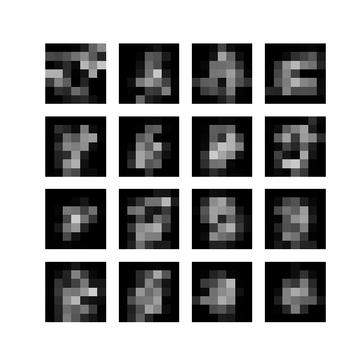

# W005. Debug a Mini GPT and Add a KV Cache

**Priority group:** First 100 — very important

**Category:** LLM internals and coding

**Study position:** 5 of 547

[Group list](../FIRST_100.md) · [All categories](../ALL_CATEGORIES.md) · [Chapter guide](../README.md)

<span class="practice-page"></span>

## Question

A small GPT-style Transformer is meant to generate handwritten digits. Each MNIST image is shrunk to 7x7 pixels and read row by row as a sequence of 49 tokens, one per pixel, with values 0 to 255 (vocabulary size 256). The model learns to predict the next pixel from the earlier ones, and new images are sampled one pixel at a time.

The code below is meant to do this but does not work. Make it train correctly. The follow-up then makes generation faster with a key/value (KV) cache.

Given code

```python
import torch
import torch.nn as nn
from torch.utils.data import Dataset
from torchvision.datasets import MNIST
from torchvision import transforms
```

```text
class CustomMNIST(MNIST):
mirrors = ["https://raw.githubusercontent.com/mkolod/MNIST/master/"]
resources = [
```

("train-images-idx3-ubyte.gz", "f68b3c2dcbeaaa9fbdd348bbdeb94873"),
("train-labels-idx1-ubyte.gz", "d53e105ee54ea40749a09fcbcd1e9432"),
("t10k-images-idx3-ubyte.gz", "9fb629c4189551a2d022fa330f9573f3"),
("t10k-labels-idx1-ubyte.gz", "ec29112dd5afa0611ce80d1b7f02629c"),

```text
]
```

```text
class MNISTSequenceDataset(Dataset):
```

"""Each item is a 7x7 digit flattened to 49 pixel tokens in 0..255."""

```python
def __init__(self, train=True, data_dir="../data", samples_per_class=100):
    ...
```

self.dataset = CustomMNIST(

```python
root=data_dir, train=train, download=True,
transform=transforms.Compose([transforms.Resize((7, 7)), transforms.ToTensor()]),
```

)
if train:

```python
targets = self.dataset.targets
indices = []
```

for c in range(10):

```python
class_indices = (targets == c).nonzero(as_tuple=False).view(-1)
```

indices.extend(class_indices[:samples_per_class].tolist())
self.indices = indices
else:
self.indices = list(range(len(self.dataset)))

```python
def __len__(self):
    return len(self.indices)
```

```python
def __getitem__(self, idx):
    ...
```

img, _ = self.dataset[self.indices[idx]]

```python
return (img.view(-1) * 255).long()
```

```text
class SimpleGPT(nn.Module):
def __init__(self, vocab_size=256, max_seq_len=49, embedding_dim=128, num_heads=4, num_layers=4, dropout=0.1):
```

super().__init__()
self.token_embedding = nn.Embedding(vocab_size, embedding_dim)
self.position_encoding = nn.Embedding(embedding_dim, embedding_dim)
self.layers = nn.ModuleList([TransformerBlock(embedding_dim, num_heads, dropout) for _ in range(num_layers)])
self.ln_f = nn.LayerNorm(embedding_dim)
self.head = nn.Linear(embedding_dim, vocab_size)

```python
def forward(self, x):
    ...
```

batch_size, seq_len = x.size()

```python
x = self.token_embedding(x)
idxes = torch.arange(seq_len)
x = x + self.position_encoding(idxes)
```

for layer in self.layers:

```python
x = layer(x)
x = self.ln_f(x)
return self.head(x)
```

```text
class TransformerBlock(nn.Module):
def __init__(self, embedding_dim, num_heads, dropout):
```

super().__init__()
self.attn = MaskedMultiHeadSelfAttention(embedding_dim, num_heads, dropout)
self.ln1 = nn.LayerNorm(embedding_dim)
self.mlp = nn.Sequential(
nn.Linear(embedding_dim, 4 * embedding_dim),
nn.ReLU(),
nn.Linear(4 * embedding_dim, embedding_dim),
)
self.ln2 = nn.LayerNorm(embedding_dim)

```python
def forward(self, x):
    x = x + self.attn(self.ln1(x))
    x = x + self.mlp(self.ln2(x))
    return x
```

```text
class MaskedMultiHeadSelfAttention(nn.Module):
def __init__(self, embedding_dim, num_heads, dropout):
```

super().__init__()
assert embedding_dim % num_heads == 0
self.num_heads = num_heads
self.head_dim = embedding_dim // num_heads
self.q_proj = nn.Linear(embedding_dim, embedding_dim)
self.k_proj = nn.Linear(embedding_dim, embedding_dim)
self.v_proj = nn.Linear(embedding_dim, embedding_dim)
self.out_proj = nn.Linear(embedding_dim, embedding_dim)
self.dropout = nn.Dropout(dropout)

```python
def forward(self, x):
    ...
```

batch_size, seq_len, embedding_dim = x.size()

```python
q = self.q_proj(x).view(batch_size, seq_len, self.num_heads, self.head_dim).transpose(1, 2)
k = self.k_proj(x).view(batch_size, seq_len, self.num_heads, self.head_dim).transpose(1, 2)
v = self.v_proj(x).view(batch_size, seq_len, self.num_heads, self.head_dim).transpose(1, 2)
attn_weights = torch.matmul(q, k.transpose(-2, -1))
mask = torch.triu(torch.ones(seq_len, seq_len, device=x.device), diagonal=0).bool()
attn_weights = attn_weights.masked_fill(mask.unsqueeze(0).unsqueeze(0), float("inf"))
attn_probs = self.dropout(torch.softmax(attn_weights, dim=-1))
out = torch.matmul(attn_probs, v).transpose(1, 2).contiguous().view(batch_size, seq_len, embedding_dim)
return self.out_proj(out)
```

```python
# ---- training ----
from torch.utils.data import DataLoader
import torch.optim as optim
```

```python
embedding_dim = 32
num_heads = 4
num_layers = 4
dropout = 0.1
batch_size = 256
epochs = 30
lr = 1e-2
seed = 0
seq_len = 49
vocab_size = 256
device = torch.device("cuda" if torch.cuda.is_available() else "cpu")
```

```python
train_dataset = MNISTSequenceDataset(train=True)
train_dataloader = DataLoader(train_dataset, batch_size=batch_size, shuffle=True,
generator=torch.Generator().manual_seed(seed))
```

torch.manual_seed(seed)

```python
model = SimpleGPT(vocab_size, seq_len, embedding_dim, num_heads, num_layers, dropout).to(device)
optimizer = optim.Adam(model.parameters(), lr=lr)
criterion = nn.CrossEntropyLoss()
```

```python
def train(model, dataloader, optimizer, criterion, device):
    ...
```

model.train()

```python
total_loss = 0
```

for batch in dataloader:

```python
batch = batch.to(device)
```

optimizer.zero_grad()

```python
logits = model(batch[:, :-1])
loss = criterion(logits.reshape(-1, logits.size(-1)), batch[:, 1:].reshape(-1))
```

loss.backward()
optimizer.step()
total_loss += loss.item()

```python
return total_loss / len(dataloader)
```

for epoch in range(1, epochs + 1):

```python
loss = train(model, train_dataloader, optimizer, criterion, device)
```

print(f"Epoch {epoch}, Loss: {loss:.4f}")

```text
# ---- generation ----
def generate_batch_no_cache(model, start_tokens, seq_len, device):
```

model.eval()

```python
input_ids = start_tokens.unsqueeze(1).to(device)
generated_tokens = input_ids
```

with torch.no_grad():
for _ in range(seq_len - 1):

```python
logits = model(generated_tokens)
next_token_logits = logits[:, -1, :]
probs = torch.softmax(next_token_logits, dim=-1)
next_tokens = torch.multinomial(probs, num_samples=1)
generated_tokens = torch.cat([generated_tokens, next_tokens], dim=1)
return generated_tokens
```

What to do
1. Find and fix the defects. Find every defect in the given code and fix it. For each one, explain how it affects training (convergence and stability, the gradients or the attention mask) and the quality of the output, and why your fix is correct. The fixed script must run on a CPU and on a GPU.
2. Train. Run the fixed script with the given hyperparameters and the given seed (seed = 0). The printed average loss of the last epoch must be below 2.8. Then sample a few images with generate_batch_no_cache and look at them. At 7x7 they are noisy; they are a sanity check, not a pass criterion.

### Rules

1. masked_fill(mask, value) writes value where mask is True.
2. Position t may attend to positions 0 .. t, itself included, and never to a later position.
3. Not every unusual-looking line is a defect. Run a line before you change it.
4. Do not change the dataset, the hyperparameters, the seed or the sampling method to reach the loss target.

### Examples

1. Running the given script on a CPU stops in the first forward pass with IndexError: index out of range in self. The training inputs are batch[:, :-1], so each sequence has 48 tokens.
2. If the attention of position 3 could see position 7, changing token 7 would change the logits at position 3. After the fixes, changing token 7 leaves the logits at positions 0 to 6 unchanged.
3. start_tokens = torch.zeros(100, dtype=torch.long) and seq_len = 49: generation returns a tensor of shape (100, 49) whose first column is all zeros.

### Constraints

Python with PyTorch 2.x and torchvision. A CPU is enough: the fixed training run takes seconds to a few minutes.
The dataset class downloads MNIST from the mirror in the code into ../data.
Training uses 100 images per digit, 1,000 in total, so one epoch is 4 batches of 256.
Follow-up 1: add a KV cache for faster generation

During generation, generate_batch_no_cache runs the whole sequence through the model again for every new pixel. Change MaskedMultiHeadSelfAttention, and pass the change through TransformerBlock and SimpleGPT, so that a forward pass can take the keys and values of earlier tokens and return them extended. Training must still work as before: model(x) with only a token tensor returns the logits.

Then write generate_batch_with_cache(model, start_tokens, seq_len, device):

it takes the same inputs as generate_batch_no_cache and returns a tensor of shape (batch, seq_len);
after the first token, each step feeds only the newest token to the model;
at every step, its logits match those of a full forward pass within 1e-4;
with the same random seed, it samples the same tokens as generate_batch_no_cache, apart from a rare single token flipped by floating-point rounding on a near-tie;
for a batch of 100 sequences of 49 tokens on a CPU, it is at least 2 times faster.

## Worked solution

### Fix the actual computation, retaining the experiment

| Defect | Consequence | Repair |
|---|---|---|
| Position table has embedding_dim entries (32 in this run), but training uses48 positions | IndexError from position32 onward | `Embedding(max_seq_len, embedding_dim)` |
| `arange(seq_len)` defaults to CPU | Device mismatch on CUDA | Create positions on token device |
| Scores omit $1/\sqrt{head\_dim}$ | Unnecessarily saturated attention and weak score gradients | Divide QK scores by square root of per-head width |
| Upper triangle includes diagonal0 | Blocks a token's own permitted key | Mask only strictly future keys |
| Mask fill uses +infinity | Softmax of infinite entries becomes NaN | Use negative infinity for forbidden scores |

Keep the existing transpose-before-head-merge, shifted `batch[:,:-1]` / `batch[:,1:]` targets, cross-entropy logits, ToTensor×255 conversion, seed and Adam lr=.01. They are correct here. The reconstructed indentation restores the intended class/function structure from the question's fragmented listing; it is not a license to change the experiment.

### Full CPU/GPU implementation and explicit layerwise cache

`model(tokens)` still returns logits for training. `model(tokens,past,use_cache=True)` returns logits and extended per-layer K/V. New positions start at cached length; the rectangular mask compares absolute query positions to key positions and also supports chunked new inputs. Dropout stays .1 in training and is disabled by eval during generation/parity checks. Neither dataset nor learning hyperparameters nor multinomial sampling is changed.

```python
import math,time,json
from pathlib import Path
import torch
from torch import nn
from torch.utils.data import Dataset,DataLoader
from torchvision.datasets import MNIST
from torchvision import transforms

class CustomMNIST(MNIST):
    mirrors=['https://raw.githubusercontent.com/mkolod/MNIST/master/']
    resources=[('train-images-idx3-ubyte.gz','f68b3c2dcbeaaa9fbdd348bbdeb94873'),('train-labels-idx1-ubyte.gz','d53e105ee54ea40749a09fcbcd1e9432'),('t10k-images-idx3-ubyte.gz','9fb629c4189551a2d022fa330f9573f3'),('t10k-labels-idx1-ubyte.gz','ec29112dd5afa0611ce80d1b7f02629c')]

class MNISTSequenceDataset(Dataset):
    def __init__(self,train=True,data_dir='../data',samples_per_class=100):
        self.dataset=CustomMNIST(root=data_dir,train=train,download=True,transform=transforms.Compose([transforms.Resize((7,7)),transforms.ToTensor()]))
        self.indices=[]
        if train:
            for c in range(10):self.indices.extend((self.dataset.targets==c).nonzero(as_tuple=False).view(-1)[:samples_per_class].tolist())
        else:self.indices=list(range(len(self.dataset)))
    def __len__(self):return len(self.indices)
    def __getitem__(self,idx):
        image,_=self.dataset[self.indices[idx]]
        return (image.view(-1)*255).long()

class MaskedMultiHeadSelfAttention(nn.Module):
    def __init__(self,embedding_dim,num_heads,dropout):
        super().__init__();assert embedding_dim%num_heads==0
        self.num_heads=num_heads;self.head_dim=embedding_dim//num_heads
        self.q_proj=nn.Linear(embedding_dim,embedding_dim);self.k_proj=nn.Linear(embedding_dim,embedding_dim)
        self.v_proj=nn.Linear(embedding_dim,embedding_dim);self.out_proj=nn.Linear(embedding_dim,embedding_dim)
        self.dropout=nn.Dropout(dropout)
    def forward(self,x,past=None,use_cache=False):
        B,T,C=x.shape;H=self.num_heads;D=self.head_dim
        q,k,v=[proj(x).view(B,T,H,D).transpose(1,2) for proj in (self.q_proj,self.k_proj,self.v_proj)]
        offset=0 if past is None else past[0].shape[2]
        if past is not None:k,v=torch.cat([past[0],k],2),torch.cat([past[1],v],2)
        scores=q@k.transpose(-2,-1)/math.sqrt(D)
        future=torch.arange(k.shape[2],device=x.device)[None,:]>(offset+torch.arange(T,device=x.device))[:,None]
        probs=self.dropout(scores.masked_fill(future,float('-inf')).softmax(-1))
        y=(probs@v).transpose(1,2).contiguous().view(B,T,C)
        y=self.out_proj(y)
        return (y,(k,v)) if use_cache else y

class TransformerBlock(nn.Module):
    def __init__(self,embedding_dim,num_heads,dropout):
        super().__init__();self.attn=MaskedMultiHeadSelfAttention(embedding_dim,num_heads,dropout)
        self.ln1=nn.LayerNorm(embedding_dim);self.ln2=nn.LayerNorm(embedding_dim)
        self.mlp=nn.Sequential(nn.Linear(embedding_dim,4*embedding_dim),nn.ReLU(),nn.Linear(4*embedding_dim,embedding_dim))
    def forward(self,x,past=None,use_cache=False):
        result=self.attn(self.ln1(x),past,use_cache);a,cache=result if use_cache else (result,None)
        x=x+a;x=x+self.mlp(self.ln2(x))
        return (x,cache) if use_cache else x

class SimpleGPT(nn.Module):
    def __init__(self,vocab_size=256,max_seq_len=49,embedding_dim=128,num_heads=4,num_layers=4,dropout=.1):
        super().__init__();self.token_embedding=nn.Embedding(vocab_size,embedding_dim)
        self.position_encoding=nn.Embedding(max_seq_len,embedding_dim)
        self.layers=nn.ModuleList([TransformerBlock(embedding_dim,num_heads,dropout) for _ in range(num_layers)])
        self.ln_f=nn.LayerNorm(embedding_dim);self.head=nn.Linear(embedding_dim,vocab_size)
    def forward(self,tokens,past=None,use_cache=False):
        B,T=tokens.shape
        if past is not None and len(past)!=len(self.layers):raise ValueError('one cache per layer required')
        offset=0 if past is None else past[0][0].shape[2]
        if offset+T>self.position_encoding.num_embeddings:raise ValueError('context overflow')
        x=self.token_embedding(tokens)+self.position_encoding(torch.arange(offset,offset+T,device=tokens.device))
        caches=[]
        for i,layer in enumerate(self.layers):
            result=layer(x,None if past is None else past[i],use_cache);x,cache=result if use_cache else (result,None)
            if use_cache:caches.append(cache)
        logits=self.head(self.ln_f(x))
        return (logits,caches) if use_cache else logits

def train(model,dataloader,optimizer,criterion,device):
    model.train();total_loss=0.
    for batch in dataloader:
        batch=batch.to(device);optimizer.zero_grad();logits=model(batch[:,:-1])
        loss=criterion(logits.reshape(-1,logits.size(-1)),batch[:,1:].reshape(-1))
        loss.backward();optimizer.step();total_loss+=loss.item()
    return total_loss/len(dataloader)

@torch.no_grad()
def generate_batch_no_cache(model,start_tokens,seq_len,device):
    model.eval();tokens=start_tokens[:,None].to(device)
    for _ in range(seq_len-1):
        probs=model(tokens)[:,-1,:].softmax(-1)
        tokens=torch.cat([tokens,torch.multinomial(probs,1)],1)
    return tokens

@torch.no_grad()
def generate_batch_with_cache(model,start_tokens,seq_len,device):
    model.eval();tokens=start_tokens[:,None].to(device);past=None;current=tokens
    for _ in range(seq_len-1):
        logits,past=model(current,past,use_cache=True);current=torch.multinomial(logits[:,-1,:].softmax(-1),1)
        tokens=torch.cat([tokens,current],1)
    return tokens

@torch.no_grad()
def check(model,device):
    model.eval();tokens=torch.arange(12,device=device)[None,:].repeat(2,1)
    changed=tokens.clone();changed[:,7:]+=40
    assert torch.allclose(model(tokens)[:,:7],model(changed)[:,:7],atol=1e-6)
    past=None;worst=0.
    for t in range(tokens.shape[1]):
        cached,past=model(tokens[:,t:t+1],past,use_cache=True);full=model(tokens[:,:t+1])[:,-1:]
        error=(cached-full).abs().max().item();worst=max(worst,error);assert error<1e-4,error
    start=torch.zeros(100,dtype=torch.long)
    torch.manual_seed(123);a=generate_batch_no_cache(model,start,49,device)
    torch.manual_seed(123);b=generate_batch_with_cache(model,start,49,device)
    assert a.shape==b.shape==(100,49) and torch.all(a[:,0]==0)
    timings=[]
    for fn in (generate_batch_no_cache,generate_batch_with_cache):
        values=[]
        for _ in range(3):
            if device.type=='cuda':torch.cuda.synchronize()
            tick=time.perf_counter();fn(model,start,49,device)
            if device.type=='cuda':torch.cuda.synchronize()
            values.append(time.perf_counter()-tick)
        timings.append(sorted(values)[1])
    return dict(cache_logit_max_error=worst,same_seed_samples_equal=torch.equal(a,b),no_cache_seconds=timings[0],cache_seconds=timings[1],speedup=timings[0]/timings[1])

if __name__=='__main__':
    import argparse
    parser=argparse.ArgumentParser();parser.add_argument('--data-dir',default='../data');parser.add_argument('--out',default='w005_output');args=parser.parse_args()
    torch.set_num_threads(4)  # CPU scheduling, not a changed learning hyperparameter.
    device=torch.device('cuda' if torch.cuda.is_available() else 'cpu')
    ds=MNISTSequenceDataset(data_dir=args.data_dir);loader=DataLoader(ds,batch_size=256,shuffle=True,generator=torch.Generator().manual_seed(0))
    torch.manual_seed(0);model=SimpleGPT(256,49,32,4,4,.1).to(device)
    optimizer=torch.optim.Adam(model.parameters(),lr=1e-2);criterion=nn.CrossEntropyLoss();losses=[]
    for epoch in range(1,31):
        loss=train(model,loader,optimizer,criterion,device);losses.append(loss);print(f'Epoch {epoch}, Loss: {loss:.4f}',flush=True)
    stats=check(model,device);stats['last_epoch_loss']=losses[-1]
    out=Path(args.out);out.mkdir(parents=True,exist_ok=True)
    (out/'w005_metrics.json').write_text(json.dumps(stats,indent=2));torch.save(model.state_dict(),out/'w005_model.pt')
    torch.manual_seed(123);images=generate_batch_no_cache(model,torch.zeros(16,dtype=torch.long),49,device)
    import matplotlib
    matplotlib.use('Agg')
    import matplotlib.pyplot as plt
    fig,axes=plt.subplots(4,4,figsize=(6,6))
    for ax,image in zip(axes.flat,images.cpu()):ax.imshow(image.reshape(7,7),cmap='gray',vmin=0,vmax=255);ax.axis('off')
    fig.savefig(out/'w005_samples.png');plt.close(fig);print(json.dumps(stats),flush=True)
    assert losses[-1]<2.8,'exact-data loss target not reached'
```

### Executed exact-data results

The supplied MNIST mirror downloaded the original images. Training selected the first100 examples of each digit, used 256 batch size,32-dimensional embeddings,4 heads,4 layers,dropout=.1,30 epochs,Adam lr=.01 and seed0. The requested mean-of-batch-losses reporting gave **last epoch2.712513**, below2.8. Epoch25 was2.7874, then2.7701,2.7565,2.7445,2.7256 and2.7125. This was an actual CPU run, not a synthetic substitute.

Cached versus full-prefix max logit error was **1.91e-6**, below1e-4; same-seed100×49 samples were identical. Three-run median generation times on this CPU were .7460s without cache and .1930s with cache: **3.865× speedup**, exceeding2×. These are measured machine-specific timings, not a universal hardware guarantee. The causal perturbation test also passed. GPU-compatible device handling is implemented, but no CUDA device was available for a separate GPU execution claim.



The viewed grid has noisy low-resolution digit-like strokes, blobs and several ambiguous shapes; this is a sanity check, not proof of high-quality digit synthesis. The first pixel remains the supplied zero seed and generated values stay in0..255. Run `python3 ../review_w005_implementation.py --data-dir ../data --out w005_output` with torch,torchvision,matplotlib to reproduce. The output directory stores metrics, model weights and the sample grid. Cache keys/values must belong to the same model/request, and inference should run without gradients; large production caches would preallocate blocks instead of concatenate on every step.

### Further study

- [F019: Debug a miniature GPT that fails to learn.](../02_attention_and_decoding_code.md#f019)
- [F013: Add a KV cache and prove equivalence to full-prefix attention.](../02_attention_and_decoding_code.md#f013)
