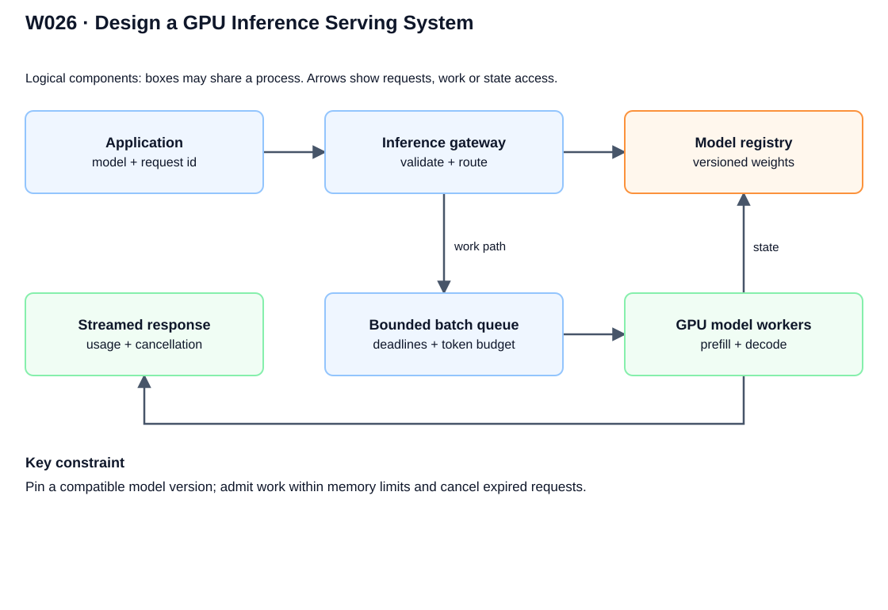

# W026. Design a GPU Inference Serving System

**Priority group:** First 100 — very important

**Category:** LLM serving and scheduling

**Study position:** 26 of 547

[Group list](../FIRST_100.md) · [All categories](../ALL_CATEGORIES.md) · [Chapter guide](../README.md)

## Question

Design a high-throughput inference serving system that hosts large models behind an API on a fixed fleet of expensive GPUs. Maximize throughput (requests / tokens per second) while keeping p99 latency low.

In your design, address:

the request lifecycle and batching strategy (static vs continuous / dynamic batching),
model loading and GPU-memory management,
routing, replication, and autoscaling across GPU workers,
hosting multiple models on shared hardware,
absorbing load spikes and overload,
the key bottlenecks and trade-offs.

The crux to nail: keeping the GPUs saturated through batching without blowing the latency target.

## Worked solution

<!-- architecture:W026:start -->
### Architecture and request flow

A version-pinned request passes deadline/token-memory admission, a bounded continuous batch and a warm GPU worker before its ordered stream is delivered.

[Open full-size diagram](../diagrams/W026_architecture.svg).
<!-- architecture:W026:end -->

### Request path and bounded batching

Assume autoregressive text generation with a fixed fleet, several versioned models and separately defined p99 TTFT/inter-token/completion budgets. `POST /v1/generate` carries request id, model alias, text, max output and deadline; returns a stream with ordered request-scoped events. Status/cancel endpoints handle disconnects and retries. Gateway authenticates, tokenizes, resolves an immutable model version and rejects unsupported lengths or quotas before enqueueing. Request state records version, prompt/output token counts, deadline, worker/attempt, status and usage; the registry stores digest, precision, tokenizer/runtime compatibility and resource profile.

Static batches wait for all members or waste finished slots. Dynamic batching collects a short bounded window for compatible independent work. For generation use continuous batching: admit/remove requests between decode iterations, with maximum active tokens and per-iteration work budget. Chunk long prefills so one huge prompt does not stall all active decodes. Prioritize imminent deadlines and age long jobs; batching is constrained by latency and memory, not merely a target batch size. A queue full of work beyond its deadlines is overload, not useful GPU utilization.

### Load models and allocate against live memory

Download verified weight shards to local disk, load/warm a new replica, run health/parity checks, then mark ready. Never route to a half-loaded model. Track memory as weights + runtime/temporary buffers + live KV + allocator headroom. KV bytes/token=$2LH_{KV}d_hs$; for L32,Hkv8,dh128,s2 it is131,072 bytes, so4k cached tokens use512MiB/request. Twenty such requests need10GiB cache before weights/buffers. Reserve or conservatively bound future output growth; paged blocks reduce fragmentation but not logical cache bytes. Release on EOS/cancel/deadline and validate prefix-cache keys by model/tokenizer/positions/tenant policy.

Route to compatible warm workers using live-token load, queue delay and prefix locality, with bounded affinity to avoid hot spots. Replicate popular models; tensor-shard models that cannot fit on one GPU, preferring fast-link groups. On a fixed fleet “autoscaling” reallocates replicas/partitions between models and may shed work; it cannot create unprovided GPUs. Model swaps cost transfer/warmup and must be rate-limited. Small models may share a GPU with hard budgets; large models/strict tails may need isolation. Avoid opportunistic evictions that repeatedly destroy a popular model's warm cache.

### Overload, failures and tuning

Use per-tenant weighted queues/quotas, short admission windows, token caps,429/503 with Retry-After and an explicitly permitted fallback. A worker crash terminates that generation attempt; retries must not splice different nondeterministic text into an already delivered stream. Event ids support reconnect replay; duplicate client keys return the existing request. Canceling queued/running work frees resources promptly.

Prefill often benefits from compute parallelism; low-batch decode often rereads weights/cache and is bandwidth-bound. Quantization can reduce bytes, fusion removes intermediates, and larger batches amortize weight reads, but all need matched quality/latency measurements. Monitor useful completed tokens/s, p99 queue/TTFT/inter-token, OOM/preemption, cache fragmentation/hits, model load times and fairness. Load-test length distributions and bursts, choose a throughput–p99 operating point below saturation, canary and rollback. The existing diagram's gateway, registry, queue and workers are the lifecycle above; the central correctness rule is that memory/deadline admission precedes dispatch.

### Further study

- [F031: Why do prefill and decode have different bottlenecks?](../04_serving_and_training_systems.md#f031)
- [F033: Explain continuous batching and paged KV storage.](../04_serving_and_training_systems.md#f033)
- [F034: Estimate an LLM serving capacity budget.](../04_serving_and_training_systems.md#f034)
