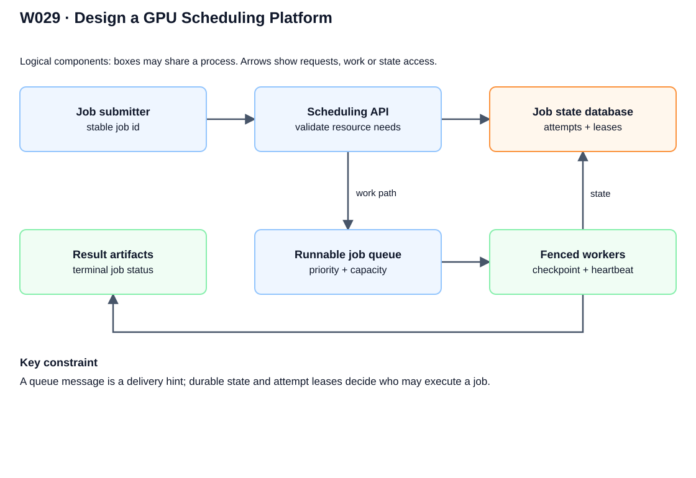

# W029. Design a GPU Scheduling Platform

**Priority group:** First 100 — very important

**Category:** ML infrastructure and distributed training

**Study position:** 29 of 547

[Group list](../FIRST_100.md) · [All categories](../ALL_CATEGORIES.md) · [Chapter guide](../README.md)

## Question

Design a cluster scheduling platform that allocates a shared, scarce pool of GPUs across many training and inference jobs submitted by different teams.

In your design, address:

the scheduling model — queues, priorities, quotas, and fairness,
gang / topology-aware scheduling for multi-GPU and multi-node jobs,
preemption and bin-packing to keep utilization high,
handling node / GPU failures and job restarts,
observability and reporting,
the trade-offs between utilization, fairness, and job wait time.

The crux to nail: the tension between maximizing utilization and guaranteeing fairness / low wait time across competing teams.

## Worked solution

<!-- architecture:W029:start -->
### Architecture and request flow

A tenant-scoped job receives a full topology-compatible gang through the durable allocation state machine; fenced workers publish only current-attempt results.

[Open full-size diagram](../diagrams/W029_architecture.svg).
<!-- architecture:W029:end -->

### Job and resource contract

Assume a shared1,000-GPU cluster in8-GPU nodes, mixed short inference and multi-hour training, with tenant guarantees rather than unconditional start SLOs. `POST /jobs` accepts image/code/data versions, GPU type/count/memory, topology, CPU/RAM/network needs, priority, estimated runtime and checkpoint/resume contract; `GET /jobs/{id}` and cancel/pause/resume APIs expose durable state. Store Job,Attempt,Allocation,NodeHealth,TenantQuota and CheckpointManifest. States are queued→reserved→starting→running→checkpointing/preempted→resuming or terminal. Duplicate submissions use stable tenant idempotency keys.

### Fairness before packing

Each team has a guaranteed share, a hard cap and permission to borrow idle GPUs. Use weighted dominant-resource fairness or deficit scheduling for entitlement, then priority/aging within a team. Account for consumed GPU-time and consider memory/type differences; declared priority is bounded by tenant policy. Reserve a small interactive pool for inference tails and allow reclaimable training backfill when safe. Strict priority without aging/guarantees can starve research; strict equal slices can waste idle capacity.

Gang placement reserves a complete compatible set atomically, then starts/rendezvouses all ranks. Eight GPUs must be in the required NVLink/interconnect group;64 GPUs may need eight low-latency nodes in one fabric region. Use topology-aware bin packing scored by fit, communication locality, fragmentation and disruption cost. Do not hold seven devices indefinitely waiting for the eighth. For an aging large job, make a reservation and backfill short/preemptible jobs that finish before it; otherwise small jobs can monopolize useful holes forever.

### Preempt and recover without pretending every job is resumable

Reclaim borrowed capacity before guaranteed allocations. Preempt only jobs with a tested checkpoint contract, a bounded warning/grace period and acceptable lost-work cost; prefer recent checkpoints and avoid repeated eviction/cooldown violations. Save model/optimizer/data cursor/RNG state under immutable manifests before releasing all gang members. Noncheckpointable jobs need a declared restart/kill cost or protected admission class. Record why each preemption occurred and preserve original queue age on resume.

A node/GPU failure quarantines hardware and fails its synchronous gang attempt; remaining ranks abort collectives under watchdog timeouts. Fence the attempt, release/reconcile allocations and restart a compatible gang from the last committed checkpoint with a new rendezvous/epoch. An expired controller lease alone does not prove old workers stopped; fence data/result commits and confirm termination before conflicting reuse. Inference replicas route around unhealthy workers and fail partial requests explicitly rather than claim a checkpointed training-style resume.

### Explain the trade-off with numbers

If a64-GPU guaranteed job is waiting while eight nodes each run one1-GPU borrowed job, total free count can be high yet placement impossible. Consolidate/preempt those eight jobs if their saved-work cost is justified; sacrificing a small amount of current utilization can deliver the guarantee and reduce fragmentation. Quotas limit accepted long-term demand: no scheduler can promise bounded waits when guaranteed demand exceeds capacity permanently.

Measure allocated utilization separately from useful compute/model FLOP utilization, queue p50/p99 by team/size, oldest wait, entitlement deficit, gang-placement failures, checkpoint/restart overhead, preemptions/job, unhealthy devices and completion goodput. The diagram's state DB is authoritative; resource queues are delivery hints, workers heartbeat with fenced attempt identities, and artifacts publish only from the current attempt. Audit fairness alongside throughput instead of optimizing a single busy-GPU percentage.

### Further study

- [F039: Design a fair GPU job scheduler.](../04_serving_and_training_systems.md#f039)
