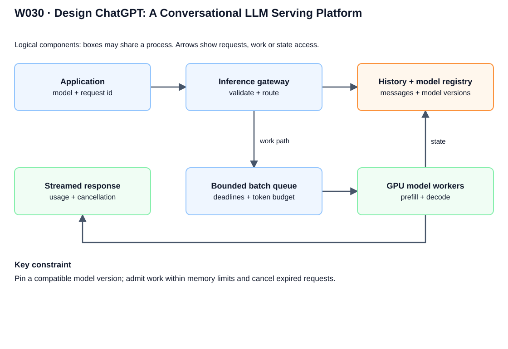

# W030. Design ChatGPT: A Conversational LLM Serving Platform

**Priority group:** First 100 — very important

**Category:** LLM serving and scheduling

**Study position:** 30 of 547

[Group list](../FIRST_100.md) · [All categories](../ALL_CATEGORIES.md) · [Chapter guide](../README.md)

## Question

Design the backend for a ChatGPT-style product: users send chat messages and receive streamed, token-by-token responses from a large language model running on GPUs.

Scale & constraints

Millions of concurrent, multi-turn (stateful) conversations.
A fixed, expensive GPU fleet — throughput is GPU-bound, not CPU-bound.
Target p99 time-to-first-token under ~1 second.

In your design, address:

the request lifecycle and how tokens are streamed to the client,
efficient GPU inference — KV-cache management, continuous batching, scheduling against GPU memory,
conversation state and context-window handling across turns,
routing, replication, and scaling to millions of concurrent sessions,
input/output safety and moderation,
the key bottlenecks and trade-offs.

The crux to nail: GPU memory — specifically the KV cache — is the scarce resource; how you batch and schedule against it decides throughput.

## Worked solution

<!-- architecture:W030:start -->
### Architecture and request flow

A conversation turn loads authenticated durable history, constructs bounded context, admits live KV tokens and streams one pinned generation; idle history stays off GPU.

[Open full-size diagram](../diagrams/W030_architecture.svg).
<!-- architecture:W030:end -->

### Separate millions of stored sessions from active GPU work

Millions of conversations need cheap durable history; only currently generating turns need GPU KV. Assume1M stored active-day conversations and10k simultaneous generations as an illustrative capacity workload, then benchmark actual token lengths. At512MiB KV per4k-token request for L32,Hkv8,dh128,BF16,10k live generations need about5TiB **just for cache**; keeping1M idle sessions resident would need about500TiB. Evict idle KV and rebuild from durable history/prefix caches rather than mapping one session to one GPU slot.

Expose conversation/message/status/cancel APIs with owner authorization, parent message id or revision, client request id and SSE/WebSocket generation events with ordered sequence ids. Store Conversation(owner,revision), Message(parent,role,content,status), Generation(request_id,model_version,attempt,state,usage) and replayable stream chunks. Commit the user turn and generation intent before queueing. A retry returns that generation; reconnect resumes known events; a worker failure marks a partial attempt rather than silently splicing a new answer.

### Schedule against memory and the one-second TTFT target

The gateway authenticates, applies input policy, resolves model/tokenizer version, loads the correct parent chain, constructs bounded context and tokenizes. Admit against live-token and remaining-output budgets, route to a compatible warm replica by cache locality plus load, prefill in chunks, then continuously batch one-token decodes. Release finished/canceled slots immediately and allocate KV in pages to reduce fragmentation. Prefix cache keys include exact token prefix, model/configuration/position version and authorization/privacy scope; stale/incompatible KV is never reused.

A chosen p99 budget might allocate100ms gateway/context,100ms safety/feature work,150ms queue and600ms prefill/first decode, leaving50ms delivery slack. These are engineering targets, not sums of independently measured p99s or a proof for arbitrary prompt length. Cap long prompts, schedule a separate long-context service class or offer explicit asynchronous processing; a fixed fleet cannot satisfy every burst and unbounded prefill below1s. Load-test the joint latency distribution and bound queues/quotas, rejecting excess instead of hiding unbounded waits. Model replicas/tensor groups scale within the fixed fleet; batching competes directly with tails and decode cadence.

### Context, safety and reliability

Select recent turns plus a versioned summary/relevant older turns under a token budget, preserving explicit current instructions and cited evidence. A summary can lose facts; keep raw history and sources to inspect corrections. Multi-turn state resides in the conversation service, not a mutable global model session. Concurrent edits branch by parent/revision instead of interleaving unrelated responses.

Input/output moderation is versioned and separately measured; buffer enough output to apply the required policy before speech/display while accounting for TTFT cost. Enforce tool/account authorization in code and treat retrieved/history text as untrusted evidence. Encrypt/isolate tenants, minimize logs, implement deletion across history/index/cache and limit retention. External inference errors/timeouts and outages return explicit partial/unavailable states; token streams never claim a completed action without evidence.

Monitor cache bytes/live tokens, block fragmentation, eviction/recompute, prefill/decode occupancy, p99 TTFT/inter-token, queue wait, overload, completed helpful turns, safety/refusal errors and fairness. Canary model/context/scheduler changes with fixed quality and load suites. The diagram's registry must be accompanied by authenticated history/stream storage; GPU workers handle transient generation, not the authoritative conversation record.

### Further study

- [F031: Why do prefill and decode have different bottlenecks?](../04_serving_and_training_systems.md#f031)
- [F033: Explain continuous batching and paged KV storage.](../04_serving_and_training_systems.md#f033)
- [F034: Estimate an LLM serving capacity budget.](../04_serving_and_training_systems.md#f034)
