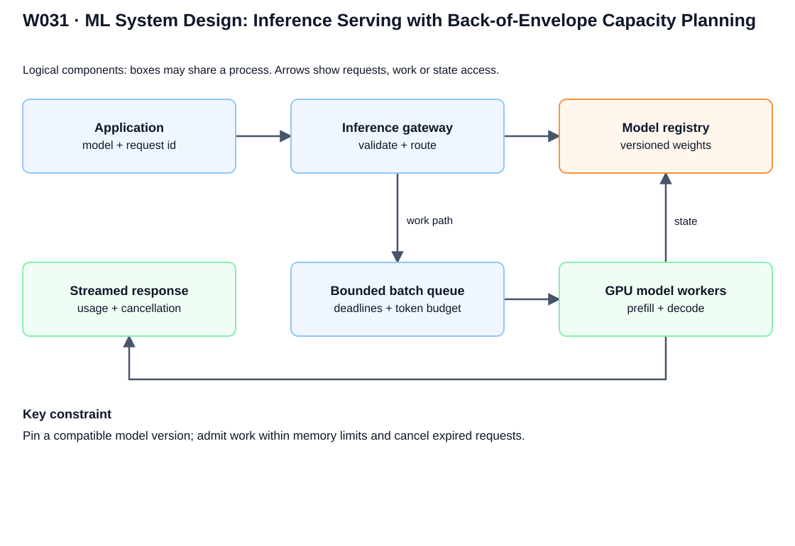

# W031. ML System Design: Inference Serving with Back-of-Envelope Capacity Planning

**Priority group:** First 100 — very important

**Category:** LLM serving and scheduling

**Study position:** 31 of 547

[Group list](../FIRST_100.md) · [All categories](../ALL_CATEGORIES.md) · [Chapter guide](../README.md)

## Question

Design an inference serving system for a machine learning model used by about 100 million daily active users. Reason from first principles about memory footprint, memory bandwidth and latency, and show how each optimization you propose changes those numbers.

### Requirements

1. Capacity estimate. Translate daily active users into peak queries per second, then into per-request FLOPs and bytes moved, and finally into the number of accelerators needed.
2. Memory budget. Account separately for weights, per-request activations or intermediate buffers, and cached state, so you can explain and avoid out-of-memory failures.
3. Latency. State a P99 latency budget and show how batching, precision and overlap of compute with memory transfers affect it under load.
4. Compute-bound or memory-bound. Compare the arithmetic intensity (FLOPs per byte) of the workload with the accelerator's ridge point and use the verdict to choose optimizations.
5. Accelerator follow-ups. Explain how kernel fusion and memory layout change memory traffic and the verdict in part 4.
6. Efficiency techniques. Explain what quantization-aware training and knowledge distillation buy and what each costs, and how you would evaluate the served model against the original.
Expected deliverable

A design with a request path, a numbered estimation chain with stated assumptions, and a trade-off discussion that ties every optimization to a bandwidth, latency or memory number.

## Worked solution

<!-- architecture:W031:start -->
### Architecture and request flow

For the explicitly chosen stateless dense model, the gateway forms a deadline-bounded compatible batch and maps one batched execution back to request ids; no KV cache is assumed.

[Open full-size diagram](../diagrams/W031_architecture.svg).
<!-- architecture:W031:end -->

### State the model and workload before sizing

100M DAU alone is not QPS. Choose **10 requests/user/day**, peak multiplier5, a stateless1B-parameter dense model doing about2 FLOPs/parameter/request, BF16 weights, no autoregressive cache, and illustrative GPU312TFLOP/s,1.5TB/s,40GB. These are explicit planning assumptions. A different model (especially a token-generating LLM) requires a different token/KV/decode estimate.

1. Requests/day=100M·10=1B; average=1B/86400=11,574/s; peak=**57,870/s**.
2. Per request compute≈2·1B=**2GFLOPs**. With no weight reuse across requests,2GB weights plus a chosen4MiB read/write activation traffic gives about2.004GB/request, I≈.998FLOP/B. Ridge=312TF/1.5TB=**208FLOP/B**, so bandwidth-bound. Compute≈6.41microseconds, memory≈1.336ms; ideal capacity≈748/s/GPU.
3. At a chosen60% useful roofline efficiency, capacity≈449/s/GPU: ceil(57870/449)=**129GPUs**, about155 with20% spare capacity (round fleet policy explicitly). These are model estimates requiring benchmark confirmation, not measured capacity.
4. With batch64,2GB weights are read once for128GFLOPs, plus64·4MiB≈.268GB activation traffic. I≈**56.4FLOP/B**, still bandwidth-bound. Roofline batch compute=.410ms, memory=**1.51ms**, ideal≈42,300requests/s/GPU. At60%,≈25,400/s: ceil(57870/25400)=**3GPUs**, deploy4 for headroom/failure. Amortized weight traffic falls from2GB to31.25MB/request; huge gains assume dense reuse and achievable batched kernels.

### Memory and p99 budget

Weights2GB are persistent; assume2MiB live intermediate storage/request, so batch64 uses128MiB; reserve a declared4GB for runtime/workspace plus safety. Peak≈6.13GB fits40GB. There is **no per-session KV** in the chosen stateless model; if the actual workload is an LLM add $2BLTH_{KV}d_hs$ and serial output time separately. OOM admission counts live batches/workspaces/model replicas, not only weight bytes.

Choose p99 end-to-end50ms:5ms ingress,8ms max batch queue target,25ms model/service budget and12ms egress/slack. Four balanced workers see about14.5krequests/s each at peak; filling64 takes about4.4ms under smooth arrivals, but use an8ms-or-full dynamic batch timer for low load. Bursts/model-call variance can violate tails; cap queue and benchmark open-loop load. Roofline is a lower bound, not the25ms service guarantee. Within each kernel max(compute,memory) assumes ideal overlap; do not add those already-overlapped terms, and do not assume overlap removes dependency/queue time.

### Tie optimization to the numbers

INT8 weights halve2GB to1GB; with the same assumed compute throughput and.268GB batch activation traffic, ideal bandwidth time becomes.845ms, about75.7krequests/s/GPU before inefficiency. Actual integer/dequantization kernels and quality decide whether this holds. QAT costs retraining/fake-quant calibration but can recover low-bit accuracy. Distilling a250M student cuts raw weights to.5GB and approximate compute to.5GFLOP/request, at teacher-label/training cost and possible capability loss; evaluate rather than assume equivalent quality.

Kernel fusion avoids HBM writes/reads of intermediates; saving two64MiB intermediates removes256MiB read+write traffic (about.179ms at1.5TB/s). Coalesced/contiguous layouts and matrix-aligned dimensions improve effective bandwidth/reuse; extra transposes can undo savings. As weights shrink and batches grow, recompute I and the ridge against the **actual precision-specific peak**; the bottleneck can move to compute, launches or CPU ingress.

### Operate the service

Request→authenticated/versioned model gateway→bounded fair dynamic queue→warm GPU replica→mapped result. APIs submit/predict/status/cancel with request ids; registry tracks weights/preprocessing/output schema. Duplicate ids reuse results, timeouts/failures count in metrics, model swaps warm/canary before traffic. Monitor joint p99, batch/queue distribution, bytes/compute profiles, error/OOM and tenant fairness. Compare quantized/distilled versus original on the same untouched tasks, rare slices, calibration and load; promote only on quality/cost/latency gates and retain rollback. The diagram uses batched model execution for this explicitly stateless example.

### Further study

- [F031: Why do prefill and decode have different bottlenecks?](../04_serving_and_training_systems.md#f031)
- [F033: Explain continuous batching and paged KV storage.](../04_serving_and_training_systems.md#f033)
- [F034: Estimate an LLM serving capacity budget.](../04_serving_and_training_systems.md#f034)
