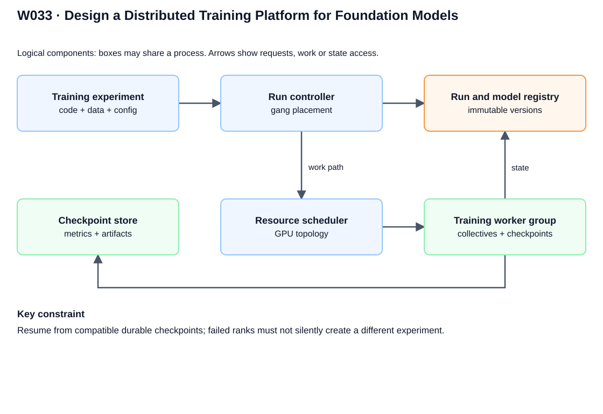

# W033. Design a Distributed Training Platform for Foundation Models

**Priority group:** First 100 — very important

**Category:** ML infrastructure and distributed training

**Study position:** 33 of 547

[Group list](../FIRST_100.md) · [All categories](../ALL_CATEGORIES.md) · [Chapter guide](../README.md)

## Question

Design a shared platform on which research teams run synchronous foundation-model training jobs for weeks at a time. The platform must keep expensive accelerators productive even though workers, networks, and storage will fail during a run.

Scale and assumptions
One shared cluster contains 10,000 GPUs; a single job may request up to 2,000 GPUs.
Jobs run from hours to weeks and require gang scheduling because every rank participates in synchronous steps.
Model and optimizer state may occupy multiple terabytes, and training data is read from immutable object-storage snapshots.
Each node holds 8 GPUs with 80 GB of memory each; the cluster spans fast links within a node and lower-bandwidth links between nodes.
Design requirements
1. Define job submission, the control plane, gang scheduling, quotas, priorities, preemption, and topology-aware placement.
2. Explain how data, tensor, pipeline, and optimizer-state sharding can be composed for a model that does not fit on one GPU.
3. Design the input pipeline, experiment lineage, metrics, health monitoring, and reproducible restart behavior.
4. Design sharded checkpoints, failure detection, rendezvous, automated recovery, and handling for dead or slow workers.
5. Explain degraded modes, capacity and utilization metrics, major communication and I/O bottlenecks, and the trade-offs among checkpoint frequency, throughput, and lost work.
Follow-ups
1. Give a concrete parallelism and placement strategy for a 2,000-GPU job, with per-GPU memory accounting and a utilization target.
2. Trace recovery after one worker fails during a collective operation.
3. Explain how a hung rank is prevented from holding the entire allocation indefinitely.
4. State exactly what is required for a deterministic restart, and distinguish reproducible data and random-number state from bit-for-bit numerical identity.

## Worked solution

<!-- architecture:W033:start -->
### Architecture and request flow

A versioned training run reserves an entire topology-compatible rank group; metrics and fully committed sharded checkpoint manifests drive recovery.

[Open full-size diagram](../diagrams/W033_architecture.svg).
<!-- architecture:W033:end -->

### Durable control plane and a concrete 2,000-GPU layout

Submit `Job{tenant,image_digest,code_sha,data_manifest,model_config,optimizer,parallel_layout,global_batch,checkpoint_policy,priority}` through `POST /training-jobs`; status/cancel/pause/resume APIs expose immutable run and attempt ids. A replicated run DB plus transactional outbox drives a reconciling controller. Tenant guarantees/caps/borrowed quotas, aging and reservations prevent large gangs starving; preempt borrowed checkpointable work at safe boundaries. Reserve an entire topology-compatible gang before rendezvous, with expiring/fenced allocations, not a subset that can deadlock waiting for resources.

For a **chosen250B dense model** use TP8 within each8-GPU node, PP5 across five nearby nodes, and DP50 replicas:8·5·50=2000 GPUs=250 nodes. Each TP/PP shard has250B/40=6.25B parameters. BF16 weights12.5GB and BF16 gradient buffer12.5GB; FP32 master25GB plus Adam moments50GB are sharded ZeRO1 across DP50, costing1.5GB/GPU. Persistent state≈**26.5GB/GPU**; budget20GB checkpointed activations,15GB collectives/workspaces and10GB reserve gives71.5GB<80GB. These activation/buffer bounds must be profiled; an oversized microbatch fails admission. Gradient accumulation/microbatches set the global batch; tune enough microbatches to reduce PP bubbles without exhausting activation memory. A plausible target is≥40% measured model FLOP utilization with low data-stall time, not a promise inferred from GPU count.

TP needs frequent fast collectives; PP sends boundary activations/gradients; DP synchronizes gradient contributions and sharded optimizer ownership. Group operations/reductions must match the chosen mean/sum loss convention. Alternative FSDP/ZeRO3 saves parameter memory but adds all-gather/transient state, so compare network and memory before combining all techniques automatically.

### Data, lineage and observability

Read immutable object manifests with document/sample ids, tokenizer version and deterministic shard permutations. Use CPU prefetch/decompression/tokenization only where not precomputed, bounded pinned buffers and local NVMe caches; monitor data starvation and throttle shared-store traffic. Each rank's next sample/cursor, epoch/shuffle seed, packing state and consumed global-batch count must be saved consistently with the optimizer step. Never silently duplicate/skip samples when world size changes; use a documented resharding/sampler transformation and report changed semantics.

Record code/container/driver/kernel/config/data/evaluation/checkpoint lineage, scalar loss/numerators/denominators, grad norms/nonfinites, optimizer/LR, tokens/s, per-stage times, collectives, network, GPU health and cost. Separate allocated utilization, kernel busy time, model FLOP utilization and successful useful-token goodput. Quarantine bad GPUs/NICs; distinguish slow data workers from slow compute ranks before restarting everything.

### Sharded checkpoints and one-rank failure

At a committed optimizer-step boundary capture local model/optimizer/master, scheduler, scaler, RNG states (Python/NumPy/CPU/device per rank), data/sampler/packing cursor and topology/config metadata. Write shards asynchronously from a consistent snapshot with checksums, then publish a manifest **only after every required shard** verifies. An upload of99/100 shards is not resumable. Keep several committed checkpoints, use local durable staging plus replicated object storage, and throttle uploads so the shared cluster is not starved.

If a rank dies mid-all-reduce, watchdogs detect missed heartbeats/collective deadlines, abort the communicator for the whole attempt, fence stale commits and terminate the gang. Mark the node suspect, acquire replacement topology, create a new attempt/rendezvous and load the last complete manifest. Discard partially applied uncommitted steps; rebuild identical data/RNG state where required. A hung rank cannot hold2,000 GPUs forever: collective watchdog plus controller lease/step-progress deadline escalates from diagnosis to bounded attempt teardown, with a retry budget/dead-letter investigation for repeated failures. A controller restart reconciles existing workers rather than launching a second gang.

### Checkpoint economics and deterministic scope

Weights+master+moments for250B are about3.5TB before metadata (gradients need not be checkpointed). At a **measured/assumed100GB/s aggregate** checkpoint bandwidth, ideal upload is35s; real capture/redundancy/contention can cost more. For pause-equivalent checkpoint cost C and job-level mean time between failures M, approximate waste C/T+T/(2M), minimized at $T\approx\sqrt{2CM}$. With C35s and M10h, T≈1587s≈26.5min; both inputs are planning assumptions to replace with observed data. Async IO changes effective pause cost, not the need for consistent capture. Preemption windows may force an earlier checkpoint.

On storage outage continue only while enough durable checkpoint safety/buffer exists, then pause/fail honestly; on degraded network reduce load or move a whole compatible group, never silently train with fewer synchronized ranks. Bit-for-bit restart additionally requires identical hardware/world size/kernel algorithms/reduction order/determinism controls and software; preserved samples/RNG/code alone provides reproducible experiment state but not necessarily identical floating-point sums. Validate resumed loss/step/data sequence on a small fault-injection run before week-long jobs.

### Further study

- [F035: Compare data, tensor and pipeline parallel training.](../04_serving_and_training_systems.md#f035)
- [F030: Train with mixed precision without losing small gradients.](../03_training_and_alignment.md#f030)
- [F039: Design a fair GPU job scheduler.](../04_serving_and_training_systems.md#f039)
