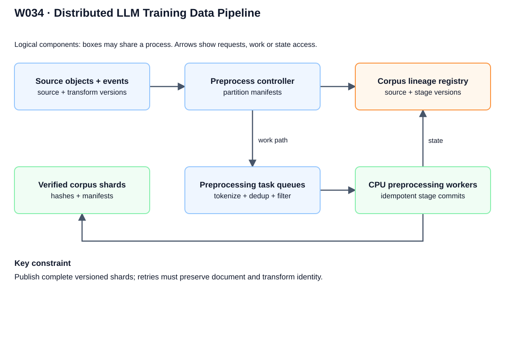

# W034. Distributed LLM Training Data Pipeline

**Priority group:** First 100 — very important

**Category:** ML infrastructure and distributed training

**Study position:** 34 of 547

[Group list](../FIRST_100.md) · [All categories](../ALL_CATEGORIES.md) · [Chapter guide](../README.md)

## Question

Design a distributed pipeline for LLM training-data preprocessing at petabyte scale: ingest from object storage (S3) plus optional streaming (Kafka), tokenize, deduplicate (exact + near-duplicate), quality-filter, and output sharded training corpora.

Stages: extraction -&gt; tokenization -&gt; dedup (exact + near-dup via MinHash/LSH) -&gt; quality filtering (heuristics + classifier) -&gt; sharded output.

Non-functional: petabyte scale, idempotent re-runs, deterministic shard assignment, and per-stage observability. Reference shape: S3 -&gt; Kafka -&gt; tokenizer workers -&gt; dedup service -&gt; quality filter -&gt; output store.

## Worked solution

<!-- architecture:W034:start -->
### Architecture and request flow

Source object versions/events feed partitioned extraction, tokenization, exact/near dedup and quality workers; complete deterministic shard manifests are the only published corpus boundary.

[Open full-size diagram](../diagrams/W034_architecture.svg).
<!-- architecture:W034:end -->

### Version the corpus, not only the worker queue

Assume1PB raw input and a daily processing window. Reading it once needs about11.6GB/s sustained before retries/expansion; extraction/dedup can require additional passes and scratch storage. Use immutable S3 object-version manifests as authoritative batch input; Kafka optionally carries source-change/object-reference events, not mandatory copies of petabyte payloads. A run API freezes `{source_manifest,extractor,normalization,tokenizer,dedup,quality_policy,output_format}` versions and exposes status/retry. Store per-stage manifests, document lineage/reason codes and checksums.

Extract document text/structure with bounded parsers, language/encoding checks, privacy/license filtering and corrupted-object quarantine. Stable doc_id hashes source identity/version; a separate canonical-content hash supports dedup. Tokenize with a fixed vocabulary/normalization version in CPU pools using bounded batches and deterministic record order. Preserve document boundaries/EOS and source metadata; changing tokenizer versions creates a new artifact lineage, never mixed ids in one shard.

### Exact and near dedup at scale

Exact normalized-content hashes are partitioned to dedup workers; verify collisions if correctness requires it and choose a deterministic survivor (for example lowest permitted source id with quality tie rules). Near dedup uses token/text shingles, deterministic MinHash seeds and LSH candidate buckets, then measured overlap to verify candidates. Bucket caps/stop-shingle policies prevent boilerplate explosions; do not merge documents solely because an approximate signature collides. Connected duplicate families may require distributed component resolution rather than independent local decisions. Keep family ids and split them as units before held-out evaluation; include evaluation contamination checks.

Quality filters combine deterministic size/spam/encoding/repetition checks and a versioned classifier with calibrated thresholds. Audit stratified random and boundary/rare-language samples, retain reason codes/counts and monitor source/language diversity; a model's high quality score is not proof of factual correctness. Permissions/privacy rejection is separate from a low style score. Redaction/erasure must propagate through text, tokens, indexes and output manifests.

### Idempotent output and restart

Partition accepted records by a fixed cryptographic hash(doc_id) modulo a recorded number of logical buckets. Within each bucket sort by doc_id and write bounded-size physical shards with deterministic boundaries under one output version. Arbitrarily rolling files based on worker arrival order is **not** deterministic. Changing bucket count creates a new output version; use many fixed logical buckets to rebalance workers without changing assignment.

Stage tasks are keyed by input partition+all transform versions. Write attempt files to staging, validate record/token counts and hashes, then atomically publish a complete stage/output manifest. Duplicate Kafka delivery or worker retry reuses the logical task; only one committed result wins. Persist offsets only after the corresponding durable stage boundary, and replay failures without appending duplicate output. Global dedup needs a snapshot/barrier before final survival decisions; a streaming provisional result must be labeled provisional until that boundary. No consumer reads partial shard sets as a complete corpus.

### Operate and explain the diagram

The corrected diagram is source objects/events→versioned preprocess controller/manifest→tokenize/dedup/filter worker queues→verified corpus shards; synchronous GPU collectives/checkpoints are not this ETL's main path. Batch orchestration and streaming are two ingestion modes into the same stable data contract. Use autoscaled stage pools, partition-skew handling, backpressure and rate limits on object store/network. Persist dead-letter inputs with bounded safe diagnostic content, retry transient failures and investigate deterministic parse/model errors.

Monitor input/accepted/rejected documents/tokens/bytes by stage/source, dedup collision/verification rates, LSH bucket skew, tokenizer throughput, queue age, IO/cache bandwidth, filter drift, privacy audits and manifest completeness. Rerun a partition and compare exact output hashes; fault-inject a crash after upload/before manifest commit. Near-dedup quality trades compute and false positives against corpus diversity; scale estimates must include dedup index/scratch, replication and any decompression expansion, not merely raw input bytes.

### Further study

- [F069: Audit human-labeled training data before scaling it.](../07_evaluation_and_data.md#f069)
- [F176: Build point-in-time training joins.](../18_data_and_sql.md#f176)
- [F177: Design an ETL job that can safely rerun.](../18_data_and_sql.md#f177)
