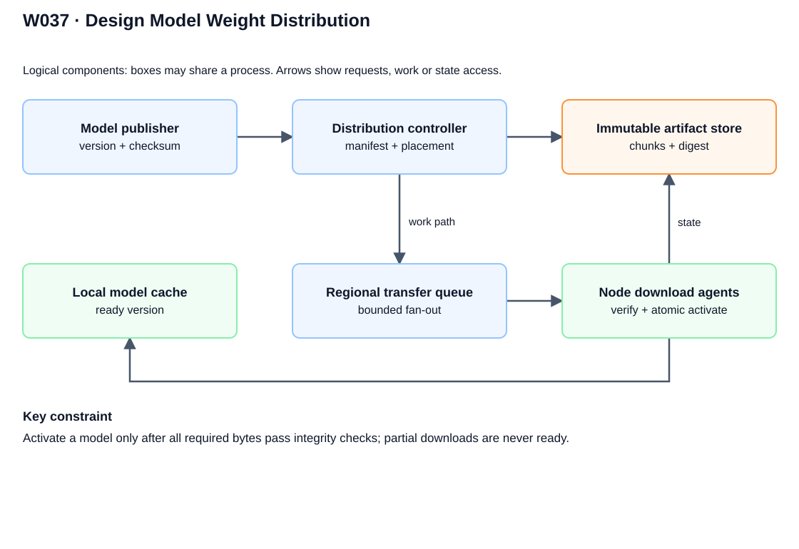

# W037. Design Model Weight Distribution

**Priority group:** First 100 — very important

**Category:** ML infrastructure and distributed training

**Study position:** 37 of 547

[Group list](../FIRST_100.md) · [All categories](../ALL_CATEGORIES.md) · [Chapter guide](../README.md)

## Question

Design a system for distributing large machine learning model weight files to a fleet of inference workers.

Context:

Model weights may be tens to hundreds of GB and may be split into multiple shards.

A new model version can be published several times per day.

Thousands of GPU inference workers across multiple regions need to receive the correct version.

The system must support staged rollout, rollback, integrity verification, access control, and minimal serving downtime.

Discuss:

Functional requirements and non-functional requirements.

High-level architecture.

Storage and metadata design.

APIs for publishing, discovering, downloading, and activating model versions.

How workers fetch and cache weights efficiently.

Versioning, consistency, and rollout strategy.

Failure handling, security, monitoring, and scalability tradeoffs.

## Worked solution

<!-- architecture:W037:start -->
### Architecture and request flow

A publisher commits an immutable signed manifest, regional agents distribute verified chunks and workers activate only fully loaded healthy bundles.

[Open full-size diagram](../diagrams/W037_architecture.svg).
<!-- architecture:W037:end -->

### Publish immutable bundles, activate separately

Assume100GB/model,5,000 workers in five regions, three releases/day. Naive full transfer is500TB/release or1.5PB/day; chunk reuse only helps unchanged bytes. Functional contract includes publish/discover/download/activate plus canary/rollback; require complete integrity, scoped access, resumability and old-version availability. Set rollout deadline/bandwidth targets from measured links rather than promising instant global replacement.

Store content-addressed immutable chunks/shards in object storage and a signed immutable `ModelManifest{model_id,version,architecture,tokenizer,precision,runtime_constraints,files:[path,size,digest,chunks],signature}`. Metadata DB holds publication state, channel alias, rollout cohort/region, desired/current/ready versions and worker acknowledgments. Publishing `POST /models/{id}/versions` creates staging uploads; `POST /versions/{v}/finalize` verifies every file then commits the manifest. `GET /models/{id}/channels/{channel}` discovers desired versions, `GET /versions/{v}/manifest` authorizes retrieval and gives bounded scoped download URLs, and `POST /workers/{id}/activations` reports verified loaded/healthy version. `POST /rollouts` and rollback update channel/cohort pointers with compare-and-swap and audit.

### Efficient transfer and local readiness

Regional caches fetch each chunk once, then rack/peer agents distribute with bounded upload/download quotas, range resume and jittered starts. Authoritative manifest hashes validate every source, including peers; retry a corrupt chunk from another source. Cache keys are digests, not mutable filenames. A node stages files under version/digest paths, records verified chunks, verifies full manifest, atomically marks disk-ready, loads/warmups/health-checks the model, then marks serving-ready. Existing requests remain pinned to their model version; new traffic moves only to a healthy cohort.

If a worker has99/100 shards it is not ready. A crash during staging resumes verified chunks; a wrong checksum discards/refetches only that chunk. A worker partition continues its last authorized stable version under the agreed policy and reports lag; it must not guess a new alias. Activation generations/fencing prevent late old downloads from overriding a newer rollout. Local disk eviction uses refcounts/pins so active, in-flight and rollback versions survive; budget disk for concurrent old/new bundles and temporary files. GPU double-buffering may not fit even if disk does, so activate via spare replicas and drain old workers to avoid downtime.

### Consistency, security and trade-offs

Manifests are immutable/strongly committed; desired-channel propagation can be eventual during a deliberately mixed rollout. A request gets one compatible tokenizer/weights/configuration bundle, never shards from different versions. Canary one cohort, verify quality/error/latency/resource gates, expand regionally with pause thresholds, and retain previous aliases/manifests for rollback. Rollback still requires load/warmup if old weights were evicted.

Authorize publisher and downloader separately, sign manifests, encrypt transit/storage, scope credentials by model/tenant/expiry and use safe non-executable weight formats/runtime controls. Checksums detect accidental corruption; a signature/approved identity protects against a malicious manifest replacement. Observe publication-to-ready lag, bytes/cache hit, origin/regional/peer bandwidth, corrupt chunks, version skew, warmup failures and serving regression. Regional/P2P fanout reduces origin pressure but adds trust/routing/cache complexity; centralized pulls are simpler for small fleets. The diagram's manifest/store, transfer queue and verify/activate agents implement these explicit phases.

### Further study

- [F034: Estimate an LLM serving capacity budget.](../04_serving_and_training_systems.md#f034)
- [F170: Design a cache without serving incorrect data.](../17_distributed_systems_depth.md#f170)
