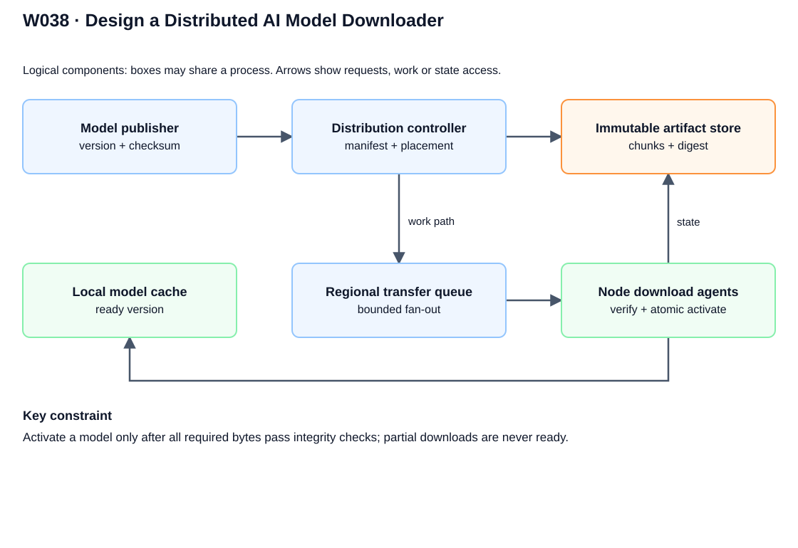

# W038. Design a Distributed AI Model Downloader

**Priority group:** First 100 — very important

**Category:** ML infrastructure and distributed training

**Study position:** 38 of 547

[Group list](../FIRST_100.md) · [All categories](../ALL_CATEGORIES.md) · [Chapter guide](../README.md)

## Question

Design a system that distributes very large model weights (tens to hundreds of GB per model) from a central store to thousands of GPU nodes in a cluster — quickly and reliably — whenever a new model version is released.

In your design, address:

where the weights live (object store / registry) and how nodes pull them,
fanning out efficiently without saturating the network (peer-to-peer, CDN, or tree / broadcast),
integrity verification and handling partial / failed / resumed downloads,
on-node caching and versioning (multiple model versions live at once),
the key bottlenecks and trade-offs (bandwidth vs latency vs cost).

The crux to nail: network fan-out — a naive pull of huge weights from one store by thousands of nodes melts the network.

## Worked solution

<!-- architecture:W038:start -->
### Architecture and request flow

Regional/rack seed caches and bounded peers fan out verified chunks, then node caches atomically publish complete model versions.

[Open full-size diagram](../diagrams/W038_architecture.svg).
<!-- architecture:W038:end -->

### Size the fanout before choosing a topology

For a chosen200GB model and4,000 nodes, each full release delivers800TB to destinations. A central100Gb/s egress is12.5GB/s, giving an impossible-to-beat64,000s≈17.8h origin bottleneck for naive direct pulls, before overhead. Even one node on a25Gb/s NIC needs at least200/3.125=64s. No distribution algorithm removes aggregate destination/disk bytes; it can remove repeated origin and cross-rack transfers.

### A rack-aware chunk swarm

Publish a signed immutable manifest with model/runtime/tokenizer versions, file sizes and per-chunk/full-file digests. Store authoritative chunks in object storage. Select a few healthy regional/rack seed caches, fetch once per seed, then let bounded peers exchange missing verified chunks within the same failure/network domain. A controller advertises available chunks and rate limits origin, rack uplinks and node upload/download. A tree broadcast is easier to control but parent loss can stall descendants; a swarm tolerates missing peers but needs discovery, fairness and upload caps. A managed regional CDN/cache is operationally simpler if transfer cost/performance is acceptable.

As a rough plan with40 racks, one200GB seed transfer/rack is8TB origin egress, about640s at12.5GB/s if that link remains the bottleneck, with local distribution pipelined. It is a topology-dependent improvement, not a promise of640s full completion: rack cross-section, disks and seed uploads must also sustain the destination load. Chunk size (for example64MiB) trades metadata/scheduling overhead against retry granularity and pipeline fill.

### Downloader state and APIs

`GET /models/{version}/manifest`, `GET /chunks/{digest}` with authenticated/range reads, `POST /workers/{id}/chunk-availability` and readiness/activation acknowledgments form the data/control contract. A download job records target manifest digest, received/verified bitmap, attempt/backoff and desired-generation. Write `.partial` chunks, verify digest, then rename to the content-addressed cache. Resume only ranges with validated identity/length; a different remote ETag/version invalidates unverified ranges. Retry from another peer/origin under bounded backoff, quarantine corrupt peers and never trust “HTTP200” as integrity proof.

Local cache stores concurrent versions with pin/refcount, space reservation and eviction of unpinned chunks. Shared chunks deduplicate; old and new weights with different digests coexist. Only after every required file verifies does a node publish a ready directory/manifest atomically, then load and warm it before traffic. GPU memory may require draining/replacing a replica rather than holding both versions. Requests pin a complete version; a straggler is skipped, not allowed to serve a mixed bundle.

### Reliability and the real trade-offs

Controller restart reconstructs desired/observed versions from durable metadata; a peer outage only changes chunk sources. Region isolation uses a local verified stable version and defers promotion. A release can pause or roll back to a retained manifest/cohort pointer; bound simultaneous activations to preserve serving capacity. Credentials are model/tenant scoped, manifests signed, peers authenticated and all bytes verified. A malicious approved publisher is outside checksum protection and needs publication control/audit.

Measure total/first-ready rollout latency, origin/rack/NIC/disk throughput, cache hits, download retries, checksum errors, active-version skew and serving disruption. Balance release latency against egress cost, interference with live inference traffic and spare disk capacity. The retained diagram maps object manifests to bounded regional transfer queues and node verify/atomic-activate agents; a downloader is not a tensor-parallel training system.

### Further study

- [F034: Estimate an LLM serving capacity budget.](../04_serving_and_training_systems.md#f034)
- [F170: Design a cache without serving incorrect data.](../17_distributed_systems_depth.md#f170)
