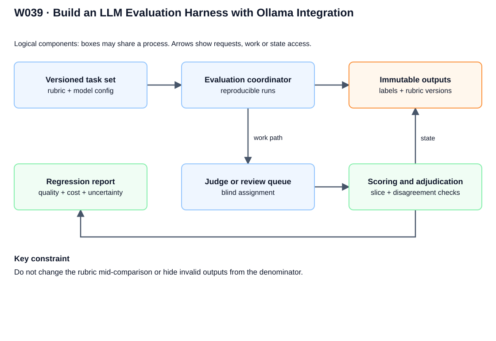

# W039. Build an LLM Evaluation Harness with Ollama Integration

**Priority group:** First 100 — very important

**Category:** Evaluation, calibration and data quality

**Study position:** 39 of 547

[Group list](../FIRST_100.md) · [All categories](../ALL_CATEGORIES.md) · [Chapter guide](../README.md)

<span class="practice-page"></span>

## Question

Task: Build a Small LLM Evaluation Harness with Ollama Integration

Implement a small evaluation harness within 4 hours, including integration with Ollama (local model serving).

Goal

Build a runnable CLI tool that:

Loads a set of evaluation samples (prompts plus expected output / reference).
Calls a specified model served by local Ollama to generate responses.
Automatically scores generations and outputs a summary report.

### Requirements

Ollama integration

Allow specifying the model name via configuration (e.g., llama3, mistral).
Send requests to a local Ollama server and obtain generations.
Handle common failures: service unavailable, timeouts, invalid response formats.

Eval harness

Define a sample schema: id, prompt, optional reference.
Implement at least two automatic metrics (pick any two):
Exact match
Keyword/substring match
Simple similarity (token overlap / Jaccard)
Rule-based checks (e.g., must output yes/no, must contain a JSON field)
For each sample, output: model output, score, and pass/fail.
Output aggregate metrics: average score, pass rate, and a list of failed samples.

Engineering

Clear modular structure (data loading, model calling, scoring, reporting).
Minimal usage instructions (CLI args or README).
Preferably add unit tests or a minimal reproducible test dataset.
Suggested input format

JSONL with one sample per line:

{"id":"1","prompt":"2+2=?","reference":"4"}
Output

Print to stdout or write a JSON report containing:

per-sample outputs and scores
*(remainder of the Output section was cut off in the source page)*

## Worked solution

<!-- architecture:W039:start -->
### Architecture and request flow



The JSONL runner invokes a local Ollama HTTP adapter, validates the response, computes exact-match/Jaccard scores and retains failures in a JSON report.

[Open full-size diagram](../diagrams/W039_architecture.svg).
<!-- architecture:W039:end -->

### A runnable CLI with a real Ollama HTTP adapter

Load JSONL with unique string id, string prompt and optional string reference. Call Ollama's `/api/generate` with `stream:false`, model name and fixed decoding settings; parse the `response` string and preserve transport/format errors per sample. Exact match normalizes case/whitespace; Jaccard compares normalized token sets. Their average is the reported score and exact match defines pass. These simple metrics do not judge reasoning or factuality.

```python
import argparse,json,re,socket,urllib.request,urllib.error
from pathlib import Path

def load_samples(path):
    samples=[];seen=set()
    for number,line in enumerate(Path(path).read_text().splitlines(),1):
        if not line.strip():continue
        row=json.loads(line)
        if not isinstance(row,dict) or not isinstance(row.get('id'),str) or not isinstance(row.get('prompt'),str):
            raise ValueError(f'line {number}: string id/prompt required')
        if row['id'] in seen:raise ValueError('duplicate sample id')
        if row.get('reference') is not None and not isinstance(row['reference'],str):raise ValueError('string reference required')
        seen.add(row['id']);samples.append(row)
    if not samples:raise ValueError('no evaluation samples')
    return samples

def ollama_generate(prompt,model,url='http://127.0.0.1:11434',timeout=30):
    payload=json.dumps({'model':model,'prompt':prompt,'stream':False,'options':{'temperature':0}}).encode()
    request=urllib.request.Request(url.rstrip('/')+'/api/generate',data=payload,headers={'Content-Type':'application/json'})
    try:
        with urllib.request.urlopen(request,timeout=timeout) as response:data=json.load(response)
    except urllib.error.HTTPError as e:raise RuntimeError(f'Ollama HTTP {e.code}') from e
    except (urllib.error.URLError,TimeoutError,socket.timeout) as e:raise RuntimeError(f'Ollama unavailable/timeout: {type(e).__name__}') from e
    except (ValueError,UnicodeError) as e:raise RuntimeError('Ollama invalid JSON') from e
    if not isinstance(data,dict) or not isinstance(data.get('response'),str):raise RuntimeError('Ollama response field missing or nonstring')
    return data['response']

def metrics(output,reference):
    normalize=lambda s:' '.join(s.casefold().split())
    exact=float(normalize(output)==normalize(reference))
    a=set(re.findall(r'\w+',normalize(output)));b=set(re.findall(r'\w+',normalize(reference)))
    overlap=len(a&b)/len(a|b) if a|b else 1.
    return {'exact_match':exact,'jaccard':overlap}

def evaluate(samples,caller,model):
    rows=[]
    for sample in samples:
        eligible=sample.get('reference') is not None
        row={'id':sample['id'],'output':None,'metrics':None,'score':None,'pass':None,'error':None,'scorable':eligible}
        try:
            row['output']=caller(sample['prompt'])
            if not isinstance(row['output'],str):raise ValueError('caller did not return text')
            if eligible:
                row['metrics']=metrics(row['output'],sample['reference'])
                row['score']=sum(row['metrics'].values())/2;row['pass']=row['metrics']['exact_match']==1
        except Exception as e:
            row['error']=f'{type(e).__name__}: {e}'
            if eligible:row['metrics']={'exact_match':0.,'jaccard':0.};row['score']=0.;row['pass']=False
        rows.append(row)
    scored=[r for r in rows if r['scorable']]
    return {'model':model,'settings':{'temperature':0,'stream':False},'sample_count':len(rows),'scored_count':len(scored),
      'unscored_count':len(rows)-len(scored),'error_count':sum(r['error'] is not None for r in rows),
      'average_score':sum(r['score'] for r in scored)/len(scored) if scored else None,
      'pass_rate':sum(r['pass'] for r in scored)/len(scored) if scored else None,
      'failed_ids':[r['id'] for r in rows if r['pass'] is False or r['error'] is not None],'samples':rows}

if __name__=='__main__':
    p=argparse.ArgumentParser();p.add_argument('samples');p.add_argument('--model',required=True)
    p.add_argument('--url',default='http://127.0.0.1:11434');p.add_argument('--timeout',type=float,default=30);p.add_argument('--out');a=p.parse_args()
    report=evaluate(load_samples(a.samples),lambda text:ollama_generate(text,a.model,a.url,a.timeout),a.model)
    encoded=json.dumps(report,indent=2,ensure_ascii=False)
    if a.out:Path(a.out).write_text(encoded)
    else:print(encoded)
```

### Run and interpret the result

Save `{"id":"1","prompt":"2+2=?","reference":"4"}` as a line in `samples.jsonl`. Start a local Ollama server with a model already pulled, then run `python3 ../review_w039_implementation.py samples.jsonl --model model-name --out report.json`. No original local model/server was provided; adapter correctness is tested against a local HTTP fixture and evaluation logic against deterministic responses, not presented as a real-model quality score. The generate request/response contract follows the [official Ollama generate documentation](https://docs.ollama.com/api/generate).

A referenced sample whose call fails gets score0/pass=false and remains in the denominator. A sample without a reference is run and reported with score/pass null and an explicit unscored count; inventing a reference would not be evaluation. Failed ids include transport failures even when no reference exists. A completely unscored run returns null average/pass rate. For actual comparisons freeze dataset/prompt/model/settings/metric versions and preserve raw outputs and errors. A response “the answer is4” may fail exact match while Jaccard gives partial overlap; neither score proves task usefulness. Extend with a task-specific validator when available, use bounded timeouts/retries and report retry costs. The diagram's generic judge queue is an optional extension; this implementation's actual path is sample loader → local model adapter → deterministic scoring → JSON report.

### Further study

- [F067: Build an LLM evaluation harness.](../07_evaluation_and_data.md#f067)
- [F078: Evaluate an agent whose outputs vary between runs.](../08_rag_and_agents.md#f078)
