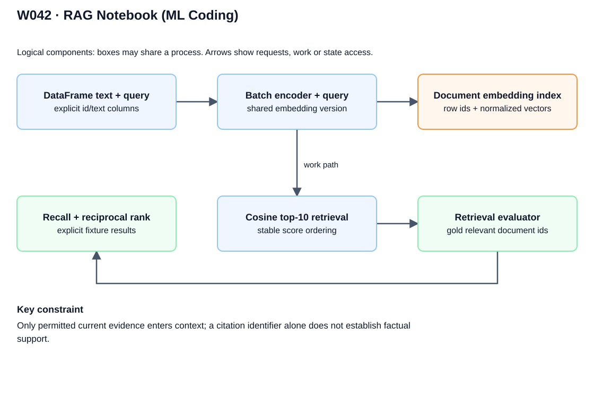

# W042. RAG Notebook (ML Coding)

**Priority group:** First 100 — very important

**Category:** RAG, agents and application security

**Study position:** 42 of 547

[Group list](../FIRST_100.md) · [All categories](../ALL_CATEGORIES.md) · [Chapter guide](../README.md)

<span class="practice-page"></span>

## Question

RAG Notebook (ML Coding)

ML-coding round in a Colab notebook: fill in a simple RAG pipeline — generate text embeddings from a pandas DataFrame, retrieve the top-10 by cosine similarity to the query embedding, and run a short evaluation. Some utility functions are pre-provided.

### Requirements

Conducted in a Colab notebook (the recruiter flags this in advance); some utility functions are pre-provided and you fill in / modify the implementation.
Build a simple retrieval-augmented pipeline:
Generate embeddings for text stored in a pandas DataFrame.
Embed the query and compute cosine similarity against the document embeddings; take the top-10.
Run an evaluation step over the retrieved results.
Notes
This is an ML-coding round, not a from-scratch algorithm — comfort with the numpy/pandas + embedding/cosine-similarity idioms is what's tested. Candidates without ML-coding reps report struggling here.
Pairs with a RAG-flavored system-design round in ML-leaning loops, since RAG over legal documents is Harvey's core product.

## Worked solution

<!-- architecture:W042:start -->
### Architecture and request flow



DataFrame documents and queries share one embedding function; normalized vectors produce stable top-10 ids, which are evaluated against relevance labels.

[Open full-size diagram](../diagrams/W042_architecture.svg).
<!-- architecture:W042:end -->

### Use the DataFrame's real row ids and a shared encoder

No Colab notebook, actual DataFrame schema, encoder or relevance labels were attached. The runnable class accepts explicit column mappings and an injected batch embedding function. Build document embeddings once, normalize rows and use the **same** encoder/version for each query; cosine scores are dot products of normalized vectors. Stable sort keeps lower source row order on ties, returns min(10,N), and maps scores back to document ids rather than mistaking a DataFrame index for a vector position.

```python
import numpy as np
import pandas as pd

class RetrievalIndex:
    def __init__(self,df,embed,text_column='text',id_column='id'):
        if text_column not in df or id_column not in df:raise ValueError('map actual schema columns first')
        if df[id_column].duplicated().any() or df[id_column].isna().any():raise ValueError('unique nonmissing ids required')
        if not df[text_column].map(lambda v:isinstance(v,str)).all():raise ValueError('text must be strings')
        self.df=df.copy().reset_index(drop=True);self.embed=embed;self.id_column=id_column
        E=np.asarray(embed(self.df[text_column].tolist()),dtype=float)
        if E.ndim!=2 or E.shape[0]!=len(df) or not E.shape[1] or not np.isfinite(E).all():raise ValueError('invalid embedding output')
        self.E=np.divide(E,np.linalg.norm(E,axis=1,keepdims=True),out=np.zeros_like(E),where=np.linalg.norm(E,axis=1,keepdims=True)>0)
    def retrieve(self,query,k=10):
        if k<0:raise ValueError('negative k')
        q=np.asarray(self.embed([query]),dtype=float)
        if q.shape!=(1,self.E.shape[1]) or not np.isfinite(q).all():raise ValueError('query embedding mismatch')
        norm=np.linalg.norm(q)
        if norm==0:return self.df.iloc[:0].assign(score=np.array([],dtype=float))
        scores=self.E@(q[0]/norm)
        order=np.argsort(-scores,kind='stable')[:min(k,len(self.df))]
        result=self.df.iloc[order].copy();result['score']=scores[order];return result
    def evaluate(self,queries):
        rows=[]
        for query,relevant in queries:
            relevant=set(relevant)
            if not relevant:raise ValueError('recall undefined without relevant labels')
            ids=self.retrieve(query,10)[self.id_column].tolist()
            rows.append({'query':query,'recall_at_10':len(set(ids)&relevant)/len(relevant),
                         'reciprocal_rank':next((1/r for r,i in enumerate(ids,1) if i in relevant),0.)})
        return pd.DataFrame(rows)

if __name__=='__main__':
    # Deterministic small embedding fixture; replace with the notebook's supplied encoder.
    def embed(texts):
        return np.array([[text.lower().split().count(w) for w in ['cat','dog','bird']] for text in texts],dtype=float)
    df=pd.DataFrame({'id':range(12),'text':['cat','dog','bird','cat dog']+['bird']*8},index=range(20,32))
    index=RetrievalIndex(df,embed)
    found=index.retrieve('cat');assert len(found)==10 and found.id.iloc[0]==0 and found.id.iloc[1]==3
    assert index.retrieve('unknown').empty
    results=index.evaluate([('cat',{0,3}),('dog',{1,3})])
    assert np.allclose(results.recall_at_10,1) and np.allclose(results.reciprocal_rank,1)
    assert df.index.tolist()==list(range(20,32))  # Preserve caller's table.
    print('W042: declared fixture retrieval/evaluation:\n',results.to_string(index=False))
```

### Evaluate the declared fixture and extend the notebook

The fixture has12 documents with a deterministic three-coordinate count encoder, not a claim about semantic embedding quality. Query “cat” ranks id0 first then mixed id3; “dog” ranks id1 then id3. Both chosen relevance sets have Recall@10=1 and reciprocal rank1. A zero-vector query returns no results under the stated policy; zero document embeddings score0. Tests also preserve a nondefault caller DataFrame index and validate dimensions/ids. Real batch APIs need bounded batches, consistent output mapping and version/normalization metadata.

Recall@10 is retrieved relevant ids divided by all labeled relevant ids; MRR averages reciprocal rank of the first relevant document. Include precision@10/nDCG and important query slices when labels support them. If expected evidence is absent from the table, retrieval cannot succeed. Evaluate a separate held-out query set rather than choosing the encoder/k on the final answers. To complete an answer-generating RAG notebook, pass the bounded retrieved text/id list to the supplied generator, return evidence citations or abstain, and evaluate grounded correctness separately. The prompt's coding deliverable itself is embedding, top10 retrieval and evaluation; generic infrastructure alone would not satisfy it.

### Further study

- [F071: Design a minimal retrieval-augmented question-answering system.](../08_rag_and_agents.md#f071)
- [F072: Choose chunk size and overlap for retrieval.](../08_rag_and_agents.md#f072)
- [F073: When should you combine lexical retrieval, embeddings and reranking?](../08_rag_and_agents.md#f073)
- [F074: Diagnose a RAG system's wrong answer.](../08_rag_and_agents.md#f074)
- [F075: Reduce RAG latency without sacrificing correctness blindly.](../08_rag_and_agents.md#f075)
