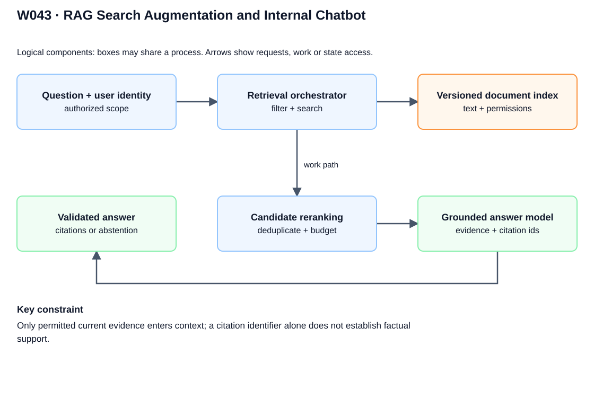

# W043. RAG Search Augmentation and Internal Chatbot

**Priority group:** First 100 — very important

**Category:** RAG, agents and application security

**Study position:** 43 of 547

[Group list](../FIRST_100.md) · [All categories](../ALL_CATEGORIES.md) · [Chapter guide](../README.md)

## Question

Design an internal assistant or search-augmentation layer over employee logs, Confluence, Jira, GDrive, or product data. The system detects fact-seeking / task-seeking queries, retrieves relevant documents, reasons over them, and returns an answer alongside normal search results.

### Requirements

Detect whether a user query is fact-seeking or task-seeking.
Extract entities and intent (manager, time range, task name, product, document source).
Retrieve relevant data from internal services, document stores, org graph, or activity logs.
Use a retrieval layer such as keyword search plus ANN/vector search.
Generate or extract an answer and present it above/alongside traditional results.
Track quality with retrieval metrics and end-to-end answer metrics: precision/recall, MRR, latency, faithfulness, answer quality, user satisfaction.
Notes
A successful design can include orchestration, retrieval, optional memory, reasoning/planning, and response-generation layers.
For employee-log navigation, examples include resolving my manager, finding a manager's activity in a time range, retrieving task-specific events.
For Jira/Confluence variants, focus on permission-aware retrieval and source grounding.

## Worked solution

<!-- architecture:W043:start -->
### Architecture and request flow

Intent/entity/time resolution selects authorized org/activity or document evidence, hybrid retrieval/reranking supplies bounded context and grounded answers accompany ordinary results.

[Open full-size diagram](../diagrams/W043_architecture.svg).
<!-- architecture:W043:end -->

### Parse a question into a bounded evidence plan

Assume100k employees,10M source items and100 peak queries/s, with the existing search UI retained. `POST /search-assist` takes query and authenticated identity, returning `{intent,answer_or_abstention,citations,search_results,source_status}`. Fact-seeking asks a known fact (“Who is my manager?”); task-seeking here means finding how-to/task events (“What did my manager do on project Apollo last week?”). Navigation queries can return direct results; actual state-changing actions require a separate authorized product scope. Use a lightweight classifier plus entity/time resolver, with confidence/clarification for ambiguous names or “last week” timezone boundaries.

Resolve “my manager” through the authenticated org graph as of the relevant time, not a guessed name from embeddings. Build a typed plan such as `manager(user,as_of)→activity(manager_id,project_id,start,end)`; map source/product/task names to canonical ids with visible disambiguation. Structured filters constrain time/entity/source, while lexical search finds exact Jira/product ids and ANN handles paraphrases. Parallelize independent source reads, fuse with reciprocal-rank fusion, deduplicate versions and rerank a bounded set. Return ordinary search results even if answer synthesis is unavailable.

### Ingest with permissions and source versions

Connectors for wiki/Jira/drive/log sources emit document/activity ids, source URI, version, owner, ACL, timestamps and content hashes. Raw objects remain in protected source/snapshot storage; parsed chunks preserve headings/table context and source offsets. Maintain lexical/vector indexes plus structured activity/org stores. Updates/deletes create tombstones/new versions, and ACL revocation is enforced by current authorization even before the index catches up. Do not assume a GDrive link available to one employee is available to another.

At retrieval apply tenant/user/group and document filters, then recheck selected evidence against current ACL/version before generation. Store a query trace with resolved plan, permitted evidence ids and answer claims; cache by query/entity/time/model/index version and permission scope, with invalidation on changes. Conversation context can resolve pronouns but cannot expand permissions. Treat source text as evidence, never instructions to call new tools or disclose other data.

### Generate only supported answers and measure the stages

For the manager-activity example, request exact dated events and distinguish “no matching authorized events found” from “the manager did nothing.” Generate a short evidence-linked summary above results, with source/time qualifiers and claim-to-passage references. If evidence conflicts or sources time out, state the limitation/abstain rather than fabricate a complete timeline. On source outage keep unaffected results with explicit coverage status; use deadlines/retries for reads and no unbounded planning loop.

Build a human-labeled query suite by fact/task/navigation, source, entity ambiguity and permission group. Measure intent/entity/time accuracy, precision/Recall@k, MRR/nDCG for retrieval and grounded answer correctness/completeness, citation entailment, refusal appropriateness and user satisfaction/task completion. Report per-stage and end-to-end p95 latency plus source freshness. Oracle-entity/oracle-retrieval tests separate parsing failures from retrieval gaps; oracle-context generation isolates synthesis. Audit no-answer and cross-permission negatives, not only answerable demos. Canary improved retrieval/prompts against the fixed suite and online interactions, with rollback and privacy-safe logs. The diagram's index/rerank/generator path is supplemented by the structured org/activity lookup in this example.

### Further study

- [F071: Design a minimal retrieval-augmented question-answering system.](../08_rag_and_agents.md#f071)
- [F072: Choose chunk size and overlap for retrieval.](../08_rag_and_agents.md#f072)
- [F073: When should you combine lexical retrieval, embeddings and reranking?](../08_rag_and_agents.md#f073)
- [F074: Diagnose a RAG system's wrong answer.](../08_rag_and_agents.md#f074)
- [F075: Reduce RAG latency without sacrificing correctness blindly.](../08_rag_and_agents.md#f075)
