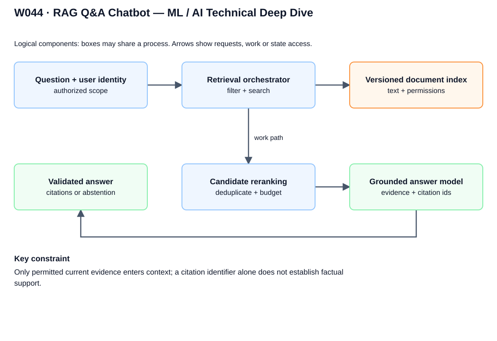

# W044. RAG Q&A Chatbot — ML / AI Technical Deep Dive

**Priority group:** First 100 — very important

**Category:** RAG, agents and application security

**Study position:** 44 of 547

[Group list](../FIRST_100.md) · [All categories](../ALL_CATEGORIES.md) · [Chapter guide](../README.md)

## Question

For Applied AI / ML roles, an ML-design round (and a separate 'AI Technical Deep Dive') centered on building a retrieval-augmented Q&A chatbot: ingesting structured and unstructured data and evaluating answer quality.

### Requirements

Design a Q&A chatbot built on retrieval-augmented generation (RAG).
Address how the system ingests and indexes both structured and unstructured data so the retriever can use them.
Define how you evaluate performance — answer quality / relevance metrics and an evaluation methodology.
Notes
Applied-AI loops include a distinct AI Technical Deep Dive round that candidates note is *not* a standard infra system-design — it leans on your hands-on ML/LLM judgment (retrieval design, data handling, evaluation) rather than load balancers and sharding.
The same loop pairs this with a Value/LP interview (e.g. an unforeseen bug that creates tech debt if you ship now vs. delays launch if you fix it — what do you do, and when would you instead prioritize paying down the tech debt) and a leadership round on a project you led.
The hiring-manager conversation deep-dives Vanta's own applied-AI product, so come ready to discuss what their applied AI covers.
Exact scope (corpus size, latency targets) hasn't fully surfaced — clarify constraints with the interviewer up front.

## Worked solution

<!-- architecture:W044:start -->
### Architecture and request flow

Structured query evidence and parsed text passages share provenance/permission metadata; hybrid retrieval feeds an evidence-grounded Q&A answer or abstention.

[Open full-size diagram](../diagrams/W044_architecture.svg).
<!-- architecture:W044:end -->

### Start with the corpus and the answer type

Assume internal policy/compliance Q&A with PDFs/wiki text plus structured controls/evidence tables; actual corpus size, providers and company-specific implementation are not supplied. Clarify answer scope, users/ACL, freshness, latency and whether questions need exact calculations or prose evidence. Start with a read-only grounded baseline and a representative evaluation set before adding agent planning.

Ingest unstructured documents through versioned connectors, OCR when needed, and structure-aware parsing that retains headings, tables, source/page offsets, dates and access metadata. Chunk on logical sections, initially perhaps400–700 tokens with small overlap, then tune using held-out evidence recall and answer quality. A table row needs its headers/units. Track parser/OCR failures and compare source text to extracted chunks; embeddings cannot recover missing content.

For structured data preserve typed rows, primary/foreign keys, units, freshness and row/column authorization. Index human-readable row summaries for discovery, but route aggregation/filter/join questions to a constrained typed query/SQL service with catalog validation and read-only permissions. “How many overdue controls?” needs a reproducible database result, not counting approximate nearest-neighbor snippets. Capture query, snapshot time and result provenance alongside text passages in one evidence contract.

### A concrete hybrid query path

`POST /qa` receives question plus server identity/conversation pointer and returns answer/citations or abstention. Retrieve authorized schema/doc candidates using lexical exact identifiers and dense semantic similarity, fuse bounded rankings, rerank if it improves validation at acceptable latency and assemble nonduplicated context. For “Which policies govern this overdue control?” resolve the control id and status through the structured store, retrieve applicable policy versions/sections, then synthesize a claim-linked answer. Context includes source type, version, effective date and ids; the generator may not infer missing status or quote a superseded policy as current.

Store document/chunk/version/ACL records, structured evidence references and a query trace; current-policy aliases and immutable evidence versions are separate. Recheck permissions before rendering/citing. Updates/deletes/ACL changes invalidate affected index/cache results; partial-source outage yields a scoped answer or abstention. Retrieved instructions remain untrusted, and any future tool actions need independent authorization.

### Evaluate ML choices with controlled ablations

Create held-out questions with gold relevant passages/rows, expected atomic claims and appropriate no-answer decisions, stratified across text, tables, OCR, multi-source, temporal contradictions, permissions and languages. Keep source-family splits and separately tune chunk size/overlap, encoder, lexical fusion and reranker. Retrieval metrics are evidence Recall@k, precision, MRR/nDCG; generation metrics are factual/grounded claim precision, completeness, citation entailment/coverage, correct abstention and user task success. Include human blinded rubrics with agreement; calibrate any LLM judge against them.

Use no-retrieval and lexical-only baselines, then oracle-context generation to tell whether errors are missing evidence or unsupported synthesis. Report uncertainty by question/document family, latency/cost/freshness and important slices. A high citation count or ROUGE score alone does not prove correctness. Roll out only if target improvements survive the regression/no-answer/permission gates. A newly found bug that exposes private data or changes regulated facts blocks release; a contained cosmetic issue can ship with an owner/deadline and monitoring. Support leadership/project discussion with real evidence rather than inventing this company's product architecture.

### Further study

- [F071: Design a minimal retrieval-augmented question-answering system.](../08_rag_and_agents.md#f071)
- [F072: Choose chunk size and overlap for retrieval.](../08_rag_and_agents.md#f072)
- [F073: When should you combine lexical retrieval, embeddings and reranking?](../08_rag_and_agents.md#f073)
- [F074: Diagnose a RAG system's wrong answer.](../08_rag_and_agents.md#f074)
- [F075: Reduce RAG latency without sacrificing correctness blindly.](../08_rag_and_agents.md#f075)
