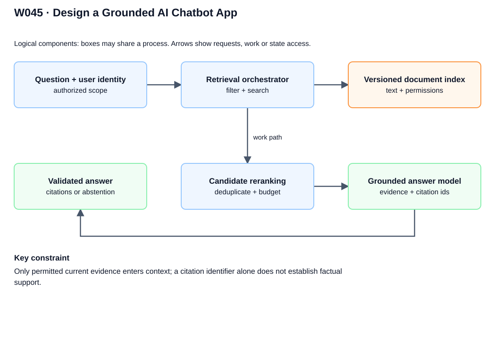

# W045. Design a Grounded AI Chatbot App

**Priority group:** First 100 — very important

**Category:** RAG, agents and application security

**Study position:** 45 of 547

[Group list](../FIRST_100.md) · [All categories](../ALL_CATEGORIES.md) · [Chapter guide](../README.md)

<span class="practice-page"></span>

## Question

Design the backend for a multi-tenant chatbot that answers questions from each customer's private documents, wikis, and support tickets. The model inference service is an external dependency; your design owns ingestion, retrieval, conversation state, grounding, and product reliability.

### Requirements

1. Support multi-turn chat with streamed answers and citations to source passages.
2. Refuse to answer when retrieved evidence is insufficient.
3. Ingest document creates, updates, and deletes; changed content must become searchable within five minutes.
4. Enforce tenant and document-level access controls during every retrieval.
5. Evaluate retrieval quality, answer faithfulness, citation correctness, refusals, latency, and freshness.
Scale and service targets

```text
1,000 tenants, 10 million documents, and about 5 billion indexed tokens in total.
200 chat requests per second at peak and 20 document updates per second.
```

First answer token within 1.5 seconds at the 95th percentile.
No cross-tenant data exposure; prioritize correctness over answering when evidence is weak.
Deliverable

Present APIs, data model, ingestion and online-query flows, storage and index choices, scaling strategy, and failure handling. Explain chunking, retrieval and reranking choices, context-window management, conversation history, cache invalidation, observability, and how you would diagnose retrieval failures separately from generation failures.

Follow-ups
1. A document changed 30 seconds ago, but the assistant cites its old version. Trace and fix the failure.
2. Two retrieved passages contradict each other. Define the answer and citation behavior.
3. Add authenticated tool calls while treating retrieved text as untrusted input.

## Worked solution

<!-- architecture:W045:start -->
### Architecture and request flow



Versioned ingestion updates lexical/ANN entries; every chat retrieval rechecks tenant/document authorization and source versions before a citation-supported stream.

[Open full-size diagram](../diagrams/W045_architecture.svg).
<!-- architecture:W045:end -->

### APIs and tenant-safe state

Expose document upsert/delete/status APIs, `POST /conversations`, `POST /conversations/{id}/messages` with request id/parent revision, an ordered answer/citation event stream and cancellation/status. Store Tenant,Principal/Group,Document(id,tenant,version,ACL_version,source_timestamp,current/tombstone),Chunk(doc_version,offsets,text_ref,embedding_version),Conversation/Message and Generation(evidence_snapshot,model/prompt/index_version,status). Object storage keeps immutable source/extracted versions; metadata DB controls current versions/access; lexical and ANN indexes serve filtered retrieval. Enforce owner/tenant on all history/citation reads, not just initial search.

At5B tokens/10M documents, mean length is500 tokens. With a chosen400-token chunk/50 overlap, boundary-aware chunk counts depend on length distribution: around15–20M is a planning range rather than blindly5B/350. A768-dimensional FP16 vector costs1536bytes:23–31GB raw for that range, plus ANN graph, text, metadata, replicas and working headroom. Peak200 queries/s retrieving100 candidates gives20k candidate evaluations/s before reranking; benchmark its GPU/CPU cost separately.20 document updates/s is modest average ingest but bursts and huge documents need bounded queues and freshness-by-age monitoring.

### Ingestion and query critical path

Connectors emit creates/updates/deletes keyed by source version. Extract/OCR/parse, redact as required, chunk with headers/table context, embed and stage new lexical/vector entries. Atomically advance current document/index manifest only after all required parts commit; idempotent tasks prevent duplicate chunks. Delete/ACL revocation writes a metadata tombstone immediately and filters stale index hits until physical cleanup. Normal content updates become searchable within5minutes; the service reports version/freshness rather than implying instantaneous propagation.

For a chat turn, authenticate, load bounded parent history, resolve references using current instructions, perform authorized lexical+ANN retrieval in parallel, fuse/dedup and rerank a small set. Recheck current ACL/tombstone/version before context assembly. Pack perhaps6–10 diverse chunks under an explicit evidence budget, preserving source offsets; retain recent turns plus a versioned summary/retrieved older turns rather than the whole history. Generate only evidence-supported claims and abstain if sufficient coverage is absent. A similarity threshold alone is not calibrated answerability.

For the1.5s p95 first-token target, an initial budget might be100ms auth/history,100ms rewrite,150ms retrieval,200ms rerank,700ms model prefill/first verified sentence and150ms network/slack=1.4s. These are chosen component targets requiring joint load measurement; the external inference dependency must meet its portion. Stream validated sentence/citation events with sequence ids; holding claims for support checks can increase TTFT, so measure that actual path. If the model cannot meet it, reduce context/model latency or return an explicit delayed mode rather than promise an impossible SLO.

### Trace the difficult failures

If a document changed30s ago and an old version is cited, first note that this is inside the stated5-minute search freshness window. Trace source event→ingest watermark→parse/embed→index commit→cache key→evidence version→generation. For known updates, invalidate answer/retrieval/prefix caches using doc/index versions and fetch current authoritative content or say an update is pending; do not call it a model hallucination automatically. Exceeding5minutes is an ingestion SLO incident. Deletions/access changes remain fail-closed immediately through metadata checks.

If two passages conflict, compare authority/effective dates and cite the chosen current source with the conflict noted; if unresolved, present both attributed facts and decline a definitive unsupported conclusion. Do not average incompatible policy values. For authenticated tools, use allowlisted typed adapters, server-derived tenant/principal, current resource authorization, read/write classifications, stable operation ids and bounded retries. Retrieved text cannot supply permission or redirect an action; consequential actions follow the product's explicit authorization flow.

### Reliability, caching and evaluation

Cache keys include tenant/principal permission fingerprint, conversation/query context, document/index/model/prompt versions and freshness policy; revoked permissions invalidate access even on a hit. Partition by tenant/hash with hot-tenant quotas, batch ingestion/embedding, replicate retrieval and keep explicit deadlines/circuit breakers. If retrieval/authorization is unavailable, refuse; if generation is unavailable, return permitted search evidence or an honest failure. Duplicate request ids reuse one generation; worker/model restarts leave partial answers marked partial. Keep citations pointing to immutable evidence while checking present access.

Evaluate retrieval Recall@k/MRR and gold evidence coverage, answer correctness/faithfulness/completeness, citation entailment/coverage, refusal precision/recall, cross-tenant leakage, p95 TTFT/completion, ingest lag and update/delete propagation. Use document-family/time splits, adversarial/no-answer/conflict cases, blinded humans plus calibrated judges and paired uncertainty. Oracle-context generation separates generation failure from retrieval failure; inspect actual assembled context to detect truncation. Alert on stale-version citations, unauthorized hits, elevated refusal, source gaps and index/model regressions, then canary/rollback versioned changes.

### Further study

- [F071: Design a minimal retrieval-augmented question-answering system.](../08_rag_and_agents.md#f071)
- [F072: Choose chunk size and overlap for retrieval.](../08_rag_and_agents.md#f072)
- [F073: When should you combine lexical retrieval, embeddings and reranking?](../08_rag_and_agents.md#f073)
- [F074: Diagnose a RAG system's wrong answer.](../08_rag_and_agents.md#f074)
- [F075: Reduce RAG latency without sacrificing correctness blindly.](../08_rag_and_agents.md#f075)
