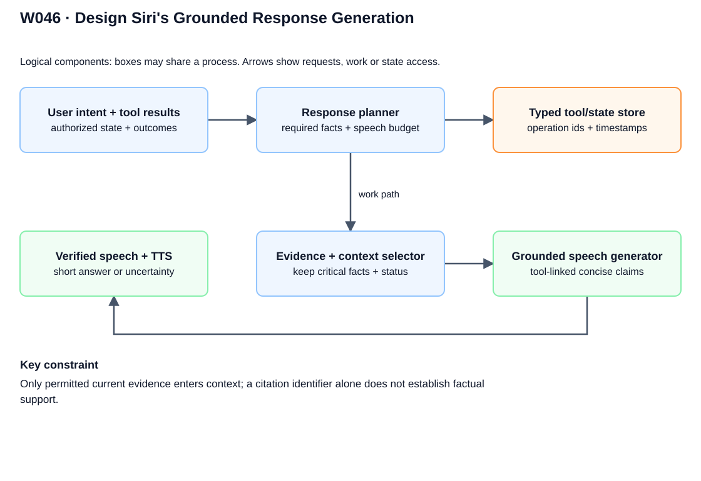

# W046. Design Siri's Grounded Response Generation

**Priority group:** First 100 — very important

**Category:** RAG, agents and application security

**Study position:** 46 of 547

[Group list](../FIRST_100.md) · [All categories](../ALL_CATEGORIES.md) · [Chapter guide](../README.md)

## Question

Design a Siri response-generation flow for an assistant that calls tools and then speaks a concise answer. Cover:
1. How the system grounds the response in tool output instead of unsupported model memory.
2. How to evaluate factuality, usefulness, and voice-chat length.
3. Why hallucination happens and what product / model guardrails reduce it.
4. How to handle long context from conversation history, user state, and tool payloads.
5. How to keep the answer short enough for spoken interaction without dropping required facts.

## Worked solution

<!-- architecture:W046:start -->
### Architecture and request flow

Authorized typed tool results and relevant state feed a required-fact/speech planner, then verified concise claims are released to TTS.

[Open full-size diagram](../diagrams/W046_architecture.svg).
<!-- architecture:W046:end -->

### Convert tool evidence into a speech plan

Assume the upstream assistant has a resolved user intent and authorized tools. Tool adapters return typed `{operation_id,status,observed_at,entities,values,units,timezone,source}`; distinguish confirmed success, failed, unknown and partial results. A response planner selects required facts/actions, then a constrained generator realizes them in concise speech. For “When is my next meeting?” a calendar result with title/start/timezone supports that answer; it does not support guessing who will attend or whether traffic is bad. A timed-out send tool supports “I couldn't confirm it was sent,” not “Done.”

Use `POST /respond` with task/turn id and evidence references, storing a claim-to-tool-field trace and result/version. Server authorization scopes every payload to the current user. Required facts and uncertainty markers survive generation; deterministic formatting handles dates, numbers and units. High-risk action confirmation can use templates. Verify grounded claims against typed fields before TTS or sentence release. A model's parametric memory may fill gaps or prefer a plausible phrase because training optimizes likely continuation, not tool entailment; stronger generation alone does not establish factuality.

### Bound context and speaking length

Keep current user request, relevant recent turns, resolved entities/preferences and a bounded **typed summary** of relevant tool fields. Preserve source/operation ids and facts such as timezone/status; drop irrelevant verbose payloads and retrieve details on demand. Conversation summaries are fallible, so compare critical facts to fresh tools and expire stale user state. If referents remain ambiguous, ask a short clarification instead of using a guessed person/time. A full response history is neither needed nor safe to append indefinitely.

Choose a speech budget, for example one or two sentences and about20 words for a simple answer, roughly8 seconds at an assumed150 words/minute. Prioritize answer/action outcome, essential quantities/time and any required caveat; offer optional detail after that. Example: “Your next meeting is Design Review at3PM Eastern. It lasts30minutes.” Voice output omits raw URLs; source details can appear on screen where available. If all required facts cannot fit, compress wording or ask which detail matters; never remove “not confirmed” just to meet length. TTS-measured duration, not word count alone, is the final latency measure.

### Evaluate the full interaction

Build frozen tool-output scenarios including success/empty/error, timezones, large numbers, conflicting/stale results, multi-turn corrections and malicious text inside tool fields. Score atomic claim support, required-fact coverage, action-status correctness, clarification/abstention and task usefulness with blinded human rubrics. Measure spoken duration, words/turn, time to first audio, interruptions/repeats and downstream task completion/CSAT; unusually short answers can omit necessary information. Compare generated versus template baselines and perturb a tool value to ensure the answer follows evidence rather than memory.

Guardrails include tool schema/semantic validation, freshness/permission checks, trusted instruction boundaries, supported-claim checks and output policy filters. Bounded retries/circuit breakers produce honest fallback speech when tools fail. Record privacy-safe traces and inspect failures by tool, planning, grounding, rendering and TTS stages. The diagram must show tool result/state→response planner→grounded short answer→TTS, not an unrelated generic document-retrieval pipeline. No claim is made about Siri's proprietary implementation; this is the proposed flow.

### Further study

- [F071: Design a minimal retrieval-augmented question-answering system.](../08_rag_and_agents.md#f071)
- [F072: Choose chunk size and overlap for retrieval.](../08_rag_and_agents.md#f072)
- [F073: When should you combine lexical retrieval, embeddings and reranking?](../08_rag_and_agents.md#f073)
- [F074: Diagnose a RAG system's wrong answer.](../08_rag_and_agents.md#f074)
- [F075: Reduce RAG latency without sacrificing correctness blindly.](../08_rag_and_agents.md#f075)
