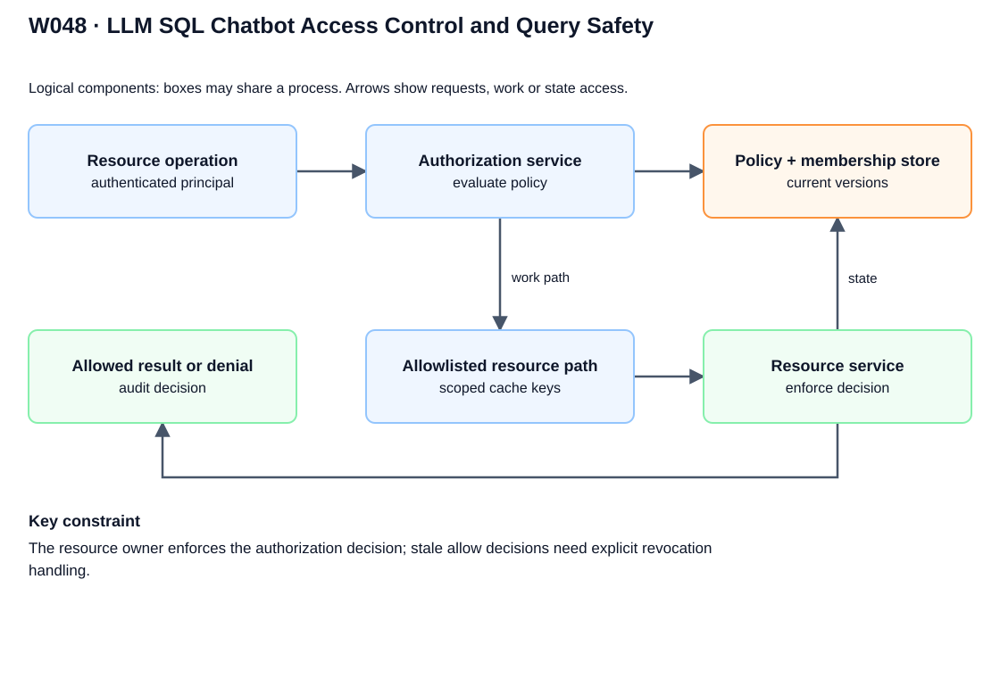

# W048. LLM SQL Chatbot Access Control and Query Safety

**Priority group:** First 100 — very important

**Category:** RAG, agents and application security

**Study position:** 48 of 547

[Group list](../FIRST_100.md) · [All categories](../ALL_CATEGORIES.md) · [Chapter guide](../README.md)

## Question

LLM SQL Chatbot Access Control and Query Safety

Design an LLM chatbot for SQL query generation over internal data. The discussion focuses on ensuring users can only query data they are allowed to access and preventing hallucinated or expensive queries such as accidental cross joins from crashing a Trino cluster.

DS Infra Eng · Tags: llm · sql · access-control · query-optimization · security · medium

### Requirements

Design an internal LLM chatbot that generates SQL queries.

Functional requirements:

Accept natural-language analytical questions from users.
Generate SQL against governed internal datasets.
Enforce data access so each user can only query authorized tables, columns, and rows.
Prevent unsafe, nonsensical, or extremely expensive SQL from reaching the warehouse unchecked.
Return useful errors or clarifying questions when the request cannot be answered safely.

Constraints and design points:

Trino-cluster stability is a first-class constraint.
Cross joins and hallucinated table / column names are explicit failure modes.
Access control must be enforced outside the model, not only through prompting.
Notes

A strong design puts the LLM behind deterministic policy and validation layers:

Retrieve the user's authorized schema subset before generation and expose only that subset to the model.
Validate generated SQL against a parser and catalog before execution.
Apply a policy engine for table, column, and row-level permissions.
Add query guards: join limits, required predicates for large tables, cost estimation, timeout, row limit, and read-only execution.
Use dry-run / explain-plan checks before submitting to Trino.
Log prompts, generated SQL, policy decisions, and execution metadata for audit and improvement.

## Worked solution

<!-- architecture:W048:start -->
### Architecture and request flow

The caller-scoped schema feeds SQL generation, AST/catalog/permission/cost gates and an isolated resource-limited Trino execution path.

[Open full-size diagram](../diagrams/W048_architecture.svg).
<!-- architecture:W048:end -->

### Generate SQL inside a governed query workflow

`POST /analysis-questions` takes text and server identity, returns a clarification or query id/validated SQL/results; `GET /queries/{id}` and cancel expose execution status. Store Question/QueryRun with principal, schema/policy snapshot, generated AST, validation decisions, plan estimates, Trino query id, resource usage and result references. Assume read-only analytics, not arbitrary SQL administration. No query runs under a universal superuser just because a model generated it.

Resolve the caller's authorized catalog subset (tables, columns, row filters, semantic join keys, metric definitions) before generation. Show only that subset with source descriptions/examples. If “revenue” or date range is ambiguous, request the missing definition rather than choose a favorable one. A generated query is a proposal, not authorization.

### Deterministic gates before Trino execution

Parse with the Trino dialect into an AST; reject multiple statements, writes/DDL, unapproved functions/connectors, external IO and unrecognized constructs. Resolve every table/column/alias against the governed catalog, including CTEs/subqueries/views and `SELECT *` expansion; hallucinated names return a bounded repair/clarification. Parameterize user literals, but remember parameters do not secure model-generated identifiers or expressions. Enforce table/column/row permissions in the warehouse/security layer under the caller/delegated scoped identity and recheck at execution, including views and derived data.

Inspect joins: require approved join relationships/equality keys for large tables, reject accidental Cartesian/cross joins and suspicious always-true predicates, bound join count and require time/partition predicates where policy demands. Legitimate tiny dimension cross joins can be allowlisted with an explicit cost limit. An outer LIMIT does **not** prevent an expensive join/aggregation from scanning huge data. Inspect `EXPLAIN`/validation plans and available statistics for estimated scanned bytes, output cardinality, memory and partition pruning; unknown/stale estimates fail closed or route to a lower-risk/manual path. Plain EXPLAIN does not execute the expensive query; do not use EXPLAIN ANALYZE as a harmless dry run.

### Runtime containment and correct results

Submit approved queries to a dedicated Trino resource group with per-user/tenant concurrency, queue limits, scan/CPU/memory/time budgets and cancellation. Apply row/result size limits and restrict spill/connector access as supported; validate those controls against actual cluster configuration. Isolate chatbot workloads from critical production queues and use circuit breakers when admission pressure rises. Authorization can change between generation and execution, so policy/version cache hits cannot bypass the warehouse check.

For example, joining two billion-row event tables without an event/entity key fails join/cost validation even if a final `LIMIT100` is present. A missing column receives a catalog error, not an invented result. Show metric definition, time range, units, snapshot and SQL/provenance with the answer; handle empty/null results explicitly. Retrieved table descriptions or query comments cannot grant a permission or command another tool.

Audit with sensitive literals/results redacted, enforce result-cache keys by principal/row-policy/schema/data version and invalidate revocations. Test cross-tenant joins, nested forbidden columns, expensive cross joins, injected text, timeout/cancel and stale plans. Monitor rejected/clarified/repaired queries, scanned bytes, p95 latency, resource-group saturation and semantic correctness against expert queries. The diagram's policy/resource enforcement path must include the SQL generator→parser/catalog/cost gate→isolated Trino resource group; generic RAG advice alone does not protect the cluster.

### Further study

- [F077: Design tool schemas and validate LLM outputs.](../08_rag_and_agents.md#f077)
- [F079: Defend an LLM application against prompt injection.](../08_rag_and_agents.md#f079)
- [F170: Design a cache without serving incorrect data.](../17_distributed_systems_depth.md#f170)
