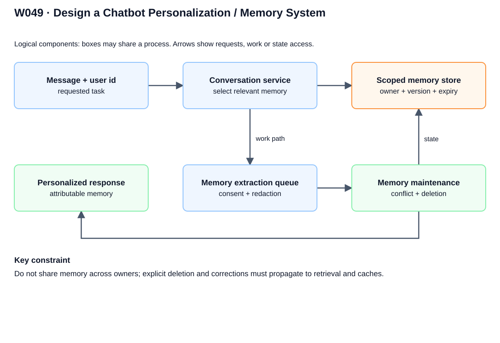

# W049. Design a Chatbot Personalization / Memory System

**Priority group:** First 100 — very important

**Category:** RAG, agents and application security

**Study position:** 49 of 547

[Group list](../FIRST_100.md) · [All categories](../ALL_CATEGORIES.md) · [Chapter guide](../README.md)

## Question

Design the long-term memory / personalization layer behind a text-only chatbot: how to store, retrieve, and reconcile per-user history so responses are personalized without re-reading everything each turn.

Functional requirements probed:

Persist per-user history and salient facts across sessions.
On each turn, retrieve the relevant slice of history to condition the response (RAG-style retrieve-then-generate baseline).
Reconcile conflicting stored facts.
Bound the cost of growing history so retrieval stays cheap over months.
Incorporate a feedback loop so memory improves from signal on whether personalization helped.

No hard scale numbers are given; stating your own assumptions is part of the signal.

## Worked solution

<!-- architecture:W049:start -->
### Architecture and request flow

Owner-scoped history extraction updates versioned facts; each turn retrieves a bounded relevant memory set and propagates corrections/deletions to indexes and caches.

[Open full-size diagram](../diagrams/W049_architecture.svg).
<!-- architecture:W049:end -->

### Separate history, facts and inferred preferences

Assume1M users,20 turns/user/day,2KB/turn raw text≈40GB/day before replicas and10k salient memories/user at an upper planning cap. Not every turn should become a durable fact. Store append-only ConversationMessage(user,turn,time,content_ref,consent), Memory(id,owner,key,value,type,source_turns,valid_from/valid_to,observed_at,confidence,explicit_or_inferred,version,expiry,status), and extraction/feedback events. History is evidence; canonical facts/preferences are a small current view; vector summaries help discovery but do not overwrite authoritative source records.

APIs append turns, retrieve context, list/edit/delete memories and record feedback under the authenticated owner. Extraction runs asynchronously with idempotency `(turn,extractor_version)` and schema/privacy checks. Save explicit user-approved facts/preferences conservatively; avoid retaining unnecessary sensitive inferences and let the user inspect/correct/delete. A message quoting another person's preference is not automatically the current user's preference or an instruction of higher authority.

### Retrieve a bounded context each turn

Load recent turns and exact current preferences relevant to the task, then filter user-owned active/nonexpired memories by topic/entity/time and retrieve top candidates using lexical/vector matching. Rerank by relevance, authority/explicitness, recency and confidence, deduplicate and pack a fixed token budget. Example: a restaurant request can retrieve “vegetarian” and “prefers walking distance,” not the full six-month chat log. A programming question may need neither. Track which memory ids influenced the response for debugging/feedback, with no cross-user sharing via cache/index mistakes.

Use per-user partitions or strictly enforced owner filters, compact summaries/index tiers and archival cold storage. Cache current profile by user/version and query retrieval by user/memory-version; invalidation on correction/delete is mandatory. If1M users average1k memories and a384-dim FP16 vector uses768bytes, raw vectors are768GB plus index/metadata, illustrating why quota/salience selection matters. Retrieval cost should depend on bounded candidates, not linearly scan a lifetime of turns.

### Reconcile rather than accumulate contradictions

For a single-valued key such as current city, a new explicit dated correction supersedes the prior value with a new validity interval; preserve history for temporal questions. “I used to live in Boston” is not a correction to current Seattle. Explicit statements outrank uncertain inference; two ambiguous equal-authority facts can coexist as disputed and trigger a clarification. Do not choose only the highest embedding similarity or average categorical facts. Multi-valued facts (languages, interests) need set/temporal semantics rather than forced overwrites. Concurrent extraction/correction uses version checks so a late old extraction cannot restore a deleted fact; tombstones propagate to summaries, vectors and caches.

### Learn whether personalization actually helped

Record helpfulness feedback, corrections, “don't remember this,” accepted recommendations and task outcomes, tied to the memory ids used. Negative feedback can mean bad retrieval, stale content or a poor answer, so inspect before deleting a correct memory. Use random audits and held-out multi-session scenarios with changes, temporal questions, no-relevant-memory turns and privacy boundaries. Measure memory precision/recall, stale/conflict rate, retrieval hit/latency/token cost, inappropriate personalization and leakage, then paired task success/human preference against a no-memory baseline. Do not make an inferred fact more confident merely because the same model repeated it. Canary extraction/ranking policy changes and retain rollback/deletion guarantees; on memory outage answer with explicit current context rather than fabricate familiarity.

### Further study

- [F071: Design a minimal retrieval-augmented question-answering system.](../08_rag_and_agents.md#f071)
- [F076: Build an agent loop with explicit stop conditions.](../08_rag_and_agents.md#f076)
- [F079: Defend an LLM application against prompt injection.](../08_rag_and_agents.md#f079)
