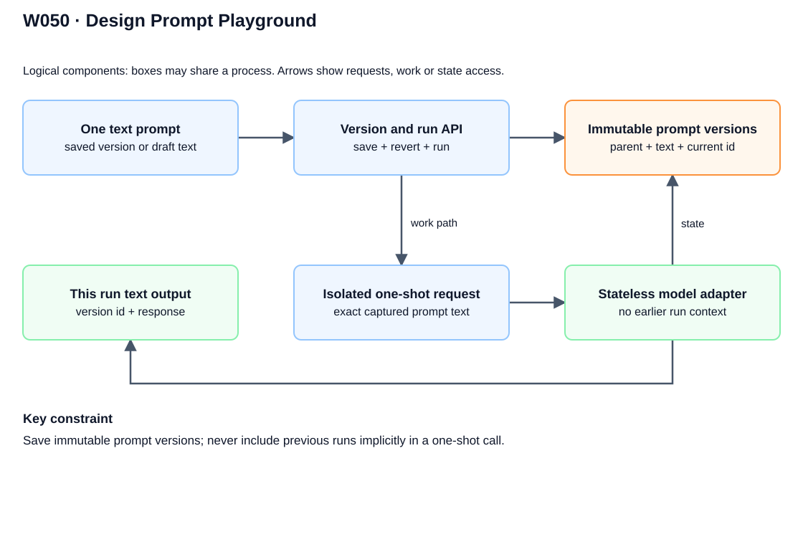

# W050. Design Prompt Playground

**Priority group:** First 100 — very important

**Category:** RAG, agents and application security

**Study position:** 50 of 547

[Group list](../FIRST_100.md) · [All categories](../ALL_CATEGORIES.md) · [Chapter guide](../README.md)

## Question

Prompt Engineering Playground — Interview Question
Background

• Prompt engineering is the process of trying to alter the input prompt for a model in order to make it better at performing a certain task.

• Prompt playgrounds do not operate around conversations.

The goal is to find the best one-off request to the model by trying variants of a message repeatedly and looking at the response. Each run happens separately, and the model has no memory between runs.

• Developing prompts is a process of trial and error.

You might try something that makes the output worse and then want to revert back to an old version to try something else.

• This system is focused on text prompts only, and will never expand to multimodal.

• Example use case from the text:

A user trying to generate a recipe might begin with a simple prompt like “Write me a recipe,” then iteratively refine it with additions like “You are a great chef who has written many cookbooks,” or by including multiple examples of good and bad recipes.

Goal

We want to build a prompt playground service where:

• Users can build and iterate on prompts.

Interview Question

Design a backend system for this prompt playground.

Your design must address the following, directly based on the provided text:

One-off, stateless model calls

Each prompt run must be isolated.
The model should have no memory between runs.

Prompt iteration and versioning

Users must be able to try many variations of a prompt.
Users must be able to revert to previous versions after a bad iteration.

Text-only scope

The system must support *only text prompts*.
The design should explicitly ignore any multimodal considerations.

Usage scenario from the text

Users iteratively refine prompts such as recipe-generation prompts.
The system should support trying improved versions, adding context, or adding examples.

Your task:

• Propose the data model to support iterative prompt development and version tracking.

• Describe the API endpoints needed to run a single prompt (statelessly), save a new iteration, list past versions, and revert to a previous version.

• Explain the architecture needed to ensure each run is independent and the model has no memory.

• Ensure the design matches *only what is explicitly stated in the text*.

Do not add new features beyond what is given above.

## Worked solution

<!-- architecture:W050:start -->
### Architecture and request flow

One captured text prompt runs through a stateless adapter; immutable prompt versions support save/list/revert without implicit conversation history.

[Open full-size diagram](../diagrams/W050_architecture.svg).
<!-- architecture:W050:end -->

### Two entities are enough for prompt iteration

Keep this text-only playground centered on one-off requests. `Prompt{id,owner,current_version_id}` points to immutable `PromptVersion{id,prompt_id,parent_version_id,text,created_at,reverted_from_version_id?}` records. Text includes whatever user-authored role/context/examples they want to test; those are part of that **one prompt**, not implicit conversation history. Saving creates a new immutable version and moves the prompt's current pointer transactionally. Old versions are never overwritten by later edits.

### Exact APIs

`POST /prompts` with `{"text":"Write me a recipe"}` creates a prompt and version1. `POST /prompts/{id}/versions` with `{"parent_version_id":"v1","text":"You are a great chef. Write me a recipe..."}` creates v2. Use an expected current version/revision to detect conflicting edits rather than silently lose an iteration. `GET /prompts/{id}/versions` lists ordered versions and `GET /prompts/{id}/versions/{v}` retrieves exact text.

`POST /prompts/{id}/revert` with `{"version_id":"v1","expected_current_version_id":"v2"}` creates a **new** v3 whose text copies v1 and whose revert provenance names v1, then makes v3 current. This preserves the failed v2 and the act of reverting; alternatively moving the pointer alone is simpler but loses an explicit version event, so choose the copy-as-new-version contract consistently. Invalid/foreign versions fail; stale expected-current returns409 without mutation.

`POST /runs` with `{"prompt_id":"p1","version_id":"v2"}` reads that exact version and returns `{"version_id":"v2","output":"..."}`. For an unsaved variation, the same endpoint can instead accept `{"text":"..."}` under a mutually exclusive request shape. A run request is one text input; running a version does not append previous outputs or implicitly alter/save the prompt. A client retry can use a request id if it needs one result rather than a duplicate billed call; no evaluation/sweep feature is implied.

### Stateless model invocation, durable prompt versions

A small API service validates ownership and text input, reads/saves prompt versions in a relational store, and invokes a model adapter with **only this run's text and fixed service configuration**. No conversation id, earlier run messages, user-memory retrieval or shared mutable model session is supplied. If the provider exposes stateful sessions, create a fresh isolated one per run or use a stateless endpoint. Reusing resident model weights or an exact compatible computational prefix cache does not authorize appending another run's text; application state must not leak between calls.

For the recipe example, v1 asks for a recipe, v2 adds chef context, v3 can add examples, and a revert creates v4 copying v1. Each version can be run independently and returns its own output. If generation fails/timeouts, report that run failure; previously saved prompt versions remain intact. Editing while a run is in flight cannot change its captured text. Basic text-size validation prevents accidental invalid requests; all multimodal inputs are rejected because the scope is permanently text-only.

The corrected diagram is text prompt→version/run API→immutable prompt store plus isolated one-shot model call→that run's text result. No conversation memory, multimodal path, shared-agent tools, benchmark suite, parameter sweep, export or collaboration feature is part of this design.

### Further study

- [F067: Build an LLM evaluation harness.](../07_evaluation_and_data.md#f067)
- [F077: Design tool schemas and validate LLM outputs.](../08_rag_and_agents.md#f077)
- [F090: Design a rate-limited LLM classification pipeline.](../09_ml_system_design.md#f090)
