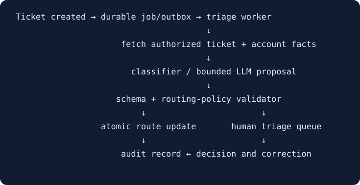

# W053. Design an LLM-Agent System for Automation (Ticket Triage / Code Review)

**Priority group:** First 100 — very important

**Category:** RAG, agents and application security

**Study position:** 53 of 547

[Group list](../FIRST_100.md) · [All categories](../ALL_CATEGORIES.md) · [Chapter guide](../README.md)

## Question

Design an LLM-agent system for an automation task. Confirmed prompts: (a) a ticket-triage agent that reads an alert, gathers context, and proposes a resolution; (b) a code-review agent that reviews a PR diff and produces structured comments.

Be ready to discuss: agent topology (single ReAct loop vs multi-agent pipeline), which steps need an LLM vs deterministic code, the tool catalog (registration, description, rate-limiting, authorization), memory design, the orchestrator (planning loop, retries, max-iteration cap), output validation, cost accounting per ticket/PR, and operational concerns (hallucination detection, idempotent retries, observability).

## Worked solution

### Choose a concrete product

I will design the ticket-triage option. The output is a proposed category, priority, responsible queue and short evidence-backed reason. The system can route routine tickets, but uncertain or consequential cases go to a human. Success means fewer manual routing minutes without increasing missed urgent tickets or repeated transfers.

[Open the architecture diagram](../diagrams/W053_review_architecture.svg).

### Why a small pipeline fits

This task has a predictable path, so start with one orchestrator rather than a team of autonomous agents. Deterministic code handles duplicate detection, account authorization, known outage matching, priority policy and writes. The model handles ambiguous language and produces a typed proposal such as `{category, urgency, queue, evidence_spans, confidence_reason}`. Do not treat its self-reported confidence as a calibrated probability; use validation and measured error rates to choose automation thresholds.

Register read tools such as `get_ticket(id)` and `get_account_facts(account_id)` with narrow descriptions and server-side access checks. A routing tool accepts only allowed queue IDs and an expected ticket version. Tool descriptions explain when a tool is useful; ordinary code still enforces permissions, timeouts and rate limits. Ticket text is untrusted input, even if it says to ignore routing rules.

### State and failure handling

Persist a job containing `ticket_id`, `ticket_version`, model/prompt/policy versions, status, attempt count and proposed decision. Use `(ticket_id, ticket_version, policy_version)` as an idempotency key. Write the decision and outbox event atomically. A worker retry can then return the recorded result instead of routing twice. If a human already edited the ticket, the version check rejects the stale route and re-evaluates current state.

Fetch only authorized facts needed for the current ticket. Recent ticket messages are short-term context; store reviewed past resolutions separately and retrieve relevant examples instead of retaining an ever-growing conversation. Permit one format-repair attempt, cap total model calls and wall time, and send persistent errors to manual triage. An unavailable account service should not silently create a fictional account status.

### Walk through an example and evaluate

“Payments have failed for every customer since the deployment” matches outage evidence. The model proposes the billing-incident queue and cites the relevant sentence; policy validates urgency, the write uses the current version, and an audit entry records the change. “Please reset my invoice email” should not inherit that incident priority merely because it contains a billing word.

Evaluate on a time-separated, reviewed ticket set, reporting urgent-ticket recall, routing accuracy, transfer rate, abstention rate and results by language and customer segment. Online, compare manual handling time and downstream resolution quality. Track cost per ticket as model input/output charges plus tool work, and record p50/p95 latency, retries, human overrides and repeated misroutes. Monitor drift after product launches. The code-review alternative uses the same bounded proposal/validation pattern but replaces ticket facts with a versioned diff, repository context and test results; it requires separate review-quality labels and should publish suggestions against the exact reviewed commit.
