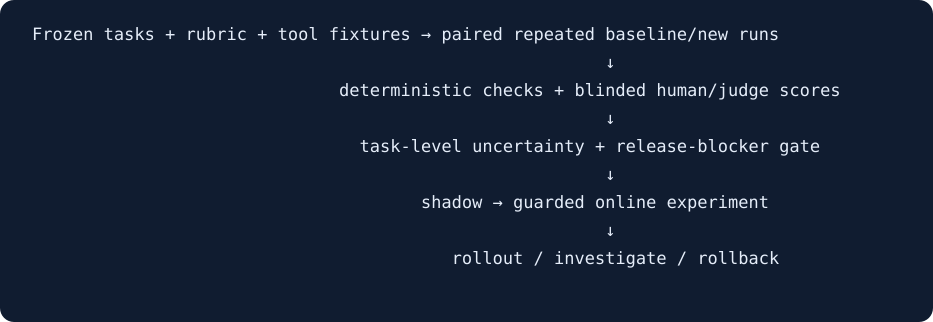

# W054. Evaluating an LLM Agent with Subjective, Nondeterministic Outputs

**Priority group:** First 100 — very important

**Category:** Evaluation, calibration and data quality

**Study position:** 54 of 547

[Group list](../FIRST_100.md) · [All categories](../ALL_CATEGORIES.md) · [Chapter guide](../README.md)

## Question

Design an evaluation framework for an LLM-based agent that is deployed to users and whose outputs are subjective and nondeterministic. There is no single correct answer to compare against, and the same request can produce a different response each time. The framework must tell the team whether a new version of the agent is better or worse than the current one, both before release and after it ships.

### Requirements

1. Quality definition and metrics: turn "a good response" into measurable criteria. Separate objective checks (task completed, valid tool calls, right format, nothing unsafe) from judgment-based quality (helpfulness, tone, usefulness). Say which metrics block a release.
2. Nondeterminism: a score must be a property of the agent version, not of one lucky or unlucky sample. Say how many samples you draw per request, how you compare them, and how you report the result.
3. Offline evaluation: a repeatable evaluation that runs before release on a fixed set of requests. Say where the requests and labels come from, who produces the labels, how the automated graders work, and how you measure the graders' quality.
4. Online evaluation: how you measure quality on live traffic after release, and how you compare two versions in production.
5. Decision rule: how the offline and online results combine into a ship or no-ship decision, with the sample sizes needed for the result to be trusted.
6. Walkthrough: the path of one new agent version from first build to full rollout.
Scope

Keep the agent generic: any LLM agent that takes a user request, may call tools, and returns a response. Training the agent itself is out of scope; state any traffic or labeling assumptions you make.

Follow-ups
Follow-up 1: the LLM judge is over-confident

An LLM used as a judge often reports high confidence and still disagrees with careful human raters. How do you measure how far it can be trusted, and how do you use it anyway?

Follow-up 2: users rarely give explicit feedback

Only a small share of sessions end with a rating, and those that do are skewed toward very happy or very unhappy users. What do you measure instead, and how do you know it reflects quality?

Follow-up 3: the developers' own judgment is biased

The people building the agent tend to rate their own changes favourably and to tune the agent to the examples they look at. How do you keep the evaluation honest?

## Worked solution

### Define what “better” means before running a judge

An agent can produce different good answers to the same request. Evaluate observable success and policy constraints, then use a rubric for the parts that are subjective. For a research assistant, objective checks include valid citations, source access permissions, correct arithmetic and completion of requested sections. Subjective dimensions include usefulness, clarity and whether important evidence was omitted. A fluent answer can fail the objective checks.

Use a 1–5 rubric with concrete anchors and examples for each subjective dimension. Mark release blockers separately: exposing unauthorized data or executing an unauthorized action cannot be compensated by better prose. Version the task set, rubric, tools, model, prompt and budgets so a comparison has a stable meaning.

[Open the architecture diagram](../diagrams/W054_review_architecture.svg).

### Build the offline experiment

Create a held-out mix of common tasks, difficult tasks, known failures and adversarial inputs. Split by user/task family and time to reduce leakage. Include frozen tool responses for reproducibility plus a smaller live-tool set for integration failures. Human reviewers produce reference facts, acceptable outcomes and rubric labels; there need not be one canonical sentence.

Run both versions on the same tasks and budgets. Start with, for example, five independent runs per task, then increase repetitions where variance is high. Five is a pilot choice, not a guarantee of statistical power. Treat the **task** as the sampling unit: runs of the same request are correlated and must not be counted as unrelated users.

For task $i$, let $d_i$ be the new version's mean score minus the baseline's mean score. Estimate

$$\bar d=\frac1n\sum_i d_i,\qquad
\operatorname{SE}(\bar d)=\frac{s_d}{\sqrt n}.$$

Use a task-level paired bootstrap or a suitable paired interval; keep task families clustered when they share data. If a pilot estimates $s_d=0.20$ on a normalized score, detecting a $0.03$ improvement with 80% power at a two-sided 5% level needs roughly $((1.96+0.84)0.20/0.03)^2\approx349$ independent tasks. This planning approximation assumes representative independent tasks; it does not size rare safety-event tests.

### Make automated grading trustworthy

Blind and randomize answer order, hide version identities, test swapped order, and compare judge scores with adjudicated human ratings on an independent sample. Measure disagreement by task type and language. Judge confidence is not evidence of correctness. Audit confident false positives and use deterministic factual checks where possible. Hold rubric examples out of the tuning set so developers cannot optimize only visible examples.

### Decide and roll out

An illustrative predeclared rule is: no critical blocker, lower confidence bound on utility improvement above zero, completion-rate noninferiority within one percentage point, and p95 latency/cost within budget. Choose these margins with product owners before viewing results. Zero critical failures in $n$ independent cases gives an approximate 95% upper rate bound of $3/n$, so zero observed failures alone does not prove safety.

After passing offline evaluation, run a small shadow deployment, then a randomized user-level experiment with a kill switch. Track task completion, retries, user edits, human escalation, latency and cost. Delay expansion until delayed outcomes mature. Sparse thumbs-up ratings are biased toward users who choose to respond; randomly solicit feedback and audit a sample of unrated outputs. For a release walkthrough: investigate citation regressions found offline, fix and rerun the frozen comparison, shadow-test live tools, launch to a small cohort, and expand only when the same prespecified gates hold. Keep a stable control and rollback on a blocker even if average ratings improve.
