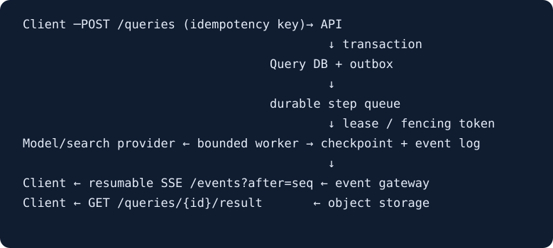

# W055. Design Durable Execution for Long-Running Agent Queries

**Priority group:** First 100 — very important

**Category:** RAG, agents and application security

**Study position:** 55 of 547

[Group list](../FIRST_100.md) · [All categories](../ALL_CATEGORIES.md) · [Chapter guide](../README.md)

<span class="practice-page"></span>

## Question

Design the backend for an AI assistant that answers research questions by running an agent. The agent is a loop that calls a language model and a web search API many times before it writes the final answer. Some questions finish in seconds, others keep working for hours.

Today a single request handler runs the whole loop in memory, so a crashed process, a deploy, a closed browser tab or a dropped connection loses the work. Redesign it so a question, once accepted, is answered even if the user disappears.

In this statement a step is one model or search call together with the checkpoint saved after it.

Current system
1. A client calls an ask endpoint.
2. The endpoint calls an ask service, which loops over the model and the search API (both are black boxes you do not change) and streams tokens back on the same connection.
3. All state lives in the memory of that one process. There is no record that the question ever existed.

### Requirements

1. Durability: once the system has accepted a question, it must run to completion even if the browser tab is closed, the phone loses connectivity, or a worker process dies in the middle of a step.
2. Long runs: a question may run for hours. A deploy or a node replacement must not cancel it.
3. Progress streaming: the client sees progress (the plan, sources found, partial answer text) as it happens. After a disconnect it reconnects, possibly on another device, and continues from where it left off without missing or repeating events.
4. Result access: a user who comes back later, with no connection open, can fetch the finished answer.
5. Control: the user can cancel a question. The system enforces a step budget and a token budget per question.
6. Cost safety: model and search calls cost money. A crash must not make the system pay for the whole question again.
Scale assumptions (assumptions for this exercise, not given facts)

```text
5 million questions per day, 20 minutes on average, peak traffic 3 times the average.
```

About 40 model or search calls per question, and about 200 progress events of 300 bytes each.
A checkpoint after each step is a delta of about 20 KB; a final answer with its sources is about 200 KB.
About 60% of running questions have a client attached at any moment.
Finished answers are kept for 30 days.
Non-goals
Improving answer quality, ranking, or the model itself.
Authentication and billing design (assume a user id and a quota check exist).
Making the model or search calls themselves faster.
Deliverables
1. The API: how a question is submitted, how progress is streamed and resumed, how the result is fetched, how it is cancelled.
2. The architecture and the data model: where state lives and what is stored per question and per step.
3. How execution survives a crash, and what exactly is repeated after one.
4. Back-of-envelope sizing for running queries, workers, checkpoint write rate, event volume and stream connections.
5. Failure behaviour for a worker crash, a lost client, a reconnect storm and a stuck step.
Follow-ups
Follow-up 1: queries that wait for a human, such as a clarifying question, for up to a day.
Follow-up 2: a user starts the same question twice by double-tapping, or the client retries after a timeout.
Follow-up 3: a single query must fan out to 20 parallel sub-agents and join their results.

## Worked solution

### Separate a durable query from a running worker

A research query lasts twenty minutes, but a worker need not remain occupied while a provider runs or a user thinks. Store the workflow durably and schedule its next ready step. The promise is that an accepted query survives worker failure, the user can reconnect, and completed steps are not needlessly repeated.



[Open the architecture diagram](../diagrams/W055_review_architecture.svg).

The acceptance transaction inserts the query and an outbox message together. A relay can publish the message more than once; a unique step ID makes duplicates harmless. Return the durable query ID, not a promise held only in a server's memory.

### Size each resource separately

Use decimal KB in these estimates. Five million arrivals per day means $5{,}000{,}000/86{,}400=57.87$ queries/s on average and $173.61$ at the stated threefold peak. Little's law gives $57.87\times1{,}200\approx69{,}444$ active workflows on average; a sustained peak implies about 208,333. At 60% attached, provision roughly 41,667 average and 125,000 peak live client sessions, with additional headroom for multiple devices if supported.

Forty external calls per query produces 200 million calls/day: 2,315/s average and 6,944/s peak. If each completed call checkpoints a 20 KB delta, writes total 4 TB/day, or 46.3 MB/s average and 138.9 MB/s peak before replication. Two hundred 300-byte events per query gives one billion events/day, 300 GB/day and 11,574 events/s average. A 200 KB final result adds 1 TB/day and 30 TB for thirty days before replication. Keeping *all* deltas and events for thirty days adds 120 TB and 9 TB respectively; compact checkpoints and apply an explicit retention policy.

Active workflows are not the worker count. If an external call occupies a worker for an assumed two seconds, peak call concurrency is roughly $6{,}944\times2=13{,}888$. At 70% target utilization that requires about 19,840 equivalent call slots. Provider concurrency and token limits may impose a lower admission rate. Measure call duration before choosing worker capacity.

### Persist enough state to resume correctly

A query row contains owner, status, current plan version, budget and result reference. Step rows contain parent dependencies, stable operation ID, status, lease expiry, fencing generation, attempt and checkpoint reference. Workers claim ready steps under a lease. A transaction commits the step output, appends uniquely sequenced events and schedules successors. A stale worker cannot commit after another worker has acquired a newer generation.

A crash before commit replays only the uncommitted step. A crash after commit reads the recorded output. An external timeout can leave provider execution uncertain: reuse its idempotency key or query operation status when supported. Without provider support, exactly-once billing cannot be guaranteed. Record uncertainty and reconcile instead of claiming the database can undo a provider charge.

### Reconnects, budgets and extensions

Assign each public event `(query_id, sequence)`. SSE sends the sequence as the event ID; clients reconnect with `Last-Event-ID`, replay events after it, and deduplicate. Persist before publishing. If old events expired, return a snapshot plus a new cursor. An event gateway holds connections, not the research worker. Reopening or double-tapping the submit button uses the same client idempotency key and yields the same query ID.

Before a provider call, atomically reserve its maximum allowed budget; settle actual usage afterward. Bound deadlines, call count, tokens, fan-out and retries. Cancellation sets durable state and prevents new work, while already running calls may still incur charges. A day-long human approval becomes a `WAITING_FOR_USER` workflow state with no occupied worker. Twenty parallel subagents become twenty child workflows with per-child IDs, quotas and checkpoints; the parent joins completed outputs and applies a global budget so parallelism cannot multiply spending without limit.
