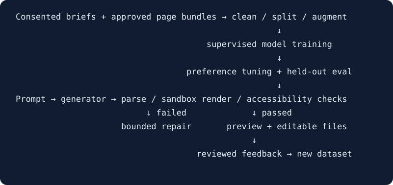

# W056. ML Model Design — Prompt-to-Design Generation

**Priority group:** First 100 — very important

**Category:** RAG, agents and application security

**Study position:** 56 of 547

[Group list](../FIRST_100.md) · [All categories](../ALL_CATEGORIES.md) · [Chapter guide](../README.md)

## Question

ML Model Design — Prompt-to-Design Generation

Design a generative ML system that turns a natural-language description into a design, and walk through its full model lifecycle with the emphasis on data and evaluation.

Choose one of two output framings and justify the choice:

Concept image — a vision-language model that outputs a concept mock of the described screen.
Webpage HTML — a model that outputs renderable HTML/CSS for the described page.
Questions to answer
1. Framing and requirements — the inputs and outputs, what a successful generation means, and the latency and cost targets.
2. Training data — where (prompt, design) pairs come from, how you collect and label them at scale, and how you clean them.
3. Data augmentation — label-preserving transforms on the prompt side and on the design side, and how you keep augmented pairs consistent.
4. Model and training — the model for your framing; supervised fine-tuning versus reinforcement learning from preferences (RLHF, RLAIF or DPO): what each is good for and how you would combine them.
5. Evaluation — how you measure quality when there is no single correct output: programmatic checks, LLM-as-a-judge and its biases, human evaluation, and online product metrics.
6. Serving and iteration — interactive latency, guaranteed-valid output, and the loop from user actions back into training data.
Deliverable

A design that answers parts 1–6 and states the main trade-offs: structured output vs. image, SFT vs. RL, synthetic vs. human data, automatic vs. human evaluation.

## Worked solution

### Define a concrete output

Choose a responsive HTML/CSS page rather than a raster concept image. The input is a design request plus optional approved assets, target viewport, brand tokens and accessibility requirements. The output is a small renderable bundle and a preview. This choice allows text editing, responsive layouts, semantic elements and programmatic checks; it needs browser testing because plausible-looking source can render poorly.

Success combines instruction adherence, visual quality, accessibility, valid rendering and low repair rate. Set example serving targets, such as a useful first preview within ten seconds and a fixed token/repair budget, then measure them under realistic page sizes rather than presenting them as existing performance.

[Open the architecture diagram](../diagrams/W056_review_architecture.svg).

### Build training pairs that teach the desired task

Collect licensed or consented brief/page pairs with screenshots, viewport metadata and assets whose use is permitted. Remove broken pages, secrets, tracking scripts, duplicates and mismatched briefs. Split by template family and site so near-identical layouts do not leak into evaluation. Store a normalized component/DOM representation alongside original source when useful.

Augment a brief and its page consistently: change brand colors in both, replace text while checking overflow, or generate desktop/mobile views of the same layout. Randomly changing the request without updating the target teaches the wrong association. Balance landing pages, forms and content-heavy layouts; quality and diversity matter more than duplicate volume.

### Train in stages and explain the loss

Start with supervised fine-tuning on good pairs. For target code tokens $y_t$ and request $x$, minimize

$$L_{\mathrm{SFT}}=-\sum_t\log p_\theta(y_t\mid x,y_{<t}).$$

Next collect pairwise preferences between renderings using a rubric for adherence, layout, responsiveness and accessibility. DPO is a practical preference-tuning option; RLHF or RLAIF can optimize a learned reward when their added complexity is justified. They are alternatives or later stages, not mandatory ingredients. Automated judges can reward a pretty screenshot that ignores the prompt, so calibrate them against blinded human comparisons and keep deterministic validity checks separate from aesthetics.

### Serve with evidence of validity

Generate in an isolated workspace with a controlled asset manifest. Parse HTML/CSS, reject disallowed scripts/external requests, render in a sandbox at required viewports, check missing assets, overflow, contrast and keyboard navigation. Feed concrete errors into one or two repair attempts. Only advertise a validated preview after these checks; constrained decoding alone does not prove good rendering or accessibility. If repair fails, preserve the draft and report the specific failure.

Evaluate held-out prompts with valid-build rate, requirement coverage, responsive-layout defects, human preference, latency and cost. Online, measure accepted previews, useful edits, regeneration rate and task completion rather than only clicks. Feedback is opt-in, filtered and reviewed before training; edited code is not automatically a superior target. Version model, prompt, assets and validator so regressions can be reproduced and rolled back.
