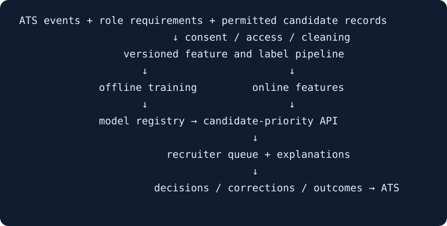

# W057. ML Design: Recruiter Hiring Pipeline Assistant

**Priority group:** First 100 — very important

**Category:** RAG, agents and application security

**Study position:** 57 of 547

[Group list](../FIRST_100.md) · [All categories](../ALL_CATEGORIES.md) · [Chapter guide](../README.md)

## Question

Recruiters each handle several open roles and hundreds of candidates at once, and their time, not the supply of candidates, is what limits hiring. Design an ML-powered assistant for a professional network that helps recruiters move candidates through the hiring pipeline (sourcing, outreach, screening, interview, offer) and get more done with the same hours. Keep each part brief: the goal is one coherent design, not every possible component.

### Requirements

Users are recruiters, each handling several open roles and hundreds of candidates at the same time. Recruiter time is the scarce resource.
The assistant may suggest, rank, draft and remind. A recruiter makes every final decision about a candidate.
Assume the platform holds member profiles, job postings, recruiter actions, messages and the outcome of past hiring processes.
What to cover
1. Problem framing and success metrics: who the users are, what hurts today, what the assistant does, and the metrics that tell you it works (efficiency, quality of hire, and guardrails).
2. Funnel and drop-off analysis: define the pipeline stages, how you measure the drop-off between them, and how you decide where the assistant should intervene first.
3. Data and labels: which signals and labels you use, how you handle delayed, missing and biased outcomes, and how you build training examples.
4. Candidate-prioritization ranking model: the model that orders candidates for a recruiter, including features, objective, how it differs between stages, and how it copes with cold start.
5. System architecture: from event ingestion to the screen the recruiter sees, covering offline and online components, latency and refresh.
6. Evaluation: offline metrics and validation, then online experiments, including how you measure a recruiter-facing tool when outcomes arrive weeks later.
7. Risks: fairness, feedback loops, privacy, and what you monitor after launch.
Deliverable

A structured design discussion that covers all seven parts, with the trade-offs you chose and the ones you rejected.

## Worked solution

### Start with the recruiter's bottleneck

The assistant helps a recruiter decide which permitted candidate records to review next for each role and what follow-up is overdue. The recruiter makes hiring decisions. Optimize qualified candidates advanced per recruiter hour, while protecting candidate experience, job-relevant evaluation and downstream hire quality. Faster outreach alone can create more low-quality work.

Map the funnel: sourced → contacted → response → screen → interview → offer → accepted. Measure stage volume, wait time and conversion by role. If recruiters already have many qualified responses but screens wait a week, improving sourcing is the wrong intervention; prioritize screen scheduling and reminders first.

[Open the architecture diagram](../diagrams/W057_review_architecture.svg).

### Labels and model

Use stage-specific outcomes with explicit observation windows: a relevant response, a completed qualified screen, an interview, an accepted offer. Hiring outcomes arrive late, and “not contacted” does not mean “unqualified.” Historical decisions reflect which candidates earlier recruiters chose to inspect. Preserve exposure and recruiter-action logs, account for censoring, and audit labels rather than training a model to reproduce every past rejection.

A first model can rank eligible candidates using a gradient-boosted tree with role-skill match, stated experience relevant to the role, stage age, contact history and candidate preferences. Exclude protected characteristics and unjustified proxies; do not infer them from names or photos. Missing information should remain missing rather than being replaced with invented qualifications. Calibrate stage-specific response/progression estimates on later cohorts.

One useful prioritization score is expected qualified progress divided by estimated recruiter effort, with explicit urgency and contact-frequency constraints. A cold-start role can use structured requirements and broad skill matching; a new candidate can be reviewed without an engagement history. An LLM can summarize evidence linked to the original record, but its unsupported summary is not a hiring signal.

### Serving and measurement

Use batch scoring for large role pools and incremental rescoring after a role change, candidate reply or stage transition. The API returns candidate IDs, recommended next actions, freshness and evidence references. Permission filters run before records reach the model and again before display. Apply role-specific contact limits and suppress candidates who opt out. Version scores so recruiters can understand why a queue changed.

Offline, use time-separated role/candidate cohorts and metrics such as qualified-screen recall at the number a recruiter can review, ranking quality, calibration and subgroup error audits. Online, randomize at a level that limits recruiter spillover, then compare time saved and qualified screens per hour. Wait for mature interview/offer outcomes; monitor outreach complaints, repeated contacts and candidate drop-off. A short-term increase in replies is insufficient evidence of better hiring.

Show recruiters the evidence and let them correct recommendations. Log overrides without assuming every override is ground truth. Regularly audit performance across relevant groups using appropriately authorized audit data, minimize retained personal data, and provide correction/deletion paths. Keep protected audit information separate from ranking features and limit its access. These controls directly address the risk of accelerating biased historical behavior.
