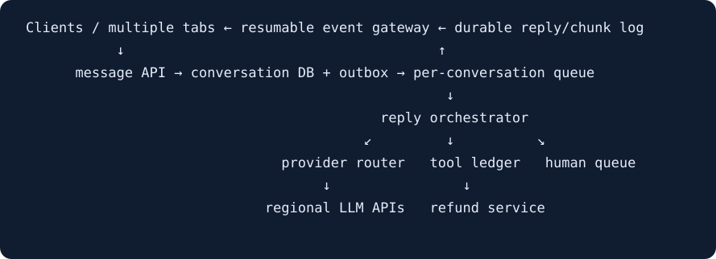

# W058. Design an LLM-Backed Customer-Service Chat System with Failure Handling

**Priority group:** First 100 — very important

**Category:** RAG, agents and application security

**Study position:** 58 of 547

[Group list](../FIRST_100.md) · [All categories](../ALL_CATEGORIES.md) · [Chapter guide](../README.md)

## Question

Design a customer-service chat system in which an AI agent answers customers. The agent's replies are generated by an external LLM provider that your company does not operate, and the replies are streamed to the customer as they are generated.

Scale and assumptions
1. Traffic: 50,000 conversations are active at peak. In an active conversation the customer sends a message about every 20 seconds.
2. Replies: an average reply is about 300 tokens, and the provider streams about 50 tokens per second.
3. Clients: customers use a web widget or a mobile app. Their networks can be slow or drop for seconds at a time.
4. Provider: the external LLM API has rate limits, occasional elevated error rates, slow first tokens and streams that stop mid-reply. A second provider (or a second region of the same provider) is available as a fallback.
5. Actions: the agent can call internal tools, for example to look up an order or issue a refund.
6. Handoff: a conversation can be escalated to a human agent.
Parts to address
1. Happy path, end to end: trace one customer message from the client to the agent, through the LLM call and any tool calls, and back to the customer as a streamed reply. Name every component, what it stores, and what the client sees at each step.
2. Pub/sub message flow: how messages and streamed reply chunks are published and delivered to the customer's connection (and to a human agent's console when one joins). Cover what happens when the customer has more than one tab or device open.
3. Failure handling (the main focus):
The LLM provider partially fails: a share of calls error out, calls are rate limited, or the first token does not arrive in time.
A stream is cut off in the middle of a reply.
The provider is down for minutes.
The customer's network breaks, during a send or during a streamed reply, and later reconnects.
4. Retry policy: when and how to retry, including exponential backoff with jitter, a cap on the delay, a limit on total retries, and a deadline per customer turn. Show the expected delay of each retry.
5. Client-side handling: what the client does on a failed send, a lost connection and a half-received reply, and what the customer sees.
Deliverables
1. The architecture and the message flow for the happy path.
2. The data model for conversations, messages and reply chunks.
3. Capacity estimates: LLM calls per second and the number of open streams.
4. A failure table: each failure, how it is detected, what the system does, and what the customer sees.
5. The retry parameters you choose, with the numbers behind them.

### Constraints

A customer must never be charged, refunded or otherwise acted on twice because of a retry.
A customer must never see the same message twice or see a reply with a gap in it.
Retries must not make a provider outage worse.

## Worked solution

### Work out the traffic before drawing services

With 50,000 active conversations and one user message every twenty seconds, the arrival rate is $50{,}000/20=2{,}500$ messages/s. A 300-token reply at fifty tokens/s takes six seconds to emit, so approximately 15,000 simultaneous model generations and 750,000 output tokens/s are needed before first-token delay, tool calls or retries. At least 50,000 client connections are open if each conversation has one attached device. Provider quotas, burstiness and region-failover headroom must be provisioned explicitly; failover does not create free capacity.

[Open the architecture diagram](../diagrams/W058_review_architecture.svg).

### Data model and client contract

`POST /conversations/{id}/messages` accepts a client-generated idempotency key. Store one user message and outbox event in a transaction. Each conversation has an ordered sequence; only one authorized writer owns its next assistant turn. A reply has a stable logical ID and explicit attempts. Persist chunks under unique `(reply_id, attempt_id, sequence)` keys before publishing them.

Clients subscribe by conversation and cursor. A gateway fans events out to multiple tabs, replays after reconnect and deduplicates by IDs. The UI shows queued, connecting, streaming, retrying, completed or handed-off status. Transport delivery may repeat; the logical message displayed to the user must not. If a cursor has expired, fetch the current conversation snapshot.

### Recover without duplicating effects

| Failure | Server action | User-visible behavior |
|---|---|---|
| Rate limit before output | Honor retry hints, bounded queue/backoff, choose available permitted region | Waiting/retrying status |
| Timeout before output | Cancel or mark old attempt uncertain; start another attempt within budget | No duplicate assistant bubble |
| Provider fails mid-stream | Mark partial attempt interrupted; regenerate as a **new attempt** | Replace/clearly restart the partial reply; never splice an unrelated continuation |
| Client disconnects | Continue under policy and persist output | Replay missing chunks after reconnect |
| Region unavailable | Circuit-break, route within quota, shed load if necessary | Explicit delay or handoff |
| Refund call times out | Query ledger/provider status under the same operation ID | Pending refund status, never a new blind refund |

A tool ledger records `operation_id`, authorized amount, status and durable result. A refund idempotency key must reach the refund service itself. If it does not support idempotency or status lookup, uncertain execution needs reconciliation; a local retry counter cannot ensure one financial effect. A human handoff acquires ownership of the conversation and prevents a late model reply from racing the agent's response.

### Bound retries and monitor the whole path

Use exponential full jitter: retry $i$ waits uniformly in $[0,\min(b2^i,c)]$. With $b=0.2$s, cap $c=2$s and three retries, maximum waits are 0.2, 0.4 and 0.8 seconds, expected total 0.7 seconds. Provider retry hints and the remaining request deadline can override this schedule. Repeated attempts consume a global retry budget; otherwise a provider outage multiplies the original 2,500/s demand. Add admission control, circuit breakers and bounded queues.

Track time to first token, full response latency, active model streams, queue age, chunk replay gaps, tool uncertainty, handoff time and duplicate-operation rejection. Alert separately on provider failures and client delivery failures. The invariant is one durable logical turn and one recorded tool operation, with replayable delivery; it is not a claim of exactly-once network transport.
