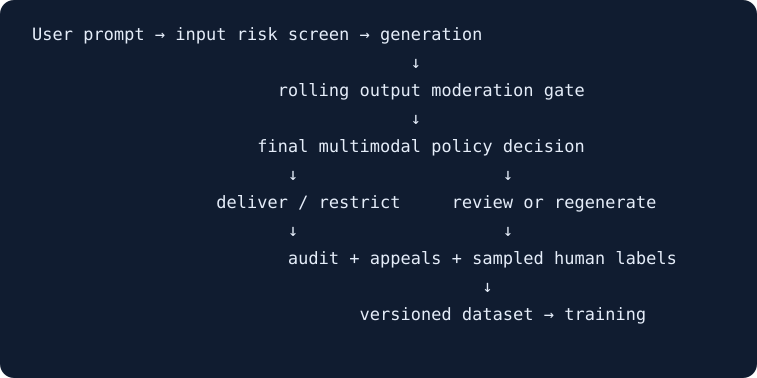

# W059. ML System to Detect Harmful LLM Content

**Priority group:** First 100 — very important

**Category:** Production ML and product design

**Study position:** 59 of 547

[Group list](../FIRST_100.md) · [All categories](../ALL_CATEGORIES.md) · [Chapter guide](../README.md)

## Question

Design an ML system to detect harmful content produced by an LLM. The system feeds a content-moderation pipeline. Cover: data collection and labeling quality, model choice across modalities, evaluation under heavy class imbalance, deployment for both online and offline content, online monitoring, adversarial drift, and — the distinctive part of this round — the policy and human-in-the-loop dimension: how model predictions map to auto-action thresholds vs. human review queues, how labeling feedback closes the loop, and how the system stays aligned with evolving content policy. Discuss scalability, reliability, and the precision/recall trade-off across harm categories.

## Worked solution

### Turn policy into measurable decisions

The system screens generated text, images and other supported modalities for specific policy categories. First define which categories require blocking, rewriting, restricting distribution, adding support resources or human review. Context matters: a supportive response discussing self-harm should not be removed solely because it contains a self-harm term.

[Open the architecture diagram](../diagrams/W059_review_architecture.svg).

### Data and model

Build a policy-versioned, multilabel dataset with contextual examples, benign lookalikes, multilingual data and adversarial paraphrases. Reviewers need decision guidelines, independent duplicate labels and adjudication for disagreement. Minimize sensitive retained data and restrict reviewer access. Include model-generated failures as hard examples, but keep near duplicates and generator families separated from held-out evaluation.

Start with rules for high-precision known patterns and a trained text classifier for contextual categories. Images need image models; video needs sampled frames plus audio/transcript and temporal aggregation. Cross-modal evidence can change the meaning of a single frame or sentence. Evaluate the combined decision, not merely each independent detector.

For a rare category, accuracy is misleading. Report per-class precision/recall, PR curves, false-negative rate on high-severity cases, calibration and performance by language/domain. Choose a high threshold for automated blocking when false positives are costly and a lower threshold for review when capacity permits. If the desired precision and recall are not simultaneously achievable, change the model, review capacity or policy; do not claim threshold tuning can overcome the measured ROC/PR curve.

### Make generation-time screening real

For streaming text, buffer a small window, classify it with the preceding context, then release approved chunks. This increases latency but avoids displaying every unsafe token before a final scan. Recheck the completed response because a harmful instruction may span chunks. A final block cannot erase content already displayed, so define which risks require full buffering. Tool outputs and retrieved text also require appropriate screening before being shown or used in consequential actions.

Store content/version hashes, model scores, policy/threshold versions, selected action and review outcome. Appeal decisions and sampled allowed outputs supply false-positive and false-negative evidence. Review queues prioritize severity, uncertainty and reach while respecting capacity. Monitor prevalence changes, adversarial drift, queue age, appeal reversals, per-class quality and serving latency. Shadow new classifiers, audit disagreements, then canary with rollback. Updating policy requires versioned relabeling and, where appropriate, rescanning stored content; it is not just changing a dashboard label.
