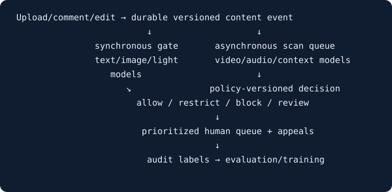

# W060. Designing a Harmful Content Detection System

**Priority group:** First 100 — very important

**Category:** Production ML and product design

**Study position:** 60 of 547

[Group list](../FIRST_100.md) · [All categories](../ALL_CATEGORIES.md) · [Chapter guide](../README.md)

<span class="practice-page"></span>

## Question

Design a system that detects harmful content on a large photo and video sharing social platform. Users upload images, videos and text (captions and comments); some of it is hate speech, harassment, nudity, self-harm or misinformation. The system must flag it automatically across all modalities, act on the clear cases, and send uncertain cases to human reviewers.

### Requirements

1. Handle multi-modal content: an image with its caption, a video with its comments, and text alone.
2. Cover these harm classes: hate speech, harassment, nudity, child safety, self-harm or suicide, and misinformation.
3. Provide two latency tiers. The pre-publish check on uploads returns within 2 seconds at p99, with the outcome block, allow, or publish with limited reach while the check continues. The post-publish check covers everything else, such as comments, edits and re-evaluation under new policies, and finishes within 5 minutes.
4. Automated moderation with a fallback to human review: clear violations are actioned automatically, borderline items go to a review queue.
5. Support model retraining with human feedback and new data.
6. Allow auditing: every decision can be explained and reproduced later.
Scale and targets (design for these)

```text
100 million uploads per day (images and short videos) and 1 billion comments per day.
```

Target precision of at least 95% for automatic removal. For the severe classes (child safety, nudity, self-harm) the target is at least 90% recall at that precision, where for self-harm the action is flagging for support and review rather than removal.
A reviewer team that can handle 200,000 items per day.
What to cover
1. Data and labels: sources, label taxonomy, multi-label support, label quality.
2. Architecture: ingestion, per-modality models, fusion, decision service, review queue, actions.
3. Models: where to use cheap classifiers, and when to use large language models or vision-language models.
4. Training and evaluation: offline metrics per class, online metrics, bias and fairness checks.
5. Serving: latency budget and cost per item at the scale above.
6. Human review: queue prioritization and feedback into training.
7. Auditing: what is recorded for each decision.
8. Monitoring, drift, and trade-offs.

## Worked solution

### Define decisions and capacity

The synchronous path must decide allow, block or limited reach within a measured p99 of two seconds. A separate asynchronous path revisits edits, richer evidence and policy changes within five minutes. Treat severe self-harm signals according to the specified support/review policy; do not automatically map every severe category to removal.

The traffic is 100 million uploads plus one billion comments per day: about 1,157 uploads/s and 11,574 comments/s, or 12,731 events/s on average. Provision bursts separately. The 200,000/day human budget is only 2.315 reviews/s, about 0.01818% of 1.1 billion events—one in 5,500. A review item may aggregate duplicate events, so track unique cases as well as raw event counts.



[Open the architecture diagram](../diagrams/W060_review_architecture.svg).

### Meet the latency and freshness requirements

Run independent low-cost detectors in parallel and reserve explicit budgets for ingestion, feature lookup, inference, policy decision and network overhead. For example, a proposed critical-path budget of 150+150+1,200+100+200=1,800 ms leaves 200 ms slack. These are design allocations, not a proof that component p99 values add to an end-to-end p99; load-test the entire path and its dependency correlations.

An upload needing expensive video analysis can receive limited reach while the asynchronous scan runs. Every decision is keyed by content ID and version. A result for an old edit cannot overwrite a newer version. Queue deadlines and age alarms enforce the five-minute requirement; scale or choose an explicitly defined conservative fallback when lag rises. Policy changes enqueue affected stored versions rather than waiting for new traffic.

### Explain the quality targets honestly

Use multilabel models with category-specific thresholds and a separate policy-action layer. Validate at least 95% precision for automated removal and the requested 90% severe-category recall at that precision, with confidence intervals on representative data. It may be impossible for the initial model to satisfy both. Increasing human review helps only within its capacity; declare an unmet constraint rather than asserting success.

For prevalence $\pi$, precision is

$$\frac{\mathrm{TPR}\,\pi}{\mathrm{TPR}\,\pi+\mathrm{FPR}(1-\pi)}.$$

At $\pi=0.001$ and TPR 0.9, 95% precision requires FPR at most about $4.74\times10^{-5}$. This illustrates why an apparently small false-positive rate can still overwhelm removals. Measure prevalence and quality by category and locale; one global threshold hides severe-class failures.

### Spend review capacity deliberately

Prioritize suspected severe cases by severity, uncertainty, likely reach and urgency. Deduplicate related reports and reserve capacity for appeals and random audits of allowed content. Uncertainty sampling alone misses confidently wrong predictions; random allowed-content review estimates false negatives. Cap queue admission and define overflow behavior, especially for high-severity cases, rather than allowing an infinite backlog.

Maintain annotation guidelines, adjudication and reviewer quality checks. Store input/version hash, relevant evidence, scores, thresholds, model/policy versions, action and appeal outcome under restricted access. Evaluate multimodal and multilingual slices, adversarial edits and disparities. A deployment progresses through shadow disagreement analysis and a guarded canary; monitor precision, severe recall estimates, queue age, reversal rates, p99 latency and five-minute completion. Roll back regressions independently of whether overall accuracy improved.
