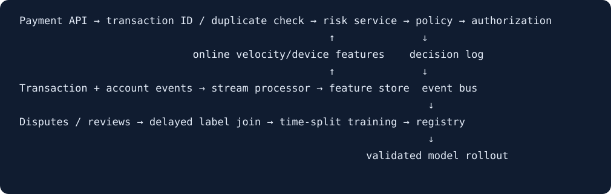

# W061. Design an ML Fraud Detection System

**Priority group:** First 100 — very important

**Category:** Production ML and product design

**Study position:** 61 of 547

[Group list](../FIRST_100.md) · [All categories](../ALL_CATEGORIES.md) · [Chapter guide](../README.md)

## Question

Design a machine learning system to detect fraudulent transactions on a payments platform. The round blends ML system design with traditional system design, with heavy emphasis on end-to-end architecture and how it serves at scale.

Cover both:

ML topics: data gathering/cleaning/preparation; model choice; handling class imbalance (fraud is rare); success metrics; deployment; post-launch maintenance/monitoring.
Infrastructure: scalability, reliability, throughput for a massive transaction volume; be ready to draw the full architecture (databases, servers, data flow).

## Worked solution

### Define the decision and its cost

Score a payment before authorization and choose allow, challenge or reject. Confirm the allowed extra latency, peak transaction rate, geographical requirements and which losses are counted. Optimize prevented fraud loss after subtracting customer friction, lost legitimate sales and review cost. A chargeback label arrives later than the transaction and may reflect disputes other than fraud.

[Open the architecture diagram](../diagrams/W061_review_architecture.svg).

### Build point-in-time training data

Join transaction, account, merchant and device facts as known at authorization time. Useful features include amount relative to the account's history, account age, device novelty, recent failed attempts, merchant risk and cross-account device velocity. Deduplicate transaction events, preserve missingness, and prevent future chargeback or post-decision information from leaking into features. Keep late-arriving labels out of prematurely classified negatives.

Start with rules plus gradient-boosted trees on tabular features. Compare a neural or graph-enhanced model when shared-device/account relationships provide measurable gains. Fraud imbalance calls for class weighting or negative downsampling during training, with correction/calibration on representative prevalence. Never report evaluation on an artificially balanced test set as production precision.

Measure PR-AUC, recall and fraud value caught at a fixed false-positive/challenge rate, expected monetary loss, calibration and subgroup/merchant slices. Use chronological splits, leave an appropriate label-maturation gap and consider entity grouping to assess generalization to new fraud rings.

### Serve, fail and improve

Keep model weights local to horizontally scaled risk workers; precompute aggregates in a low-latency feature store and update velocity features from streams. Attach freshness timestamps and choose documented missing-feature defaults. Let peak QPS be $Q$, per-instance tested capacity $q$ at the latency target and utilization target $u$; provision at least $\lceil Q/(qu)\rceil$ instances plus failure headroom. “Massive volume” is not a numerical capacity requirement, so ask for $Q$ and benchmark $q$.

A transaction ID makes repeated scoring auditable; it does not by itself prevent duplicate payment authorization, which belongs to the payment ledger. On feature timeouts, use a tested reduced-feature model or risk-tier policy rather than silently allowing everything. Shadow new versions, then canary with rollback. Monitor score shifts, missing/stale features, model latency/errors, challenge completion, mature fraud loss and legitimate declines. Route uncertain cases within review capacity and audit allowed payments to detect blind spots. Retrain with delayed, reviewed outcomes and investigate adversarial adaptation instead of treating drift alerts as automatic retraining orders.
