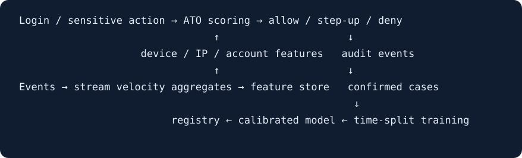

# W062. Design an Account Takeover Prediction System

**Priority group:** First 100 — very important

**Category:** Production ML and product design

**Study position:** 62 of 547

[Group list](../FIRST_100.md) · [All categories](../ALL_CATEGORIES.md) · [Chapter guide](../README.md)

## Question

Design a machine learning system to predict Account Takeover (ATO) risk for a payments platform. ATO occurs when an attacker steals login credentials or uses a fake identity to break into a real user's account. The prompt is deliberately open-ended — clarify rules and requirements up front.

The interview covers three areas:

Modeling (~20 min): feature engineering (login time/location/device, transaction amount and velocity, IP/network signals), preprocessing (missing values, scaling, categorical encoding), model choice and evaluation metrics, and risks (class imbalance, duplicate/leaky features, overfitting).

System (~15 min): architecture (ingestion, feature store, model serving, health monitoring), low-latency inference at high QPS, handling data-fetch delays, live model updates, and production monitoring of both prediction quality and system speed.

Business value (~15 min): proving impact (fewer compromised accounts, higher trust), the cost of false positives (blocking a legitimate user), and future improvements.

Follow-up on data splitting: how to train on heavily imbalanced data — oversampling, SMOTE, stratified sampling.

## Worked solution

### Clarify account takeover

Predict whether the current login or account action is controlled by an attacker. Ask whether the decision occurs at login, account-setting changes or payment, what challenge methods exist, and the latency/false-positive budget. ATO differs from payment fraud: a new device may be a legitimate owner, and a low-value login can precede a high-value theft.

[Open the architecture diagram](../diagrams/W062_review_architecture.svg).

### Features, preprocessing and labels

Use device novelty, recent credential failures, IP/network reputation, impossible-travel estimates, hour relative to usual activity, password-reset recency, account age, transaction amount deviation and velocity. Treat VPNs, shared networks and travel as noisy evidence rather than proof. Collect labels from confirmed compromises, recoveries and adjudicated investigations; a blocked login is not automatically an attacker.

Deduplicate repeated events and join only facts available before scoring. Add missing-value indicators, encode categories with training-only vocabularies and scale continuous inputs for linear/neural models. Trees usually need no scaling. Remove near-duplicate or post-outcome features that inflate offline quality. Start with boosted trees and compare a calibrated logistic baseline; add sequence/graph models only if they improve the intended decision.

### Handle imbalance without leaking

Use chronological train/validation/test periods with enough label delay and evaluate important user/device splits. Preserve real prevalence in validation and test. Class weighting or training-only negative downsampling is a practical first choice. Oversampling must happen **after** the split; otherwise copies can land in both training and test. SMOTE can create unrealistic mixtures of IP/device categorical features and should not be the default for this event data. A stratified random split preserves class proportion but does not protect against temporal leakage or repeated-user overlap.

Report PR-AUC, recall at a fixed legitimate-user challenge rate, calibrated probability, confirmed loss and account recovery burden. Choose thresholds using the cost of an undetected compromise versus a challenge or false block. Where uncertainty is manageable, step-up authentication is less disruptive than denial.

### Production and business proof

Keep a low-latency online feature store and in-process model, with versioned schemas and an atomic model switch. Bound feature lookups; fall back to an evaluated reduced-feature model or explicit risk-tier policy when signals are unavailable. Monitor p95/p99 latency, QPS, timeouts, feature age and score shifts alongside delayed confirmed ATO, legitimate-user lockouts and challenge abandonment.

Use a guarded experiment on eligible traffic, preserving strong protections for high-risk actions. Measure fewer confirmed compromises and lower loss together with successful legitimate logins, support contacts and trust/recovery outcomes. Interpret early results cautiously because compromise confirmation is delayed. Future work includes better device linking, sequence signals and friction-aware challenges, with access limits and retention rules for sensitive login data. Retraining and canary deployment must keep calibration and customer-friction guardrails intact.
