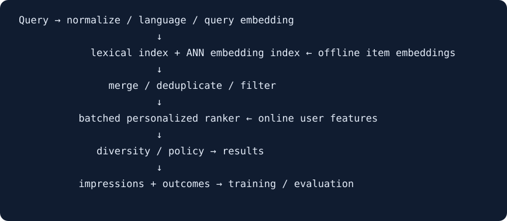

# W063. ML System Design: Search & Ranking

**Priority group:** First 100 — very important

**Category:** Production ML and product design

**Study position:** 63 of 547

[Group list](../FIRST_100.md) · [All categories](../ALL_CATEGORIES.md) · [Chapter guide](../README.md)

## Question

Family of design prompts: Pin search, Pin ranking, home-feed retrieval, search input suggestions. Interviewers expect a candidate-generation -&gt; ranking stage architecture with explicit embedding sourcing, loss choice (pair-wise vs point-wise), offline metrics, and candidate-pool sizing math.

### Requirements

Design one of:

A search engine for Pins (the most common framing): candidate generation, ranking, query understanding, personalization.
Pin ranking / home feed: surface relevant pins to a user in real time, responsive to engagement.
Search input suggestions / typeahead: low-latency query autocompletion with personalization signal.
A recommender system end-to-end: data storage, candidate generation, ranking model serving.

The interviewer typically asks for explicit answers to: How do you efficiently generate candidates? What models / loss function (pair-wise vs point-wise vs list-wise)? What features and how are they constructed? Offline vs online metric? How many candidates pass to the ranker (justify the number)? Where is data stored / how are models served? For a 60GB GPU, how do you compute the serving batch size?

### Notes

The standard reference architecture: two-tower retrieval (user tower, item tower; dot-product similarity) for candidate generation, plus a heavier ranker (DLRM / DCN / MMoE) for the top-N candidates. Pinterest's published PinSAGE / PinnerSAGE family is the relevant embedding work.
Candidate-count math: candidate pool is sized as inference_complexity_per_item x items_per_inference_batch x number_of_instances against the per-request latency budget. Be ready to derive it from a stated 100ms latency budget.
Batch size for a 60GB GPU: model weights + activation memory + intermediate buffers must fit; max_batch = (60GB - weights - KV) / activation_per_sample.
Embedding training is the most common driver: positive pairs (co-engaged pins, user-pin engagement), negative sampling (in-batch negatives, hard negatives), label-noise handling.
Pair-wise (BPR / RankNet) for ranking with implicit feedback; point-wise (cross-entropy on click) for retrieval when calibrated probabilities matter.

## Worked solution

### Pick Pin search and define the stages

Given a query and permitted user context, return relevant Pins within an assumed 100 ms serving budget. Use lexical and embedding retrieval for broad recall, a heavier ranker for relevance/engagement, and a final diversity/policy pass. The other proposed products need different targets: a home feed has no explicit query, while typeahead prioritizes prefix matching and much tighter latency.

[Open the architecture diagram](../diagrams/W063_review_architecture.svg).

### Train retrieval and ranking differently

Build item embeddings from Pin text/images and co-engagement data; build a user/query representation from permitted history and the current query. Train retrieval on positive query–Pin or user–Pin pairs with sampled/in-batch negatives. A contrastive softmax loss makes positives score above sampled alternatives. Filter accidental positives among negatives and add hard negatives carefully. Graph/co-engagement representations can complement content embeddings, particularly for established items; content is essential for cold starts.

The ranker combines lexical match, embedding similarity, user/item features, freshness and quality. Pointwise binary cross-entropy on clicks can estimate click probability **after** accounting for exposure and calibration. Pairwise RankNet/BPR losses prefer a positive over a negative:

$$L_{\mathrm{pair}}=-\log\sigma(s^+-s^-).$$

A listwise loss can optimize a whole displayed slate. Pairwise scores are not automatically calibrated probabilities, and retrieval is not restricted to pointwise training. Choose the objective for the stage and target, rather than memorizing one loss per architecture.

### Derive candidate and memory budgets

Suppose measured non-ranking work consumes 45 ms of the 100 ms budget and the ranker processes 64 candidates in 8 ms. With no extra overhead, at most $\lfloor55/8\rfloor\times64=384$ candidates fit sequentially on one reserved lane. Start around 300 and validate tail latency under contention. Parallel lanes reduce per-request latency only when spare capacity exists; multiplying instance count alone does not make each request faster. Measure recall@K to see whether that pool preserves relevant items.

For a 60 GB GPU, estimate

$$B_{\max}\le\left\lfloor\frac{60-W-R}{A}\right\rfloor,$$

where $W$ is resident weight/embedding memory, $R$ is runtime/workspace/reserve and $A$ is measured incremental activation memory per example, all in consistent units. A feed-forward ranker normally has no autoregressive KV cache. With illustrative $W=12$ GB, $R=8$ GB and $A=0.05$ GB, memory permits 800 examples, but latency may require a much smaller batch. Load-test dynamic batching and queue delay.

### Storage and evaluation

Keep versioned training tables in object storage, item vectors in sharded ANN indexes, lexical documents in a search index and hot user/item features in an online store. Publish model and embedding-index versions compatibly. Evaluate retrieval recall, ranker NDCG and slices for rare queries/new Pins, then run an online experiment on useful saves/long-term satisfaction with latency, diversity and negative-feedback guardrails. Log the actual displayed slate and its propensity/exploration context to reduce position and feedback bias.
