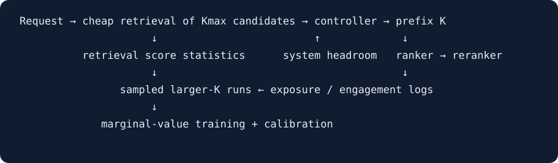

# W064. ML System Design: Dynamic K in Retrieval Stage

**Priority group:** First 100 — very important

**Category:** Search and retrieval systems

**Study position:** 64 of 547

[Group list](../FIRST_100.md) · [All categories](../ALL_CATEGORIES.md) · [Chapter guide](../README.md)

## Question

In a recommendation stack (retrieval, then ranking, then re-ranking), the retrieval stage hands a fixed number K of candidate items to the ranking stage for every request. A static K wastes ranking compute on easy requests and starves ranking on ambiguous ones. Design a model or system that chooses K dynamically for each request.

### Requirements

Your design must cover these parts:
1. Goal metric: define how you decide that the chosen K was right for a request, and which guardrail metrics (latency, ranking cost, engagement) bound it.
2. Model output: decide whether the model predicts K directly or predicts a per-candidate quantity from which K is derived, and justify the choice, including where the training labels come from.
3. Features: list the request-level, session-level, retrieval-stage and system-level signals the controller uses.
4. Calibration and thresholds: explain how scores are made trustworthy enough to turn into a count, and how the threshold is tuned.
5. Serving and safety: explain how worst-case latency is bounded, how the controller stays cheap, and how the learning loop is run.
6. Evaluation and trade-offs: give an online experiment plan and compare static K with dynamic K, including failure modes.

### Constraints

Ranking cost grows roughly linearly with K; p99 latency is a hard ceiling.
The controller adds negligible latency compared with the compute it saves.
A regression in downstream engagement must be caught before full rollout.

## Worked solution

### Choose the smallest useful candidate count

The controller should save ranking work while preserving downstream value and a hard latency limit. Start with a small menu, for example $K\in\{100,200,400,800\}$, rather than regressing an arbitrary integer that may be unstable or unsupported by training data.

[Open the architecture diagram](../diagrams/W064_review_architecture.svg).

### Learn a quantity with an interpretable decision

For each adjacent menu step, predict the expected marginal gain from adding that block of candidates. Offline, run the expensive downstream ranker on a sampled maximum pool and compare the best final slates attainable at each K. That provides a teacher signal, but is limited to the maximum retrieved pool and inherits the teacher's biases. Online engagement labels require randomized exploration or suitable propensity-aware estimation: unranked candidates do not have observed clicks.

A policy can select

$$K^*=\arg\max_{K\in\mathcal K,\ T_{99}(K)\le D}
[\widehat U(x,K)-\lambda C(K)],$$

where utility comes from the downstream task, $C$ is measured ranker cost and $D$ is the latency ceiling. Predicting marginal gains makes the reason for spending another block understandable. Direct multiclass prediction of the best menu item is a simpler alternative, but its labels still need reliable counterfactual comparisons.

### Features and calibration

Use query ambiguity, user/session history length, current intent, retrieval-score gaps/entropy, source disagreement, candidate diversity and recent repetition. Include current queue depth, available ranker capacity and feature freshness. A controller that saves 5 ms but itself consumes 10 ms fails the purpose; use a tiny tree or shallow model and precomputed statistics.

On held-out requests, group predicted marginal gains and compare them with measured gains. Calibrate by request type and time, especially for tail queries and cold users. Tune $\lambda$ and menu boundaries against a utility–cost frontier, then validate latency on production-like load. A probability threshold alone is insufficient unless the predicted event and its relation to downstream value are defined.

### Enforce safety outside the model

Clamp K between a minimum-quality floor and a capacity-dependent hard maximum. Reserve time for feature retrieval, reranking and network overhead; if the controller fails, use a tested static K. A fixed Kmax retrieval still costs something, so include it when estimating total savings. Avoid rapidly changing K with noisy queue depth; use bounded adjustments and stable admission control.

First shadow the policy and measure recall loss, ranking cost and tail latency. Then randomize users/requests as appropriate between static and dynamic K with a small exploration allocation. Primary success is lower cost at prespecified engagement noninferiority, or higher engagement at equal cost. Monitor rare-intent slices, p99, fallback frequency and controller drift. Roll back if it repeatedly starves ambiguous queries, learns from biased exposure labels or increases p99 during load spikes.
