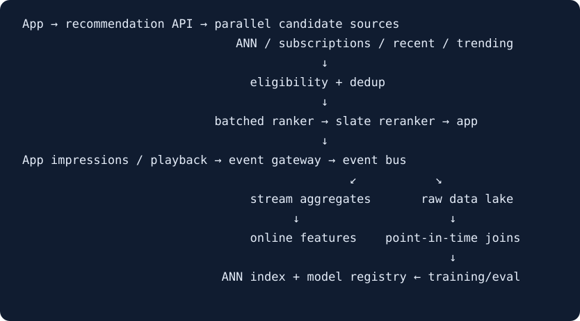

# W065. Video Recommendation

**Priority group:** First 100 — very important

**Category:** Production ML and product design

**Study position:** 65 of 547

[Group list](../FIRST_100.md) · [All categories](../ALL_CATEGORIES.md) · [Chapter guide](../README.md)

## Question

ML system-design round: architect a video recommendation system covering candidate generation, ranking, serving, and feedback loops. The interviewer pushes hard on infrastructure: service split, data flow end to end, and especially event logging, pipelines, and observability that power the feedback loop.

Areas to cover
Candidate generation: embedding-based / two-tower retrieval, recency and engagement sources, filtering.
Ranking: scoring model(s), features, multi-objective balancing.
Serving: request-time flow with bounded latency.
Feedback loops: how observed engagement improves model quality.
Interviewer emphasis

Service split (where boundaries sit), data flow (interaction -&gt; event bus -&gt; training data + features -&gt; serving; training-serving skew), and event logging + observability as the central deep-dive (Kafka -&gt; offline store -&gt; training/feedback; metrics and monitoring).

## Worked solution

### Follow a recommendation from request to training

Recommend a diverse set of eligible videos with useful watch time and satisfaction, rather than maximizing clicks on misleading thumbnails. Separate the online latency path from the durable feedback pipeline; event quality is as important as the ranker.

[Open the architecture diagram](../diagrams/W065_review_architecture.svg).

### Candidate and ranking services

A two-tower model retrieves videos close to the user's current interests. Item embeddings combine content and engagement so new videos can enter before they have many clicks. Add recency, subscriptions and popularity sources to avoid relying on one representation. Merge and filter removed, already watched or ineligible videos before expensive ranking.

The ranker predicts click/start, useful watch duration, completion, skip and negative feedback. Combine these with explicit weights or constraints; raw duration alone favors long videos. A slate stage limits repeated creators, introduces diversity and respects product policies. Set candidate counts from measured recall and ranker latency rather than an unexplained constant. Serve a cached eligible slate or lightweight popularity fallback if an optional source misses its deadline.

### Design the event contract

Each recommendation response has a request ID, model/index versions, experiment assignment, candidate sources, displayed item IDs, positions and scores. The client emits actual impressions, starts, heartbeats, stops and feedback with unique event IDs, event time, receive time and session/request IDs. An API response is not proof that the user saw every item.

The event gateway validates schemas and writes to a partitioned durable bus. Consumers deduplicate event IDs and handle out-of-order/late playback events with event-time windows. Heartbeats can overlap or be missing: compute bounded watch intervals rather than blindly summing every reported second. Persist immutable raw events for replay; derive versioned feature tables and training labels from them.

### Prevent the feedback loop from corrupting training

Use one feature definition for offline point-in-time joins and online aggregates. Store feature timestamps and freshness; never join a user's future watch history into an earlier impression. Exposed-but-unwatched items can be negatives after a defined window; unexposed items are not known negatives. Add controlled exploration and log its probabilities when using counterfactual methods.

Monitor event drop/duplicate rates, client/server count reconciliation, consumer lag, label maturation, feature skew, source recall, score drift and per-stage p99. Offline metrics include recall@K and ranking quality; online tests measure satisfied watch time, skips/complaints, creator diversity and long-term retention with cost/latency guardrails. Train on a schedule, validate, canary and roll back model and index versions together where compatibility requires it.
