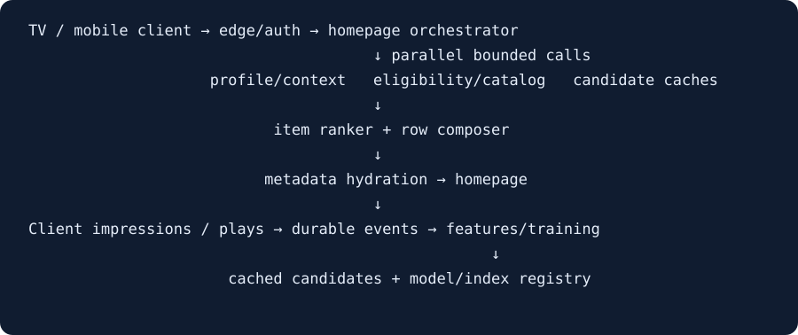

# W066. Homepage Video Recommendation System

**Priority group:** First 100 — very important

**Category:** Production ML and product design

**Study position:** 66 of 547

[Group list](../FIRST_100.md) · [All categories](../ALL_CATEGORIES.md) · [Chapter guide](../README.md)

## Question

Open ML-system-design prompt: recommend videos for the Netflix home page. Reported rounds skew toward high-level service architecture (how many services, how they communicate) over feature engineering / modeling / evaluation.

Clarify whether the prompt wants an ML-system-design treatment or a product-serving architecture treatment before diving into model internals.

## Worked solution

### State the product and service boundary

Assume the task is the serving architecture for a personalized streaming-video homepage. Return rows of eligible titles and their order, not just one globally ranked list. Ask about catalog size, regions, peak requests/s, profile privacy, device types and latency before assigning machine counts. Model details can be a follow-up; the core design must explain how a page arrives reliably.

[Open the architecture diagram](../diagrams/W066_review_architecture.svg).

### What each service owns

The edge authenticates the profile and passes a request deadline. Catalog/eligibility owns region rights, maturity constraints and playable versions. Candidate services retrieve personalized, continue-watching, trending and editorial pools. The ranker scores candidates, while the row composer chooses coherent rows, orders them and removes excessive duplication across rows. Metadata hydration batches title/artwork fields and uses a CDN for assets. These are responsibility boundaries; a small deployment can combine some processes.

Store durable viewing history and progress separately from low-latency derived recommendation features. Version item embeddings and precomputed per-profile candidate sets. Use event-driven updates for recent viewing and batch computation for expensive long-term interests. Content publication and rights changes invalidate eligibility caches promptly; cached personalization must still pass current rights checks.

### One request and its failures

The orchestrator fetches independent candidate sources concurrently with individual deadlines. It does not wait indefinitely for one source. Rank the merged eligible pool, compose rows, hydrate metadata and return a response with request/model/experiment IDs. Continue-watching can be returned early if progressive rendering is supported.

If personalization is unavailable, use cached candidates or region-appropriate popular/editorial rows. If a metadata lookup fails, omit the affected card or use an already validated cached representation. Fail closed for unknown playback rights. Bound fan-out and use bulk feature/metadata reads; one RPC per item creates a latency and load explosion. Cache stable profile/context combinations briefly, respecting recent viewing and ownership boundaries.

### Capacity and proof

Let peak homepage traffic be $Q$ requests/s. If a source receives one call per page, it must sustain roughly $Q$ calls/s; multiplying five source calls means total downstream demand near $5Q$, before retries. Estimate response bytes, candidate counts and ranker throughput from measurements, and size each service for failure headroom. Do not equate catalog size with online ranking load.

Test end-to-end p99 under slow dependencies and a lost zone. Monitor source deadlines, fallback rate, page completeness, rights violations and feature freshness. Log actual card visibility and play completion, not just returned candidates. A/B tests use profile-level assignment and compare useful viewing, row interaction, long-term satisfaction and abandonment with latency guardrails. Daily model updates can proceed through shadow/canary rollout without making homepage availability depend on the training pipeline.
