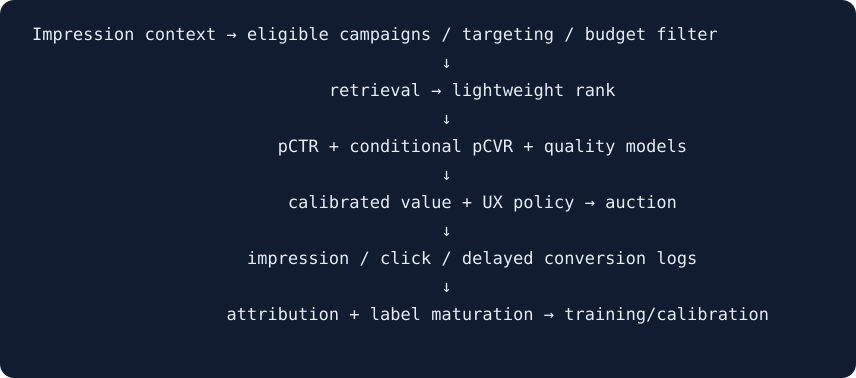

# W067. Design Meta Ads Ranking

**Priority group:** First 100 — very important

**Category:** Production ML and product design

**Study position:** 67 of 547

[Group list](../FIRST_100.md) · [All categories](../ALL_CATEGORIES.md) · [Chapter guide](../README.md)

## Question

Design the Meta ads-ranking system. Given a user impression slot, select and rank ads to show, optimizing advertiser value (bid × pCTR × pCVR) while respecting user experience.

The three reported deep-dive zones are feature engineering, model architecture, and calibration. Be ready to go deep on the data pipeline (how training data is sourced, logged, labeled) as well.

## Worked solution

### Define the probability and value being ranked

For a conversion-valued ad, an illustrative expected advertiser value per impression is

$$v=b\,P(\mathrm{click}\mid x,a)\,
P(\mathrm{conversion}\mid\mathrm{click},x,a).$$

Here the bid $b$ is value per conversion and the conversion probability is **conditional on a click**. If a model already predicts conversion per impression, multiplying by pCTR again double counts the click probability. This is a ranking-value component, not a complete specification of auction payments.

[Open the architecture diagram](../diagrams/W067_review_architecture.svg).

### Features and architecture

User/context features include permitted recent interests, device, time and placement. Ad features include creative text/image embeddings, category, destination quality and campaign history. Interaction features capture user–ad similarity, prior exposure and frequency. Fast-changing budget/pacing state belongs in the serving policy; do not infer spend solely from a stale training feature. Apply privacy/consent constraints before feature access.

Retrieve eligible campaigns with cheap representations, then rank a bounded candidate pool. A shared-bottom or multi-task network can share sparse embeddings while separate heads estimate click, conversion and negative feedback. Compare with strong simpler baselines. Model conditional conversion carefully because clicked impressions are a selected sample; all-impression multitask formulations can reduce some selection issues but still require correct label definitions.

### Data and calibration are central

Log unique impression IDs, displayed positions, eligible context, model versions, predictions and experiment assignment. Join clicks and attributed conversions by stable IDs with an explicit attribution window. A recent impression with no conversion yet is censored, not a mature negative. Deduplicate events, handle late arrivals and prevent post-impression information from leaking into features. Correct training negative sampling when recovering production probabilities.

Evaluate log loss, calibration curves and predicted/observed ratios by placement, advertiser cohort and traffic slice in addition to AUC. A model that orders ads correctly but doubles pCVR can misallocate spend. Fit Platt/isotonic or other suitable calibration on a separate, representative period; validate again after model or traffic changes. Small slices require smoothing and uncertainty, not independent overfit calibrators.

### Serve and evaluate the complete decision

Fetch hot features in bulk and enforce deadlines; keep a reduced-feature fallback. Budget reservation and pacing need their own concurrency-safe state. Combine expected value with user-quality penalties/constraints such as repetitive exposure and hide/report risk. Candidate filtering, ranking and auction eligibility must use consistent policy versions.

Offline use time-based mature labels, ranking metrics and calibration. Online measure advertiser outcomes and spend efficiency together with user engagement, hides/reports, frequency, latency and budget correctness. Controlled exploration provides evidence beyond ads the old model preferred. Canary model/calibration changes, monitor delayed outcomes, and retain rollback versions. A short-term click increase does not establish improved conversion value or user experience.
