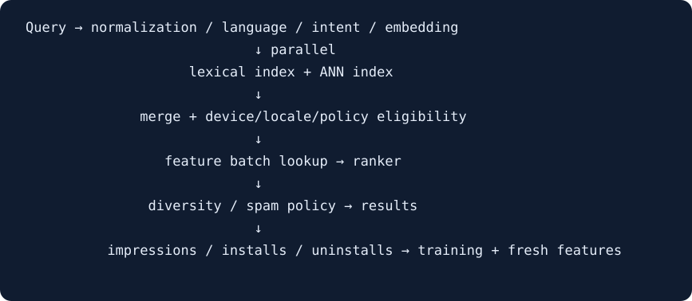

# W068. Design App Store Search and Ranking

**Priority group:** First 100 — very important

**Category:** Production ML and product design

**Study position:** 68 of 547

[Group list](../FIRST_100.md) · [All categories](../ALL_CATEGORIES.md) · [Chapter guide](../README.md)

## Question

Design the search and ranking system for the Apple App Store: a user types a query and receives a ranked list of relevant apps.

### Requirements

1. Scope and scale — state the catalog size, query volume, latency budget and objectives (relevance, install conversion, quality and anti-spam) you design for.
2. Query understanding — how you normalize the query, detect its language, embed it, and classify its intent (navigational vs. exploratory).
3. Retrieval — how you produce a candidate set of a few hundred apps from millions, covering both exact and semantic matches.
4. Ranking — the model, the features it uses (from the sources below), and the training objective.
5. Feature freshness and serving — how static and fast-changing features are computed, stored and served within the latency budget.
6. Risks and trade-offs — cold-start apps, spam and keyword stuffing, optimizing clicks vs. installs, and privacy limits on user features.
Available feature sources
Static app features (recomputed when the app is updated): title, subtitle, description, category, keywords, icon and preview-image embeddings, price, in-app-purchase presence, developer reputation.
Dynamic app features (updated every minute): rating, review count, install velocity, recent click-through and uninstall rates.
Query features: normalized tokens, language, query embedding, inferred intent, query popularity.
Query-app interaction features: BM25 score, semantic cosine similarity, historical click-through and install rate for the (query, app) pair, lexical overlap.
User and context features (subject to privacy constraints): locale, device, prior downloads, cohort.

### Constraints

Catalog of several million apps; end-to-end latency of roughly 200 ms per query.
Deliverable

A design that answers parts 1–6: the pipeline stages, the features and model used at each stage, and the main trade-offs.

## Worked solution

### Scope the search request

Assume a catalog of five million apps and an illustrative peak of 10,000 queries/s; confirm the actual traffic. Return organic results for the user's locale/device within roughly 200 ms. Optimize useful installs and relevant discovery with quality/anti-spam constraints. A navigational query such as an exact app name needs different handling from “offline photo editor.”

[Open the architecture diagram](../diagrams/W068_review_architecture.svg).

### Retrieve broadly, then score carefully

Normalize Unicode and spelling while preserving the original query and brand names. Detect language, classify navigational/exploratory intent and produce a query embedding. Retrieve several hundred candidates from BM25/title-prefix matching and semantic ANN search; merge, deduplicate and filter apps unavailable for the device/region. Exact title matches should remain available even when embedding similarity is imperfect.

Build static item features at app update: title, subtitle, description, category, keywords, image/icon embeddings, price, purchase model and developer quality. Index text lexically and embed it semantically. Stream minute-level rating counts, install velocity, recent CTR and uninstall rate into a timestamped online feature store. Smooth low-count rates so one click does not make a new app appear perfect.

A tree or neural ranker combines BM25, cosine similarity, lexical overlap, intent, locale/device compatibility, static quality and query-app install history. Use only permitted prior-download/cohort features. Start with pointwise install prediction on exposed results; add relevance labels or a pairwise/listwise component so pure popularity does not overwhelm query matching. Account for position/exposure bias and conversion delay.

### Meet 200 ms with explicit ownership

An illustrative critical-path allocation is 25 ms for understanding, 50 ms for parallel retrieval, 25 ms for bulk feature lookup, 55 ms for ranking/policy and 25 ms for transport/slack: 180 ms total. Benchmark actual end-to-end p99; sums of allocated budgets do not substitute for measurement. Cache popular normalized queries by locale/device, with short freshness bounds. Keep static vectors in the index, changing aggregates in the online store and raw events/training tables in durable analytical storage.

### Handle product risks and prove improvement

New apps use content relevance and developer priors with controlled exposure; absence of installs is not evidence of low quality. Detect keyword stuffing, manipulated reviews and abnormal install patterns separately from relevance. Uninstall rates are delayed and context-dependent; define their observation window. A click-optimized model can reward misleading icons, so monitor useful installs, retention and user complaints.

Offline measure recall@K, NDCG from relevance judgments, install calibration and tail-query/new-app slices. Online randomize stable users and compare useful install conversion with relevance, spam, latency and privacy guardrails. Audit navigational success separately. Version model/index/features, shadow new versions and fall back to a filtered lexical baseline when semantic retrieval or personalization times out.
