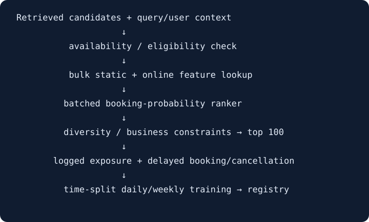

# W069. Airbnb Experiences — Search Ranking (ML Design)

**Priority group:** First 100 — very important

**Category:** Production ML and product design

**Study position:** 69 of 547

[Group list](../FIRST_100.md) · [All categories](../ALL_CATEGORIES.md) · [Chapter guide](../README.md)

## Question

Design the ranking model for Airbnb Experiences (or for the main listings search). Standard MLSD scope: problem framing, training data, features, model architecture, eval, online serving, A/B test plan.

### Requirements

Functional
Rank Experience candidates returned by retrieval for a given (user, query, context).
Optimize for booking conversion as the primary metric; engagement (clicks, dwell) as guard metrics.
Non-functional
Online p99 ranking latency under ~100ms for a top-K list of 100.
Model retraining cadence: daily or weekly batch.
A/B test infrastructure: production-grade with multi-arm support.

## Worked solution

### Frame the ranking target

Retrieval already supplies eligible Experience candidates. Rank them for the current user, query, dates, party size and context, with booking conversion primary and clicks/dwell as guardrails. Clarify whether the task means ranking exactly 100 candidates or selecting 100 from a larger pool; the latency budget depends on the number scored. Assume a bounded pool is scored to return the top 100 within a ranking p99 below 100 ms.

[Open the architecture diagram](../diagrams/W069_review_architecture.svg).

### Training data and features

Create one row per displayed candidate with request ID, position, model version and feature timestamps. Define a booking label and attribution window; recent unbooked impressions remain immature. Join later cancellations separately to distinguish low-quality bookings from durable ones. Unexposed listings are not observed negatives. Preserve randomized exploration information to diagnose position and selection bias.

Features include query/category and embedding relevance, location/distance, requested dates, price relative to the user's query, capacity, ratings with counts, host reliability, cancellation history and permitted user preferences. Retrieve current availability from an authoritative service or short-lived cache. Do not train on a booking confirmation field or a price that changed after the impression.

A boosted tree is a strong baseline; a neural ranker can combine sparse IDs, content embeddings and interactions at larger scale. Minimize booking cross-entropy, optionally adding auxiliary click loss or a pairwise/listwise ranking objective. Calibrate probabilities on representative time-separated data. Cold-start Experiences rely on content and smoothed priors rather than a nonexistent booking history.

### Serving, latency and experiment

Precompute static features, update behavioral aggregates incrementally and fetch all candidate features in batches. Keep the model resident in replicated workers. A proposed 100 ms ranking budget might reserve 25 ms for features, 50 ms for batched scoring and 15 ms for postprocessing, leaving 10 ms slack; validate p99 under peak load. On optional-feature failure, use a tested fallback rather than waiting indefinitely. Availability must be rechecked before purchase even if it was fresh at ranking time.

Offline evaluate recall within the supplied pool, NDCG, booking log loss/calibration and slices by market/new host. Retrain daily or weekly using mature data and versioned feature definitions. Canary the model with a rollback path.

For multi-arm tests, use stable user-level hashing to assign mutually exclusive variants, log assignment before ranking and reserve a persistent control. Predeclare the booking metric, minimum detectable effect, sample size and multiple-comparison correction. Wait for bookings to mature; guard clicks/dwell, cancellations, host concentration, latency and revenue-quality trade-offs. Do not stop at the first nominally significant arm or change traffic weights without an analysis plan.
