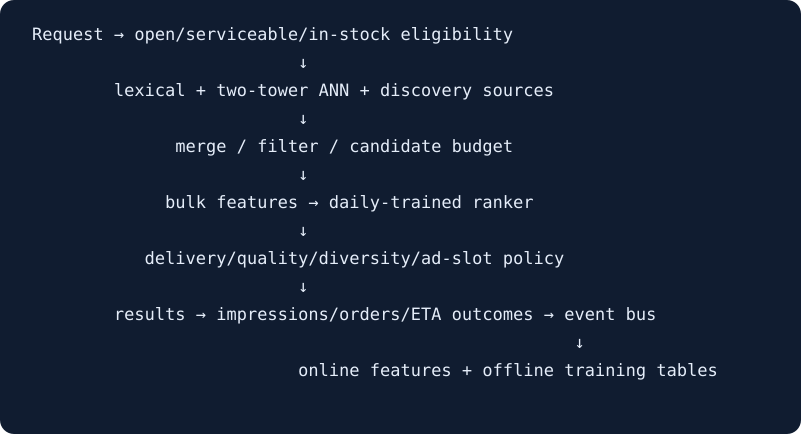

# W070. ML System Design: Restaurant / Store Recommendation

**Priority group:** First 100 — very important

**Category:** Production ML and product design

**Study position:** 70 of 547

[Group list](../FIRST_100.md) · [All categories](../ALL_CATEGORIES.md) · [Chapter guide](../README.md)

## Question

Design a recommendation system that surfaces restaurants or store items to a DoorDash user given a query plus context (location, time, history). Interviewers push toward infrastructure (feature store, two-tower retrieval, online serving) rather than model architecture; multi-objective optimization (conversion rate vs delivery time) is a recurring follow-up.

Non-functional: 100-200ms p99 end-to-end inference; millions of catalog items, hundreds-to-low-thousands candidates per user after retrieval; daily ranker retraining, less frequent retrieval-embedding refresh. Handle personalization, query-relevance vs discovery, and business constraints (ad slots, freshness).

## Worked solution

### Define relevance under real delivery constraints

Given a query, delivery location, time and permitted history, rank restaurants or store items that can actually be ordered. Optimize completed satisfactory orders; high predicted conversion is less useful if delivery is consistently late. Confirm whether the result is a restaurant list or an item list because inventory, embeddings and attribution differ.

[Open the architecture diagram](../diagrams/W070_review_architecture.svg).

### Separate slow representations from fast facts

Train a two-tower retriever on user/query–item engagement and completed-order pairs with carefully sampled negatives. Refresh expensive item embeddings less frequently, using content features for new entries and incremental index updates where possible. Retrieve hundreds to low thousands from millions. Query lexical matching protects exact food/store intents; personalized ANN sources provide discovery.

A daily ranker combines relevance, user cuisine preferences, price, fees, distance, estimated arrival, store quality and recent conversion/cancellation rates. The online feature store serves recent aggregates; the authoritative availability/fulfillment services provide open status, stock and current ETA. A yesterday embedding is tolerable for taste similarity, but yesterday's stock or serviceability cannot decide whether an item is orderable.

### Make the objective explicit

An illustrative score is

$$S=P(\mathrm{completed\ order}\mid x,i)
\cdot V_i-\lambda\,\widehat{\mathrm{late\ minutes}}-\mu\,P(\mathrm{cancel}\mid x,i).$$

Choose interpretable weights through offline trade-off curves and online tests, or enforce lateness as a constraint rather than hiding everything in one number. Do not multiply dollars and minutes without defining conversion weights. Preserve minimum query relevance so personalization does not show unrelated cuisine. Separate ad eligibility/auction decisions and label sponsored slots; ad insertion still must respect serviceability and quality rules.

### Serve inside 100–200 ms

Parallelize independent retrieval sources, batch feature lookup and scoring, and cap candidate count from measured ranker throughput. Precompute slow features, set per-source deadlines and use an eligible popular/lexical fallback. Monitor the end-to-end p99, not just model inference. Cache by location/time/query carefully and invalidate serviceability and inventory changes; long-lived cached results can violate the product's core promise.

Log actual impressions, source, position, model/index versions and experiment assignment. Join orders, delivery times, cancellations and refunds with explicit attribution/maturation windows. Offline use retrieval recall, ranking quality and calibration with time-separated data; online compare completed orders and repeat use with ETA error, lateness, cancellations, cost, diversity and latency guardrails. Audit new stores, sparse neighborhoods and feedback loops so popular nearby restaurants do not permanently crowd out reasonable alternatives.
