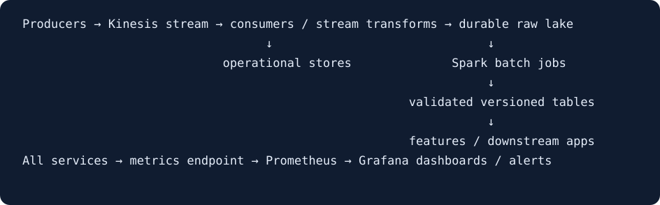

# W099. Data Platform, Pipeline, and ML Operations Fundamentals

**Priority group:** First 100 — very important

**Category:** SQL, data modeling and pipelines

**Study position:** 99 of 547

[Group list](../FIRST_100.md) · [All categories](../ALL_CATEGORIES.md) · [Chapter guide](../README.md)

<span class="practice-page"></span>

## Question

Data Platform, Pipeline, and ML Operations Fundamentals

Senior data-engineering candidates can face a one-hour technical assessment covering a small coding warmup plus production data-platform operations: Kinesis, Prometheus / Grafana, idempotency, Spark partitioning and skew, backfills, cost optimization, and debugging incorrect pipeline output.

### Requirements

Be ready to answer concrete operational questions across the data stack:

Solve or discuss a merge-interval style coding warmup.
Explain where Kinesis, Prometheus, and Grafana fit in a data platform.
Make pipeline writes idempotent so retries do not duplicate or corrupt data.
Tune a Spark job, including partition count, skew handling, and optimization strategy.
Plan a backfill without breaking current production outputs.
Reduce the cost of an expensive job while preserving correctness.
Debug a data-pipeline issue from symptoms to root cause.
Diagnose incorrect results when the code itself appears clean.
Notes

The signal is practical production judgment. Strong answers separate correctness, observability, and cost:

Idempotency should cover input deduplication, deterministic output partitions, retry-safe writes, and exactly-once or effectively-once semantics where the platform supports them.
Spark tuning should start with data shape and stage metrics before changing knobs: skewed keys, shuffle size, partition count, executor memory, caching, and broadcast joins.
Backfills need a scoped date range, replay isolation, validation checks, rollback plan, and clear ownership of downstream side effects.
Debugging incorrect results should include lineage, input freshness, schema drift, late-arriving data, timezone / partition boundaries, and metric reconciliation against a trusted source.

## Worked solution

### Coding warm-up: merge overlapping intervals

```python
def merge_intervals(intervals):
    ordered = sorted((start, end) for start, end in intervals)
    if any(start > end for start, end in ordered):
        raise ValueError("Interval start exceeds end")
    merged = []
    for start, end in ordered:
        if not merged or start > merged[-1][1]:
            merged.append([start, end])
        else:
            merged[-1][1] = max(merged[-1][1], end)
    return merged
```

This treats touching closed intervals as overlapping: `[1,3]` and `[3,5]` become `[1,5]`. For half-open intervals where touching should stay separate, change the comparison. Sorting costs $O(n\log n)$; scanning is linear and does not mutate input.

### Put ingestion and observability in the architecture



[Open the architecture diagram](../diagrams/W099_review_architecture.svg).

Kinesis transports partitioned event records and supports replay within configured retention; a partition key shapes ordering/load. Prometheus collects/query metrics such as lag, errors and freshness. Grafana visualizes those metrics and operational signals. They do not replace durable event storage or correctness validation. Keep high-cardinality per-record IDs out of metric labels and put those details in logs/traces.

### Make retries and backfills safe

Use stable source event IDs, deduplicate within the required replay horizon, and write under natural/business keys or deterministic partition/version keys. Commit output and consumer progress atomically where the sink/platform supports it; otherwise use staging plus idempotent merge and reconciliation. A checkpoint alone does not make an arbitrary external side effect exactly once.

For a backfill, freeze code/schema/input versions and a date range, write to isolated versioned partitions, rate-limit shared resources and disable/reconcile external notifications. Validate counts, keys, aggregates and sampled records, then atomically publish/replace the intended partitions. Keep the old version and downstream ownership/rollback plan. Decide whether late data should be recomputed, merged or preserved before running the job.

### Tune Spark and cost from stage evidence

Inspect input sizes, task duration distribution, shuffle bytes, spill, GC and skew before changing executor counts. Too few partitions underutilize cores or create huge tasks; too many create scheduling/small-file overhead. Repartition by workload keys where appropriate, salt exceptional hot keys carefully and recombine correctly, and broadcast a genuinely small dimension table only when executor memory permits. Filter/project early, prune partitions, use columnar storage, compact small files and cache only reused expensive data. Validate that an optimization preserves null/join/aggregation semantics.

### Debug clean-looking code with a dirty-data mindset

Start from one incorrect output and trace lineage backward. Reconcile source counts, dedup keys and aggregate totals against a trusted source; check data freshness, schema changes, implicit casts, many-to-many joins, timezone/daylight-saving boundaries, late events and incomplete partitions. Compare the last correct version and reproduce a small affected slice. Alert on invariants such as uniqueness and expected partition completeness. Compute cost per correct, fresh output; a cheaper job that quietly drops late records is not a successful optimization.
