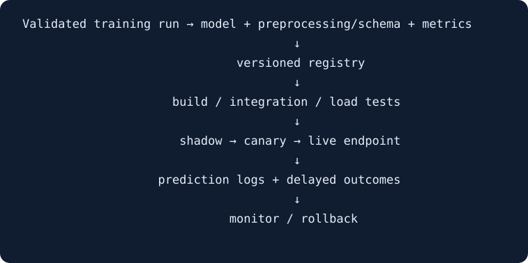

# W100. MLE Deployment, Monitoring & Latency Optimisation

**Priority group:** First 100 — very important

**Category:** Evaluation, calibration and data quality

**Study position:** 100 of 547

[Group list](../FIRST_100.md) · [All categories](../ALL_CATEGORIES.md) · [Chapter guide](../README.md)

<span class="practice-page"></span>

## Question

MLE/AR loop second technical round, 60 minutes in two segments.

Segment 1 — Coding warm-up (~20 min): a simple problem, most often 'print all root-to-leaf paths in a binary tree' or a similar easy tree traversal.

Segment 2 — Deployment & Latency discussion (~40 min):

How do you deploy your ML model? Walk from a trained artifact to a live endpoint.
How do you monitor your ML model after deployment?
Latency scenario: 'You have a fraud-detection model deployed via an API, but it misses the &lt; 50ms latency requirement. How do you fix it?' Give a systematic diagnosis and remediation plan.

## Worked solution

### Coding: root-to-leaf paths

A path ends at a node with no children, not at every internal node. Carry the current path during depth-first search, copy it when reaching a leaf, then undo the append before exploring a sibling.

```python
from dataclasses import dataclass


@dataclass
class Node:
    value: object
    left: object = None
    right: object = None


def root_to_leaf_paths(root):
    result = []
    path = []

    def visit(node):
        if node is None:
            return
        path.append(node.value)
        if node.left is None and node.right is None:
            result.append(path.copy())
        else:
            visit(node.left)
            visit(node.right)
        path.pop()

    visit(root)
    return result


assert root_to_leaf_paths(Node(1, Node(2), Node(3, Node(4)))) == [[1, 2], [1, 3, 4]]
assert root_to_leaf_paths(None) == []
```

Traversal visits n nodes, plus the total number of values copied into the output. Extra traversal memory is $O(h)$ for height h, excluding results. A very deep skewed tree can exceed recursion limits; an explicit stack avoids that. Printing paths can be done after collecting them or at each leaf using the same traversal.

### Deploy a reproducible artifact



[Open the architecture diagram](../diagrams/W100_review_architecture.svg).

Package model, feature schema, preprocessing and dependencies together. Verify offline/online feature agreement, input validation and an example request. Load the model once per worker, warm it, and use health/readiness checks before routing traffic. Keep the prior version for rollback and record model/feature versions on each prediction.

### Monitor model and service separately

System metrics include QPS, queue time, p50/p95/p99 latency, error/timeout rate, CPU/GPU utilization and memory. Data metrics include missing/stale features, schema violations and distribution changes. Outcome metrics include mature fraud recall/value caught, false declines/challenges, calibration and loss. Labels arrive late, so immediate score drift is a diagnostic, not proof that fraud accuracy fell. Track product/business slices and alert ownership.

### Diagnose the fraud API's 50 ms failure systematically

First specify whether the requirement is end-to-end p99 and measure at realistic peak traffic. Trace request parsing/network, queueing, feature fetch, preprocessing, model inference and policy/serialization. A ten-millisecond model cannot compensate for a hundred-millisecond sequential feature lookup.

If features dominate, batch/parallelize reads, precompute costly aggregates, co-locate hot stores and enforce freshness/deadline-aware defaults. If inference dominates, benchmark a smaller/distilled model, optimized runtime or supported quantization and recheck calibration/fraud quality. If queueing dominates, add capacity/admission control and tune concurrency; large batches may improve throughput but violate the latency deadline. If cold starts dominate, keep warm replicas and load models before readiness.

Set an illustrative budget such as network/parsing 5 ms, feature/preprocess 15 ms, inference 15 ms, policy/serialization 5 ms and 10 ms slack, then verify the actual full-path tail rather than summing measured component percentiles. Test a lost instance/zone and slow dependencies. Use an approved reduced-feature model or risk-tier fallback when a deadline is missed; indiscriminately allowing payments to meet latency would defeat the fraud objective. Canary each optimization and compare latency, cost and mature decision quality before expanding.
