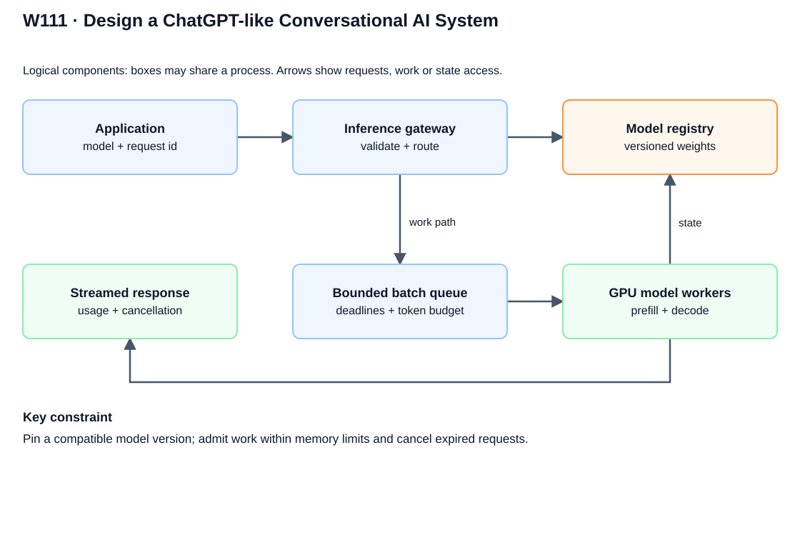

# W111. Design a ChatGPT-like Conversational AI System

**Priority group:** Second 100 — important

**Category:** LLM serving and scheduling

**Study position:** 111 of 547

[Group list](../NEXT_100.md) · [All categories](../ALL_CATEGORIES.md) · [Chapter guide](../README.md)

## Question

Design a conversational AI system like ChatGPT: users send text prompts and receive AI-generated responses streamed back token-by-token, with persistent conversation history across sessions.

## Worked solution

<!-- architecture:W111:start -->
### Architecture and request flow

[Open the diagram at full size](../diagrams/W111_architecture.svg). This is a baseline component diagram for this question. The boxes describe responsibilities; they do not require a separate microservice for every box.

- **Request and state:** Application — model + request id → Inference gateway — validate + route. That component consults or updates **History + model registry — messages + model versions** under the required access and consistency rules.
- **Work and result:** the work path passes through **Bounded batch queue — deadlines + token budget** and **GPU model workers — prefill + decode**, producing **Streamed response — usage + cancellation**. Bound waiting and retries where a slow dependency can stall this path.
- **Correctness point:** Pin a compatible model version; admit work within memory limits and cancel expired requests.

When explaining the drawing, trace one normal request first, then a duplicate request, an unavailable dependency and recovery from saved state. If the question requires stricter guarantees or a different scope, state the change explicitly rather than treating this baseline as the only possible design.
<!-- architecture:W111:end -->

### Contract, history and the stream

Assume authenticated users, text-only chat initially, 10M turns/day, 1,000 prompt tokens and 300 output tokens per turn, with peak traffic 5× the average. Average arrival is 116 turns/s; peak is about 579/s and peak output demand about 174k tokens/s. These are sizing assumptions, not supplied product numbers. Choose TTFT and inter-token SLOs independently from completion time, and enforce per-user/tenant quotas.

Expose `POST /conversations`, `GET /conversations/{id}/messages?cursor`, `POST /conversations/{id}/messages` with `{request_id,parent_message_id,text,model_config}`, `GET /generations/{id}/events?after=seq`, and `POST /generations/{id}/cancel`. Use SSE or WebSocket events `started`, ordered `delta(seq,text)`, `usage`, `completed` or `failed`. Request-id uniqueness prevents a reconnect from starting another generation; event sequence numbers support replay and client deduplication. A canceled or failed partial answer is explicitly marked partial.

Store `Conversation(id,owner,title,created_at)`, `Message(id,conversation_id,parent_id,role,content_ref,status,created_at)` and `Generation(id,request_id,model_version,prompt_version,status,last_event_seq,usage)`. Enforce ownership on every history/stream read. A parent id permits branching and prevents silently mixing concurrent turns; alternatively serialize writes with a conversation revision check. Commit the user message and pending generation before scheduling inference. Store completed assistant content durably; persist stream deltas in bounded chunks/event log so crashes have a known replay boundary.

### Trace the diagram and history service

The displayed gateway → bounded queue → GPU worker → stream path handles generation. The authenticated history/model registry path stores cross-session messages as well as pinned model versions. On a turn, load the selected parent chain, apply the versioned context policy, tokenize, admit against token/memory limits, and pin the model before prefill. A long conversation needs truncation or a versioned summary plus retrieved relevant history; tell the product what can be forgotten. Durable history is not the same thing as a GPU KV cache, which can be evicted.

Workers continuously batch decode, release finished slots and use paged KV allocation. Chunk long prefills to protect interactive streams. A 32-layer model with 8 KV heads, width128 and 2-byte elements consumes $2(32)(8)(128)(2)=131072$ bytes per cached token: 4k tokens is 512MiB per request. Add weights, activation buffers, allocator overhead and headroom before setting live-token limits. If a measured worker sustains $r$ output tokens/s at the target TTFT/latency mix, a first capacity bound is $174000/r$ workers at peak, plus redundancy; do not invent r from parameter count.

### Recovery and protection

A repeated POST returns the existing generation. A dropped connection resumes event replay, with a bounded grace period before canceling unused GPU work. A GPU crash marks that attempt failed; a new attempt has a distinct stream/attempt identity, because regenerating from a nondeterministic model is not guaranteed to reproduce already delivered tokens. Do not silently splice a different answer into the old stream. Queue deadlines, rate limits, overload responses and cancellation bound memory and cost. Keep history available when inference is down.

Encrypt stored messages, isolate tenants, apply retention/deletion policies to content and caches, restrict tool/data access separately and avoid sensitive raw text in ordinary logs. Monitor successful completed turns, stream disconnects, failed/partial outputs, TTFT, inter-token p95, queue delay, per-tenant fairness, cache memory, cost and answer-quality/safety audits. Roll out a model through offline evaluations, shadow/canary traffic and reversible configuration; pin old conversations only if required, and keep the selected version visible in generation records. The system succeeds when a user can return in another session, read the same durable history and continue the correct branch.

### Further study

- [F031: Why do prefill and decode have different bottlenecks?](../04_serving_and_training_systems.md#f031)
- [F033: Explain continuous batching and paged KV storage.](../04_serving_and_training_systems.md#f033)
- [F034: Estimate an LLM serving capacity budget.](../04_serving_and_training_systems.md#f034)
