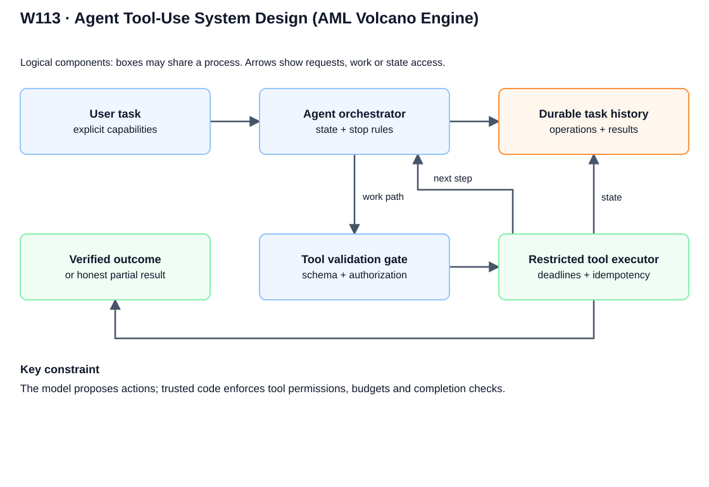

# W113. Agent Tool-Use System Design (AML Volcano Engine)

**Priority group:** Second 100 — important

**Category:** RAG, agents and application security

**Study position:** 113 of 547

[Group list](../NEXT_100.md) · [All categories](../ALL_CATEGORIES.md) · [Chapter guide](../README.md)

## Question

Senior research-scientist intern round at ByteDance AML (Volcano Engine): open-ended design of an agent tool-use system, drilling on state management, evaluation, and failure modes of multi-step tool-invoking agents.

Sub-questions
State management across long tool-invocation chains: context window vs external memory store.
Evaluation: unit of eval — single call, trajectory, or end-to-end task outcome.
Tool catalog & dispatch: scaling to hundreds of tools (retrieval over tools, hierarchical menus, learned routing).
Failure modes: malformed output, timeouts, infinite loops, hallucinated arguments — detect and recover.
Latency vs quality: parallel vs serial dispatch, speculative execution, caching.
Notes

Short-term scratchpad in context + long-term structured store (vector + KV + audit log). Trajectory-level success rate + per-step regression tests + human spot-checks + online A/B. Retrieval-augmented tool selection; loop detection via max steps + repeated-call detection; schema-validate arguments before dispatch.

## Worked solution

<!-- architecture:W113:start -->
### Architecture and request flow

[Open the diagram at full size](../diagrams/W113_architecture.svg). This is a baseline component diagram for this question. The boxes describe responsibilities; they do not require a separate microservice for every box.

- **Request and state:** User task — explicit capabilities → Agent orchestrator — state + stop rules. That component consults or updates **Durable task history — operations + results** under the required access and consistency rules.
- **Work and result:** the work path passes through **Tool validation gate — schema + authorization** and **Restricted tool executor — deadlines + idempotency**, producing **Verified outcome — or honest partial result**. Bound waiting and retries where a slow dependency can stall this path.
- **Correctness point:** The model proposes actions; trusted code enforces tool permissions, budgets and completion checks.

When explaining the drawing, trace one normal request first, then a duplicate request, an unavailable dependency and recovery from saved state. If the question requires stricter guarantees or a different scope, state the change explicitly rather than treating this baseline as the only possible design.
<!-- architecture:W113:end -->

### State that survives a long chain

Assume a few hundred tools, mostly reads with a smaller set of state-changing actions, and up to 50 steps/task. Define `Task{id,owner,goal,status,state_version,budget,deadline}`; `Step{task_id,seq,tool_version,args_hash,operation_id,status,result_ref,error}`; and an append-only event log. Expose `POST /tasks` with client idempotency key, `GET /tasks/{id}`, `POST /tasks/{id}/cancel`, and tool-dispatch interfaces accepting typed arguments, a deadline and stable operation id.

The orchestrator in the diagram loads a bounded in-context working set: goal, current plan, verified facts and recent observations. Large outputs live in an object store with references. Structured KV state holds authoritative facts and operation status; vector search only retrieves relevant memories, it does not decide whether a payment occurred. Summaries retain source ids and cannot overwrite raw tool evidence. Use optimistic state-version checks or one leased task writer to avoid concurrent inconsistent plans.

### Retrieve tools, then validate meaning

A registry stores tool name/version, JSON schema, capability description, owner, auth scope, side-effect class, latency/cost and examples. Filter by the caller's permissions, retrieve perhaps ten tools using lexical/embedding matches, then route through a domain menu if needed. Evaluate tool-retrieval recall independently: the planner cannot choose a correct tool absent from its shortlist. Pin versions per step. The model proposes; the validation gate checks schema, allowed resource ids, units, ranges and current permissions in ordinary code before dispatch.

For example, “find invoice 23 and email its owner” retrieves invoice-read and mail tools. Read invoice state, verify ownership, build the intended mail payload, then execute the authorized send under one operation id. A string claiming “ignore prior policy” in an invoice remains untrusted content, never permission to call another tool.

### Execute and recover

Transitions are pending → leased → running → completed/failed/unknown. Persist operation identity before dispatch and commit results before planning dependent actions. Reads can retry with exponential backoff and a deadline. For a malformed argument, return a structured error for at most one or two repairs; a hallucinated account id fails authorization rather than being “fixed” into an arbitrary valid id. Timeouts on writes are **unknown outcomes**: query provider status or retry the same provider-supported idempotency key. If no reconciliation is possible, stop for explicit resolution rather than duplicating an effect.

Parallelize independent reads from a known plan; serialize dependent decisions and conflicting writes. Speculation should use cancellable reads, not irreversible sends. Cache by tool/schema/input/data-version/authorization scope and honor freshness. Detect repeated `(tool,args,state_version)` calls without progress, cap steps/tokens/cost and stop on verified completion, cancellation, budget or unresolved error. Process restarts recover from durable task/step state and reclaim expired leases with fencing tokens so stale workers cannot commit.

### Evaluate at three levels

Single-call tests check valid selection/arguments and error handling. Trajectory tests check ordered dependencies, recovery, redundant work and forbidden side effects. End-to-end tests score the externally verified outcome, including abstention, failures and partial completion, under fixed cost/retry limits; “all calls returned 200” is insufficient. Use a frozen suite with tool mocks plus replayable sandbox integrations, several seeds, human spot-checks, adversarial tool output and held-out tool/task families. Track success@1, success-at-budget, unsafe-action rate, tool-retrieval recall, recovery correctness, latency p50/p95 and dollars/task. A/B only after offline gates, record every model/tool/version, canary and rollback. If 1,000 tasks/min average 10 steps, plan for about 167 tool calls/s before bursts and retries; benchmark external quotas and latency before claiming system capacity.

### Further study

- [F076: Build an agent loop with explicit stop conditions.](../08_rag_and_agents.md#f076)
- [F078: Evaluate an agent whose outputs vary between runs.](../08_rag_and_agents.md#f078)
- [F167: Design preemptible long-running generation jobs.](../17_distributed_systems_depth.md#f167)
