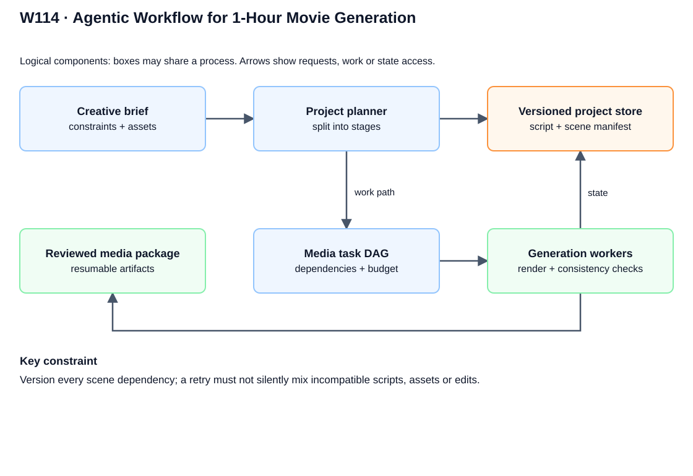

# W114. Agentic Workflow for 1-Hour Movie Generation

**Priority group:** Second 100 — important

**Category:** RAG, agents and application security

**Study position:** 114 of 547

[Group list](../NEXT_100.md) · [All categories](../ALL_CATEGORIES.md) · [Chapter guide](../README.md)

## Question

Agentic Workflow for 1-Hour Movie Generation

15-minute screen for the Video-Generation / Agent-RL team. After a quick ML-direction intro, the interviewer asks: how would you design an agentic workflow that generates a one-hour-long movie? Open-ended, no right answer — the bar is hypothesis quality and how concretely you can scope subproblems under time pressure.

RS · RE · MLE

ml-knowledge · agentic-workflow · video-generation · open-ended · medium

### Requirements

In ~10 minutes verbal, sketch:

The high-level pipeline (script → shots → frames → audio → assembly) and the agents that own each stage.
The consistency problem: characters, environments, and props must remain coherent across thousands of generated frames spanning many scenes.
Narrative pacing: the agent must decide scene length, transitions, and tonal arcs — not just generate frames.
The memory / context layer the agents share: scene bible, character sheets, continuity tracker.
Where reinforcement learning fits (reward model on coherence + viewer engagement, RLAIF for narrative quality).
Compute and latency tradeoffs: per-frame inference cost × frames × scenes × revisions.
Notes
The interviewer probes for *concrete subproblems* rather than a wishlist. Pick two or three to go deep on (consistency tracking and narrative pacing are the most defensible choices) instead of skimming the whole pipeline.
A reasonable hook: a "director" agent decomposes a script into shot list; "consistency" agent maintains an embedding-keyed memory of characters / props; "renderer" agent calls the underlying video diffusion model with conditioning from both; "editor" agent does cuts and pacing review.
The reporter felt blindsided in the moment — the round rewards candidates who have thought about agent decomposition for long-horizon generation tasks beforehand.
Mention real systems if you can (Sora, Runway Gen-3, Veo) but treat them as inspiration rather than reference architectures — the interviewer wants your take, not a recap.

## Worked solution

<!-- architecture:W114:start -->
### Architecture and request flow

[Open the diagram at full size](../diagrams/W114_architecture.svg). This is a baseline component diagram for this question. The boxes describe responsibilities; they do not require a separate microservice for every box.

- **Request and state:** Creative brief — constraints + assets → Project planner — split into stages. That component consults or updates **Versioned project store — script + scene manifest** under the required access and consistency rules.
- **Work and result:** the work path passes through **Media task DAG — dependencies + budget** and **Generation workers — render + consistency checks**, producing **Reviewed media package — resumable artifacts**. Bound waiting and retries where a slow dependency can stall this path.
- **Correctness point:** Version every scene dependency; a retry must not silently mix incompatible scripts, assets or edits.

When explaining the drawing, trace one normal request first, then a duplicate request, an unavailable dependency and recovery from saved state. If the question requires stricter guarantees or a different scope, state the change explicitly rather than treating this baseline as the only possible design.
<!-- architecture:W114:end -->

### A concrete production unit

Assume a 3,600-second film at 24fps, 1080p final output, with human approval of expensive creative choices. That is 86,400 final frames. Choose an initial average shot length of six seconds: about 600 shots. Render temporally conditioned clips, not 86,400 independent images. The existing diagram's planner, versioned project store, media DAG, workers and reviewed package map to this hierarchy: film → scenes → shots → assets → final timeline.

Use `POST /projects` for a brief/budget, `POST /projects/{id}/plans` for a versioned screenplay/shot manifest, `POST /shots/{id}/renders` for bounded candidate jobs, `POST /assets/{id}/approve`, and `POST /projects/{id}/assemble`. A shot record includes script version, duration, characters, location, camera, dialogue timing, entry/exit world state, reference-asset versions and selected render. Store media in immutable objects and decisions in a transactional project database. A stable render id/configuration hash deduplicates retries; each selection and edit creates a new version.

### Continuity: facts plus conditioning

A character sheet contains approved multi-view references, wardrobe variants, voice identity and permitted transformations. Location/prop records describe geometry and ownership. The continuity ledger states facts such as `bag.owner=A`, `bag.location=train`, `A.costume=blue`, with scene-time validity. Retrieve relevant images by embeddings, but enforce symbolic constraints through the ledger. Before rendering a shot, validate required entry facts; after approval commit its exit facts. Adjacent shots share appropriate final-frame/motion conditioning, consistent references and audio, while longer-range checks compare identity and prop state against the ledger.

Example: if A leaves a red bag on a train in scene 3, a later shot cannot show A carrying it unless the plan includes retrieval or an explicit flashback. A detector's low identity distance cannot establish that logical fact. When a costume reference changes, dependency invalidation marks affected shots stale; selected renders built against old versions cannot silently enter the current cut. Humans review ambiguous continuity and any expensive global repair.

### Pacing: reason in timeline units

The director assigns dramatic function and target duration to scenes: setup, tension, turn, release. The editor agent operates on a timeline with hard duration sum 3,600 seconds and soft constraints for dialogue intelligibility, action readability, tonal transitions and scene rhythm. First create an inexpensive animatic with stills and temporary audio. Measure speech/shot length, repeated exposition and unresolved setups, then use blinded human scene/sequence ratings to validate the pacing judge. A long silent shot can serve suspense; a universal “faster is better” reward would damage the film.

A concrete repair loop finds a 90-second scene rated repetitive, proposes cutting two redundant shots and extending an emotionally important reaction, verifies dialogue/continuity, reviews the animatic, then regenerates only missing media. Narrative edits can invalidate downstream story facts; local frame artifacts should only trigger local rerendering.

### Agents, learning and an honest budget

The screenplay/director agent owns narrative and scene plans; continuity owns reference/ledger checks; renderer calls video models; sound owns dialogue, music and effects; editor owns cuts, transitions, subtitles and final duration. They communicate through versioned records, not one growing transcript. The DAG scheduler permits independent shots after their references are approved, checkpoints completed assets and enforces retry/candidate budgets. Failed or suspect shots return a reason code instead of repeatedly consuming compute.

Let measured render cost be $c$ GPU-seconds per output second. With two candidates and a 25% rerender factor, video costs $3600(2)(1.25)c=9000c$ GPU-seconds = $2.5c$ GPU-hours. If **as an illustrative assumption** $c=60$, video alone costs 150 GPU-hours. Add measured audio, upscaling, evaluation, encoding and storage. For 600 selected shots, two candidates and 25% retries imply roughly 1,500 six-second render jobs. Thirty workers each producing a job in r seconds have a lower-bound render wall time $1500r/30=50r$ seconds before dependencies, queues and reviews. Do not promise a deadline without measuring r at the target resolution.

Start with supervised planning and human preferences. RL can optimize shot-selection, repair and pacing decisions with clip/scene rewards for continuity, constraint satisfaction and human engagement preferences; RLAIF supplies cheap candidate rankings but requires calibration to human judgments. Delayed full-film preference is noisy and expensive, so use hierarchical rewards and independent holdouts. Penalize cost, repetition and reward exploitation; a judge that rewards matching appearances can be gamed by static frames. Evaluate completed-film continuity defects/minute, narrative ratings, audio alignment, repair effort, completion rate, cost and wall time. Roll back to an approved manifest/asset selection after a bad edit; never overwrite prior reviewed work.

### Further study

- [F076: Build an agent loop with explicit stop conditions.](../08_rag_and_agents.md#f076)
- [F078: Evaluate an agent whose outputs vary between runs.](../08_rag_and_agents.md#f078)
- [F167: Design preemptible long-running generation jobs.](../17_distributed_systems_depth.md#f167)
