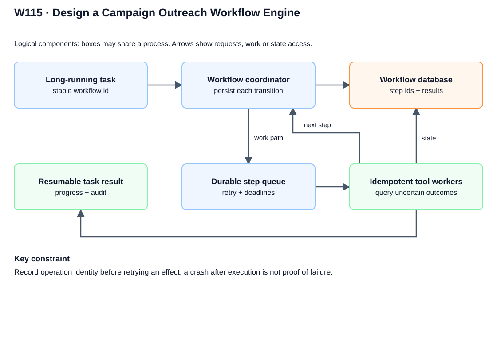

# W115. Design a Campaign Outreach Workflow Engine

**Priority group:** Second 100 — important

**Category:** RAG, agents and application security

**Study position:** 115 of 547

[Group list](../NEXT_100.md) · [All categories](../ALL_CATEGORIES.md) · [Chapter guide](../README.md)

<span class="practice-page"></span>

## Question

Design an internal tool that lets members of a sales team launch outreach campaigns against a chosen group of clients. Each campaign contacts every client in its group through a fixed sequence of emails and text messages, waits for replies between steps, and stops contacting a client as soon as the sequence is finished. Sales staff define the sequence in an editor, so the sequence is data, not code.

Behavior to support
1. A sales user creates a campaign by choosing a customized subset of clients and a contact sequence, then starts it.
2. For each client, the campaign sends an email first. If the client does not respond within 3 days, it sends a text message. If there is still no response, it retries the text after another 3 days. If there is still no response after that, the client is marked unresponsive.
3. If any message fails to send, or the contact information needed for a step is missing, the campaign ends for that client only. Other clients are not affected.
4. The sequence can contain a choice, for example picking the email language (English or Spanish) from the client's profile, and different branches can end in different outcomes.
5. A workflow editor shows the sequence as a flow: a start step, send steps, wait steps, choices, and terminate steps. The editor has a Cancel button and a "Validate and Save" button. Saving must refuse a flow that cannot run correctly.
6. A sales user can see the state of every client in a campaign and can cancel a running campaign.
What to produce
1. Requirements, assumptions and a rough scale estimate.
2. The data structure that represents a workflow, and the rules "Validate and Save" enforces on it.
3. The data model and APIs for workflows, campaigns and per-client progress.
4. The execution engine: how waits are implemented, how a reply or a cancel is handled while a client is waiting, and how the engine avoids sending the same message twice.
5. The failure modes you would handle and the trade-offs behind your choices.

### Constraints

A campaign may target up to 100,000 clients, and many campaigns may run at once.
The engine must survive process restarts without losing or repeating a step.
Email and text providers enforce rate limits and may fail or time out.

## Worked solution

<!-- architecture:W115:start -->
### Architecture and request flow



[Open the diagram at full size](../diagrams/W115_architecture.svg). This is a baseline component diagram for this question. The boxes describe responsibilities; they do not require a separate microservice for every box.

- **Request and state:** Long-running task — stable workflow id → Workflow coordinator — persist each transition. That component consults or updates **Workflow database — step ids + results** under the required access and consistency rules.
- **Work and result:** the work path passes through **Durable step queue — retry + deadlines** and **Idempotent tool workers — query uncertain outcomes**, producing **Resumable task result — progress + audit**. Bound waiting and retries where a slow dependency can stall this path.
- **Correctness point:** Record operation identity before retrying an effect; a crash after execution is not proof of failure.

When explaining the drawing, trace one normal request first, then a duplicate request, an unavailable dependency and recovery from saved state. If the question requires stricter guarantees or a different scope, state the change explicitly rather than treating this baseline as the only possible design.
<!-- architecture:W115:end -->

### Scope and the editable workflow

Assume at most 100 concurrent campaigns of 100k clients: 10M client runs, with up to three sends each. If 10M initial emails are launched over a day, average provider demand is 116 sends/s, but launch bursts need throttling. Quiet hours, consent/unsubscribe and channel policy are checked before sending. Freeze client membership and workflow version at launch; changes create a new version. Replies terminate that client's outreach as `RESPONDED`; exhaustion is `UNRESPONSIVE`; failure/missing contact is `FAILED`. Canceling the editor discards unsaved changes, distinct from canceling a launched campaign.

Represent the sequence as a typed directed graph, for example:

```json
{"start":"language","nodes":[
 {"id":"language","type":"choice","field":"language","cases":{"es":"email_es"},"default":"email_en"},
 {"id":"email_en","type":"send","channel":"email","template":"en_v1","next":"wait1","on_error":"failed"},
 {"id":"email_es","type":"send","channel":"email","template":"es_v1","next":"wait1","on_error":"failed"},
 {"id":"wait1","type":"wait_reply","seconds":259200,"on_reply":"responded","on_timeout":"sms1"},
 {"id":"sms1","type":"send","channel":"sms","template":"sms_v1","next":"wait2","on_error":"failed"},
 {"id":"wait2","type":"wait_reply","seconds":259200,"on_reply":"responded","on_timeout":"sms2"},
 {"id":"sms2","type":"send","channel":"sms","template":"sms_v1","next":"wait3","on_error":"failed"},
 {"id":"wait3","type":"wait_reply","seconds":259200,"on_reply":"responded","on_timeout":"unresponsive"},
 {"id":"responded","type":"terminate","outcome":"RESPONDED"},
 {"id":"unresponsive","type":"terminate","outcome":"UNRESPONSIVE"},
 {"id":"failed","type":"terminate","outcome":"FAILED"}]}
```

A final three-day wait after the retry is an explicit interpretation of “still no response after that”; agree on this interval if product intent differs. An implicit start wrapper points to `language`. Validation requires exactly one start, unique ids, valid references, all nodes reachable, correctly typed payloads/templates, positive bounded waits, exhaustive choice defaults, allowed profile fields/operators, terminal outcomes and no cycles (or an explicitly bounded loop construct). Every path must terminate and every send must define error handling. Validate user/template permissions and size/step limits; reject arbitrary code predicates and missing branches. Save atomically only after validation; running campaigns retain their immutable version.

### Durable data and APIs

Store `Workflow(id,owner,version,graph,status)`, `Campaign(id,workflow_version,membership_snapshot,status,cancel_epoch)`, `ClientRun(campaign_id,client_id,node_id,state_version,status,due_at,last_message_id)`, `Message(operation_id UNIQUE,run_id,node_id,provider_id,status)`, plus inbox/webhook dedup records and an outbox. APIs: create/edit/validate workflows; create campaign with membership filter and idempotency key; start/cancel campaign; list client runs with pagination; query run events; receive signed provider delivery/reply webhooks. Compound `(campaign_id,client_id)` uniqueness prevents duplicate membership. Index ready work by shard/status/due_at and history by campaign/client.

### Execute waits and settle races

A coordinator in the diagram advances one client at a time using a row lock or compare-and-swap state version. Entering a send transactionally creates the message operation/outbox row. Workers dispatch with stable provider idempotency key `(campaign,client,workflow_version,node,attempt-purpose)`; transport retries reuse it. Successful send records delivery acceptance and transitions to the wait node with a persisted due timestamp. Do not hold a worker or sleep for three days: a durable timer scan/delayed queue wakes ready run ids, verifies their current state/version and advances only if still waiting.

A reply webhook resolves the provider/conversation id, deduplicates the event, locks the run and sets RESPONDED if active. A timer racing the reply rechecks status immediately before creating a send. Define the cutoff as events recorded before the dispatch transaction; replies that physically arrived but were not delivered by the provider cannot be known. A late reply still stops later messages. Cancel marks the campaign canceled and increments its epoch; queued work verifies epoch and run status before dispatch, lazily terminating runs. An already accepted provider send cannot be recalled; document that boundary.

### Failures and operational checks

Missing email/phone or any definitive provider send failure terminates that client only, as required. A rate-limit rejection before acceptance can wait in the dispatch queue within policy; it must not be confused with a permanently failed send. On timeout the outcome is unknown: query provider status or retry **the same supported idempotency key**. Database uniqueness alone cannot prevent duplicate external messages if the provider has no idempotency/reconciliation; with such a provider, strict never-repeat and guaranteed delivery are incompatible. Choose a provider offering that contract or stop uncertain runs for review.

Restart recovery leases pending work and rebuilds timers from the DB. Use fencing tokens against stale workers, transactional outbox for DB/queue gaps, bounded retry/dead-letter handling, per-provider token buckets and tenant fairness. Other clients proceed independently. Track waiting age, send/reply/failure counts, duplicate attempts, provider throttling and campaign cancel delay. Test a crash after provider acceptance before DB commit, duplicated webhooks, reply-vs-timeout, cancel-vs-send, missing contact and invalid editor graphs. The existing diagram's workflow DB/queue/idempotent workers map directly to these records; no movie-generation state belongs in this engine.

### Further study

- [F076: Build an agent loop with explicit stop conditions.](../08_rag_and_agents.md#f076)
- [F078: Evaluate an agent whose outputs vary between runs.](../08_rag_and_agents.md#f078)
- [F167: Design preemptible long-running generation jobs.](../17_distributed_systems_depth.md#f167)
