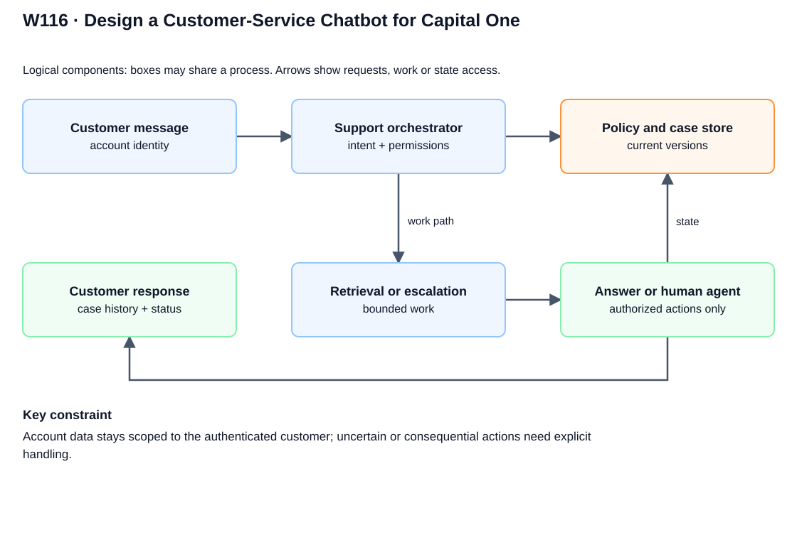

# W116. Design a Customer-Service Chatbot for Capital One

**Priority group:** Second 100 — important

**Category:** RAG, agents and application security

**Study position:** 116 of 547

[Group list](../NEXT_100.md) · [All categories](../ALL_CATEGORIES.md) · [Chapter guide](../README.md)

## Question

Power Day case study: design and discuss the deployment of a customer-service chatbot for Capital One, a regulated financial institution. The prompt is intentionally under-specified — you are expected to scope the problem before going deep. Coverage typically includes:

Product framing — which customer interactions does the chatbot replace? What is in-scope vs deferred to a human agent?
Model choice — fine-tuned LLM vs RAG over Capital One docs vs a smaller intent-classification + retrieval hybrid. Trade-offs in latency, cost, accuracy, compliance.
Evaluation — CSAT, deflection rate, escalation rate, hallucination rate, regulatory-compliance rate. How do you measure pre- and post-launch?
Risks — hallucination on regulated topics (credit decisions, fee disputes), PII handling, adversarial prompts.
Rollout — staged rollout, human fallback, monitoring, circuit-breakers.

## Worked solution

<!-- architecture:W116:start -->
### Architecture and request flow

[Open the diagram at full size](../diagrams/W116_architecture.svg). This is a baseline component diagram for this question. The boxes describe responsibilities; they do not require a separate microservice for every box.

- **Request and state:** Customer message — account identity → Support orchestrator — intent + permissions. That component consults or updates **Policy and case store — current versions** under the required access and consistency rules.
- **Work and result:** the work path passes through **Retrieval or escalation — bounded work** and **Answer or human agent — authorized actions only**, producing **Customer response — case history + status**. Bound waiting and retries where a slow dependency can stall this path.
- **Correctness point:** Account data stays scoped to the authenticated customer; uncertain or consequential actions need explicit handling.

When explaining the drawing, trace one normal request first, then a duplicate request, an unavailable dependency and recovery from saved state. If the question requires stricter guarantees or a different scope, state the change explicitly rather than treating this baseline as the only possible design.
<!-- architecture:W116:end -->

### Scope a safe first release

Treat this as a proposed design, not a description of Capital One's actual systems or current legal obligations. Start with public product/policy questions, navigation help and authenticated read-only account explanations. Route credit/adverse-action explanations, disputed charges, complaints, account access problems and uncertain answers to approved workflows or humans. Do not let a generator invent eligibility decisions, promise fee reversals or change accounts. Stakeholders must define the exact approved categories, retention rules and service expectations before launch.

Use an intent/risk router plus retrieval over versioned approved documents, with a small generator for grounded explanation. An intent/template hybrid is cheap, auditable and predictable for common questions but limited for long-tail language. RAG updates policies without retraining but requires high retrieval recall, access filters and abstention. Fine-tuning can improve style/intent handling; it does not guarantee current policies or replace evidence. Evaluate all three on the same customer scenarios and measured latency/cost rather than assuming a large model is needed.

### Account-scoped flow and data

APIs are `POST /support/sessions`, `POST /sessions/{id}/messages` with request id, `GET /sessions/{id}`, and `POST /sessions/{id}/handoff`. Store session owner, message/evidence versions, risk intent, tool operation ids, outcome and consent/retention metadata. An account-read adapter takes the authenticated account scope from server identity, never a model-supplied arbitrary user id. Retrieve authorized policy chunks with effective dates, generate a citation-backed answer, validate regulated claims and either answer or escalate. Hand off the conversation summary, verified evidence and unresolved request so the customer need not repeat everything.

Example: “Why was I charged a fee?” requires the relevant transaction plus the policy effective on that date. If either is unavailable, state what is known and hand off; do not infer a personalized fee waiver from a public FAQ. A repeated request reuses its response/operation identity. A tool timeout fails to a read-only explanation or human path, not fabricated account details.

### Measure correctness and real resolution

Before launch, build a deidentified historical/synthetic test set with common intents, confusing policies, languages, accessibility needs and adversarial prompts. Subject experts label correct action, evidence, compliant wording and escalation need. Score retrieval recall, grounded-claim error, unsupported/incorrect regulated statements, privacy disclosure, appropriate escalation and task resolution. Define “compliance rate” against an explicit expert rubric; zero errors in a small sample is not proof of zero risk.

After launch, measure CSAT with response rate, verified resolution, repeat contacts within a fixed window, escalation and successful human transfer, latency and cost. Deflection is the fraction of eligible contacts resolved without a human **and without later repeat contact**, not simply chats that ended. Audit a random sample plus high-risk cases; neither voluntary CSAT nor an LLM judge alone gives an unbiased safety estimate. Compare to the existing support channel with matched traffic or randomized rollout, accounting for case difficulty.

### Rollout, privacy and failures

Keep encryption, narrow service credentials, tenant/account isolation, PII minimization, redacted logs, retention/deletion and approved data use outside the model. Treat customer and retrieved text as untrusted instructions; schema validation is followed by resource authorization. Start offline → internal/shadow → a small low-risk canary → staged traffic. Keep humans available and publish the supported scope. Circuit-break on account-scope leakage, unsafe claims, retrieval outages or material quality regression; switch to approved templates/human routing through configuration. Monitor policy-index freshness and invalidate answer caches on policy version changes. As an illustrative scale, 100k chats/day at ten turns is about 11.6 turns/s average; size for peak traffic and measured model throughput, not that average alone.

### Further study

- [F071: Design a minimal retrieval-augmented question-answering system.](../08_rag_and_agents.md#f071)
- [F076: Build an agent loop with explicit stop conditions.](../08_rag_and_agents.md#f076)
- [F077: Design tool schemas and validate LLM outputs.](../08_rag_and_agents.md#f077)
