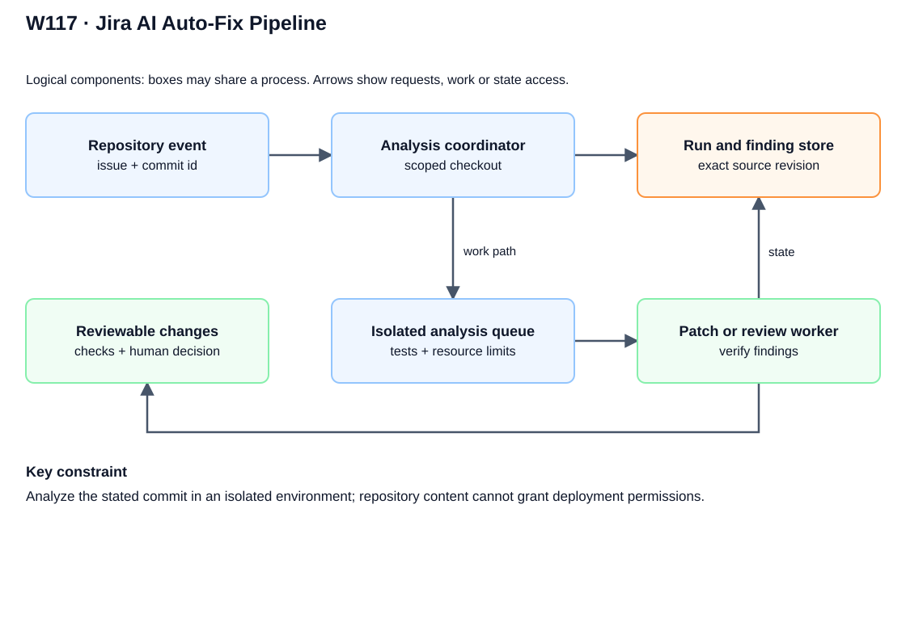

# W117. Jira AI Auto-Fix Pipeline

**Priority group:** Second 100 — important

**Category:** RAG, agents and application security

**Study position:** 117 of 547

[Group list](../NEXT_100.md) · [All categories](../ALL_CATEGORIES.md) · [Chapter guide](../README.md)

## Question

Design an internal tool that pulls new Jira bug tickets (each bug corresponds to a test failure) and sends each ticket to an AI system that generates a fix PR in roughly 30+ minutes.

Jira continuously produces bug tickets; an AI service accepts a ticket and generates a fix PR.
AI generation is slow (~30+ min per PR).
Build a service that pulls Jira tickets, buffers them via a message queue, dispatches to the AI service, and tracks each ticket's current state in a DB.
Discuss schema design, sharding, and scaling.
The workflow must tolerate retries and never create duplicate PRs for the same ticket.

## Worked solution

<!-- architecture:W117:start -->
### Architecture and request flow

[Open the diagram at full size](../diagrams/W117_architecture.svg). This is a baseline component diagram for this question. The boxes describe responsibilities; they do not require a separate microservice for every box.

- **Request and state:** Jira ticket event — ticket + source revision → Fix-run coordinator — idempotent dispatch. That component consults or updates **Ticket and run store — cursor + exact revision** under the required access and consistency rules.
- **Work and result:** the work path passes through **Durable ticket queue — leases + retry budget** and **AI fix + PR finalizer — verify failing test**, producing **One tracked fix PR — checks + ticket status**. Bound waiting and retries where a slow dependency can stall this path.
- **Correctness point:** Analyze the stated commit in an isolated environment; repository content cannot grant deployment permissions.

When explaining the drawing, trace one normal request first, then a duplicate request, an unavailable dependency and recovery from saved state. If the question requires stricter guarantees or a different scope, state the change explicitly rather than treating this baseline as the only possible design.
<!-- architecture:W117:end -->

### Persist the ticket before dispatch

Poll Jira using a durable `(updated_at,ticket_id)` cursor with overlapping windows; optionally combine webhooks with periodic reconciliation. Deduplicate by `(jira_instance,ticket_id)` in a transactional DB. Store the exact ticket snapshot, repository, failing-test reference, requested source revision and current state. The diagram now starts with a Jira ticket event; the durable poll cursor and reconciliation loop implement that ingestion boundary.

Tables: `Ticket(id UNIQUE,source_version,repo,base_sha,state,created_at)`, `Run(ticket_id UNIQUE,operation_id UNIQUE,status,lease_epoch,service_job_id,started_at,heartbeat_at,pr_url,error)`, `Attempt(run_id,number,status,checkpoint_ref)`, and a transactional outbox. State goes discovered → queued → submitted → running → verifying → PR_CREATED, or retryable_failure/permanent_failure/canceled. Expose internal `GET /tickets/{id}`, `POST /tickets/{id}/retry` and signed job callbacks; require retry requests to reuse the same logical run identity.

### Separate short dispatch work from thirty-minute generation

Commit ticket and outbox together; the queue carries ticket/run ids, not a live network connection. A dispatcher claims with a lease and submits `create_fix(operation_id,ticket_snapshot,repo,base_sha)` to the AI service. Persist the returned job id and poll or receive callbacks. A 30-minute job should not occupy a consumer's fragile request timeout. The AI service must support `get_by_operation_id` and idempotent job creation. If a submission times out, query the same operation id; never create a new job just because the response was lost.

The patch worker uses an isolated checkout of `base_sha`, reproduces the identified failing test, implements a patch, runs targeted and relevant regression tests, and records commands/results. Repository/ticket content cannot grant new secrets or production permissions. It publishes one reviewable PR under a deterministic branch/run marker; a finalizer reconciles existing PRs before creation. `UNIQUE(ticket_id)` in our DB alone cannot prevent duplicate PRs across a crash between remote creation and local commit. Require provider/service idempotency, or serialize one finalizer with stable branch identity and query/reconcile the remote outcome before retrying. Ambiguous outcomes remain `unknown` until reconciled.

### Scale and recovery

Assume 1,000 tickets/hour at peak and mean generation 0.5 hour: Little's law gives roughly 500 simultaneous AI jobs before headroom/retries. Dispatch workers are cheap; AI concurrency, repository quotas and compute are the bottlenecks. Use bounded queue age, per-repo/tenant quotas, priorities plus aging, and rate-limited Jira polling. Shard ticket/run state by hash of ticket id within tenant; index `(state,next_poll_at)` and `(repo,created_at)`. Do not shard by a low-cardinality status alone. Queue partitions can use repo id to limit conflicting fixes while different repositories run in parallel.

On restart scan expired leases and reconcile service jobs; fencing epochs prevent stale dispatchers committing newer state. A duplicated callback checks run and terminal state before updating. Poison tickets go to a dead-letter/review queue with reason; closed/withdrawn Jira tickets stop pending work. A new ticket revision updates the snapshot policy explicitly instead of silently creating another PR. Measure backlog age, submission/verification/PR completion rates, job duration, test-fix acceptance, duplicate PR count and cost. A manual retry of a failed verification can create another **attempt**, but the logical ticket still has one tracked PR.

### Further study

- [F076: Build an agent loop with explicit stop conditions.](../08_rag_and_agents.md#f076)
- [F078: Evaluate an agent whose outputs vary between runs.](../08_rag_and_agents.md#f078)
- [F167: Design preemptible long-running generation jobs.](../17_distributed_systems_depth.md#f167)
