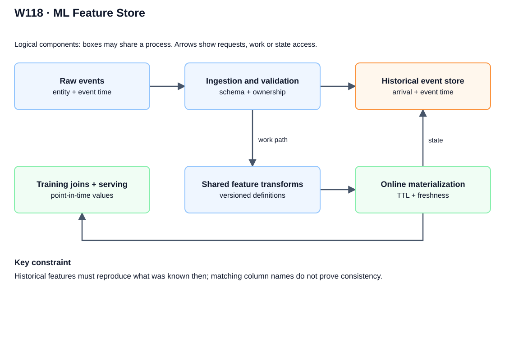

# W118. ML Feature Store

**Priority group:** Second 100 — important

**Category:** SQL, data modeling and pipelines

**Study position:** 118 of 547

[Group list](../NEXT_100.md) · [All categories](../ALL_CATEGORIES.md) · [Chapter guide](../README.md)

## Question

Design a feature store serving both training pipelines (batch reads, point-in-time correctness) and online inference (low-latency lookups by entity id). Discuss deployment, CI/CD, caching, online/offline parity, and reliability under load.

### Requirements

Functional: register feature definitions; ingest into offline and online stores; read features for a list of entity ids at inference; read training tables with point-in-time-correct joins.
Non-functional: online lookup p99 &lt; 50ms for ~1k entities; offline generation processes TB/day; online and offline consistent at any timestamp.
Interviewer drives at

Storage split (offline lake vs online KV) fed by one ingestion pipeline; point-in-time correctness (ASOF join to avoid label leakage); online/offline parity; feature versioning + schema evolution; CI/CD for feature definitions (schema validation -&gt; lineage -&gt; canary -&gt; promote); inference caching (TTL trade-off); observability SLIs (freshness lag, parity divergence, latency/error, null-fallback rate, drift); safe multi-tenant rollout with rollback; data-quality failure modes (backfills, stale data, failed jobs, degraded upstreams).

## Worked solution

<!-- architecture:W118:start -->
### Architecture and request flow

[Open the diagram at full size](../diagrams/W118_architecture.svg). This is a baseline component diagram for this question. The boxes describe responsibilities; they do not require a separate microservice for every box.

- **Request and state:** Raw events — entity + event time → Ingestion and validation — schema + ownership. That component consults or updates **Historical event store — arrival + event time** under the required access and consistency rules.
- **Work and result:** the work path passes through **Shared feature transforms — versioned definitions** and **Online materialization — TTL + freshness**, producing **Training joins + serving — point-in-time values**. Bound waiting and retries where a slow dependency can stall this path.
- **Correctness point:** Historical features must reproduce what was known then; matching column names do not prove consistency.

When explaining the drawing, trace one normal request first, then a duplicate request, an unavailable dependency and recovery from saved state. If the question requires stricter guarantees or a different scope, state the change explicitly rather than treating this baseline as the only possible design.
<!-- architecture:W118:end -->

### Define what “consistent at any timestamp” means

Offline history can retain every version; an ordinary current-value online KV cannot answer arbitrary past timestamps. The achievable contract is: for feature definition v and an explicitly committed ingestion watermark w, online reads and offline replay return the same value **known by w**. If arbitrary historical online reads are mandatory, retain versioned online values or route historical reads to a history service; latest-only KV is insufficient. State freshness lag rather than promising instantaneous cross-store consistency during outages.

Register `Feature{name,version,entity_keys,dtype,transform_hash,event_time_field,availability_time_field,ttl,owner,schema,freshness_slo}`. Store immutable `FeatureValue(entity,feature_version,event_time,available_at,revision,value)` records offline in partitioned Parquet/lake tables; materialize latest eligible versions online under `(tenant,entity,feature_version)`. One validated event log and versioned transform code feed both paths. Conditional upserts reject late older values overwriting newer current values; corrections and backfills preserve availability/revision history.

### APIs and point-in-time correctness

`POST /feature-definitions`, `POST /ingest` with event id, `POST /online:batchGet` with up to 1,000 entity ids and feature versions, and `POST /trainingSets` with entity/prediction-time rows and versions. Online results include each entity id, value, event/availability time, watermark and explicit missing/stale status. Preserve input order/mapping even for partial failures.

For a prediction row `(entity,t)`, choose only feature records with `event_time <= t` **and** `available_at <= t`, then apply the same as-known revision/window semantics as production. An ASOF join on event time alone leaks late data. A purchase at 10:00 ingested 10:10 cannot enter a 10:05 prediction; a correction received tomorrow must not rewrite what was known today. Replaying a backfill for new experiments may intentionally use a different historical truth contract; label it accordingly.

### Latency, deployment and parity

Assume 20 float features/entity, 8 bytes/value: 1,000 entities is 160kB raw before keys/protocol. Batch/scatter-gather across bounded KV shards and co-locate compute; 1,000 serial RPCs cannot meet p99<50ms. Use per-shard deadlines, partial-result policy and training-approved defaults/missingness indicators. Benchmark under realistic key skew, payload and tenant mix. TB/day offline processing needs partition pruning, incremental materialization, checkpoints, event dedup and controlled backfills.

Deploy stateless registry/read services with horizontally scalable stream/batch processors; isolate tenants and reserve resources for online work. CI validates schemas, feature keys, time availability, transform determinism, reference examples and lineage; canary a new version into shadow online keys and compare sampled online values to offline replay at matched watermarks. Promote through a registry alias while models pin compatible feature versions. Roll back the alias and keep old keys until dependent models migrate. Adding a column can be compatible; changing units or window semantics needs a new version.

Cache key includes tenant/entity/feature version and freshness boundary; TTL must be at most allowed staleness, with invalidation or version/watermark updates on change. Avoid caching missing values too long. Monitor availability, p99 latency, freshness lag, parity divergence, null/default rate, drift and per-tenant quota. Pause bad writes on schema/quality failures, serve last-known-good only within declared staleness, otherwise degrade explicitly. Rebuild online data by replay, verify watermark before traffic switch, and throttle backfills so historical data cannot starve live updates.

### Further study

- [F086: Design a feature platform with online/offline consistency.](../09_ml_system_design.md#f086)
- [F176: Build point-in-time training joins.](../18_data_and_sql.md#f176)
