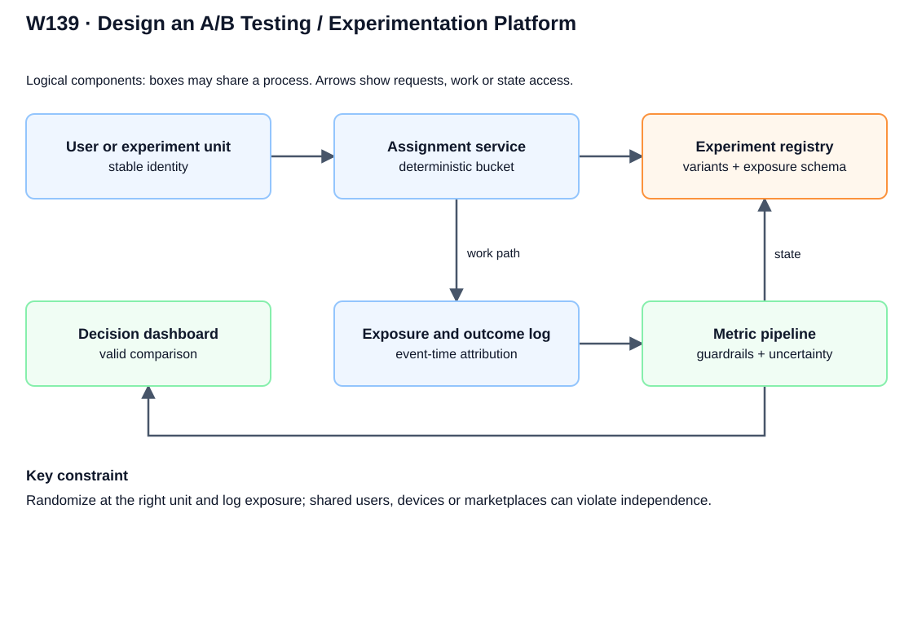

# W139. Design an A/B Testing / Experimentation Platform

**Priority group:** Second 100 — important

**Category:** Evaluation, calibration and data quality

**Study position:** 139 of 547

[Group list](../NEXT_100.md) · [All categories](../ALL_CATEGORIES.md) · [Chapter guide](../README.md)

## Question

Design an A/B Testing / Experimentation Platform

Design an end-to-end A/B testing / experimentation platform: experiment configuration, traffic / bucket allocation, and metrics collection. A collaborative round that goes deep into trade-offs.

SWE ab-testing metrics experiment-design

### Requirements

Design an end-to-end A/B testing / experimentation platform. Cover at least:
Experiment configuration: defining experiments, variants, and targeting.
Traffic allocation: assigning users to buckets / variants with stable, deterministic assignment.
Metrics collection: logging exposures and outcomes, then aggregating results.
Discuss optimizations and trade-offs; interviewers often extend the round to dig deeper into the design.
Notes
The most frequently seen Affirm system-design prompt; it appears across many onsite loops.
Interviewers are usually collaborative here, but some stay silent—drive the structure yourself: requirements → data model → allocation → metrics → scale.

## Worked solution

<!-- architecture:W139:start -->
### Architecture and request flow

[Open the diagram at full size](../diagrams/W139_architecture.svg). This is a baseline component diagram for this question. The boxes describe responsibilities; they do not require a separate microservice for every box.

- **Request and state:** User or experiment unit — stable identity → Assignment service — deterministic bucket. That component consults or updates **Experiment registry — variants + exposure schema** under the required access and consistency rules.
- **Work and result:** the work path passes through **Exposure and outcome log — event-time attribution** and **Metric pipeline — guardrails + uncertainty**, producing **Decision dashboard — valid comparison**. Bound waiting and retries where a slow dependency can stall this path.
- **Correctness point:** Randomize at the right unit and log exposure; shared users, devices or marketplaces can violate independence.

When explaining the drawing, trace one normal request first, then a duplicate request, an unavailable dependency and recovery from saved state. If the question requires stricter guarantees or a different scope, state the change explicitly rather than treating this baseline as the only possible design.
<!-- architecture:W139:end -->

### Configuration and APIs

Assume 10M daily active users, 100M evaluations/day (1,157/s average, 10× peak), 1,000 concurrent experiments and outcome delays up to seven days. Choose user/account as the default randomization unit, configurable for device, household or marketplace region-time; the unit must match interference. `POST /experiments` stores variants, targeting, unit, salt, rollout buckets, mutual-exclusion layer, metric versions, hypothesis, MDE/power, duration and guardrails. `POST /experiments/{id}/publish|pause|stop`, `POST /evaluate` and `GET /experiments/{id}/results` complete the control/data plane. Require approvals/RBAC and an audit log for publishing; assignments use an immutable published version.

Data model: `Experiment(id,version,status,salt,targeting,layer,allocation,metric_plan)`, `Variant(id,configuration)`, `Assignment(unit_id,experiment_version,variant)` if persisted, `Exposure(event_id,unit,experiment_version,variant,occurred_at,received_at,decision_id)`, `Outcome(event_id,unit,type,value,occurred_at,source)` and versioned metric definitions. Protect identities and isolate organization data. Separate low-latency assignment from analytical event processing.

### Stable bucketing and its change policy

Compute a specified cross-language keyed hash of `(namespace,experiment_salt,unit_id)`, map to an unsigned integer bucket in `[0,9999]`, and select contiguous variant intervals. Do not use language-runtime hash() because seeds/versions can differ. In a 20% rollout, buckets 0–1999 are eligible; A=0–999, B=1000–1999 gives equal arms. Increasing rollout while moving the A/B boundary can change old assignments, so use a separate enrollment hash and a stable arm hash, or persist enrollment/variant once assigned. Eligibility changes, new unit identities, login merges and restarts need an explicit stickiness policy; do not silently rebucket mid-experiment.

Clients use locally cached signed configuration for responsiveness; target only on known pre-treatment attributes. At equal configuration/user, server and SDK must return the same assignment. If config is missing, serve baseline with an explicit “not evaluated” status rather than log a fake control exposure. Mutual-exclusion layers hash users into nonoverlapping experiment ranges; orthogonal namespaces allow concurrent experiments when interactions are acceptable. Snapshot/persist enrollment when eligibility is mutable.

### Exposure, attribution and correct inference

Assignment is not exposure. Log exposure only when the selected experience is actually rendered/used, with decision id and experiment version. The business operation emits outcomes independently; join through identity and a predeclared window without multiplying one purchase by duplicate impressions. Deduplicate event ids, retain event and arrival times, apply watermarks, and distinguish provisional from mature results. Preserve an intention-to-treat population when the design requires it; treatment-dependent exposure filtering can bias an otherwise randomized experiment. The platform should report assignment and exposure funnels side by side.

For binary conversion per user aggregate one eligible outcome per user; for revenue use user totals and robust uncertainty rather than treating every purchase as an independent user. Keep metric numerator and denominator separately; average-of-averages can be wrong. Check sample-ratio mismatch, A/A calibration, missing events by arm, bot filtering, cross-device contamination and baseline balance. Present effect size with interval, sample size, maturity and guardrail changes. Predeclare fixed-horizon stopping or a valid sequential procedure; correct multiple testing and do not turn exploratory subgroup wins into confirmatory claims. CUPED can use pre-treatment covariates; marketplace interference can require balanced switchbacks and cluster-aware analysis rather than user A/B.

### Scale, failures and the diagram

The existing diagram maps registry → deterministic assignment → exposure/outcome log → metric pipeline → decision dashboard. At 100M exposures/day and an assumed 300B/event, raw exposures are 30GB/day; three replicas for 30 days are 2.7TB, excluding outcomes/indexes/overhead. Partition logs by date and experiment/unit hash, use a durable stream, append-only lake and incremental warehouse aggregations. Cache configs close to callers, not final per-user statistics in the critical path. Reprocess from immutable event/metric versions; results remain marked provisional until watermark completion.

A duplicate evaluation must return the same variant; a duplicate event must count once. Offline SDK buffering can recover temporary event outages but must report lost/buffered volume. A paused experiment stops new exposure while keeping historical assignments for analysis. Rollout changes are versioned so dashboards never mix incompatible policies unknowingly. Monitor assignment p99/availability, config propagation lag, event loss/delay, dedup rate, SRM alerts and metric freshness. Optimize local evaluation for availability while acknowledging temporary config staleness; the analysis must know which version actually served.

### Further study

- [F064: Design an A/B test for a new ML ranking model.](../07_evaluation_and_data.md#f064)
- [F138: Design a switchback experiment for a shared marketplace.](../14_regression_and_experiment_depth.md#f138)
