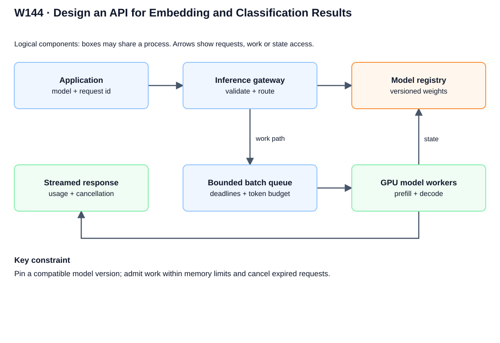

# W144. Design an API for Embedding and Classification Results

**Priority group:** Second 100 — important

**Category:** LLM serving and scheduling

**Study position:** 144 of 547

[Group list](../NEXT_100.md) · [All categories](../ALL_CATEGORIES.md) · [Chapter guide](../README.md)

<span class="practice-page"></span>

## Question

Two models work as a pipeline: an embedding model turns a stored file into a vector, and a classifier turns that vector into a label. Clients want one API they can call with a file and get the classification back. Design that API and the service behind it so that it stays correct, responsive and affordable even when the models are slow or fail.

What you are given
1. Stored file: the file is already in the system and has an identifier. Uploading files is out of scope.
2. Stage 1, embedding model (black box): input is one file, output is an embedding for that file. You cannot change or inspect the model, so its exact input and output contract is part of the design.
3. Stage 2, classification step: input is the embedding from stage 1, output is a classification result in JSON format.
4. Client: a user calls your API to obtain the classification result for a file.

### Requirements

1. The API surface: endpoints, request and response JSON, status codes, and how the API is versioned.
2. How a request flows through the embedding stage and then the classification stage, including what is passed between them.
3. Whether the call is synchronous or asynchronous, and the exact behaviour of each choice, including idempotency and how a client retrieves a result.
4. The data you store, and how embeddings are reused across requests.
5. Failure handling: timeouts, retries, partial failure between the two stages, and invalid input.
6. How you scale it and how you observe it.
Constraints and assumptions to state
The exact input type and size limits of the embedding model, the embedding dimension and dtype, and the label set of the classifier are not given. State your assumptions explicitly and show which parts of the design depend on them.
The model stages may be slow compared with an ordinary web request, and may fail independently.
Results must be consistent: the same file and the same model versions must give the same answer.

## Worked solution

<!-- architecture:W144:start -->
### Architecture and request flow



[Open the diagram at full size](../diagrams/W144_architecture.svg). This is a baseline component diagram for this question. The boxes describe responsibilities; they do not require a separate microservice for every box.

- **Request and state:** Stored-file client — file id + model versions → Classification API — authorize + deduplicate. That component consults or updates **Job and model registry — state + contracts + results** under the required access and consistency rules.
- **Work and result:** the work path passes through **Two-stage work queues — stage deadlines + quotas** and **Embedding + classifier — validate + persist vector**, producing **Durable JSON result — poll job or bounded wait**. Bound waiting and retries where a slow dependency can stall this path.
- **Correctness point:** Pin file and model versions; reuse valid embeddings and commit one canonical result.

When explaining the drawing, trace one normal request first, then a duplicate request, an unavailable dependency and recovery from saved state. If the question requires stricter guarantees or a different scope, state the change explicitly rather than treating this baseline as the only possible design.
<!-- architecture:W144:end -->

### Make the black-box contract explicit

Assume an immutable stored UTF-8 text file ≤10MiB, an embedding service accepting authorized file bytes plus preprocessing/model version and returning a finite float32 vector of dimension 768, and a deterministic classifier accepting that exact embedding contract and returning one of `invoice`, `report`, `other` with optional normalized probabilities. These are **chosen assumptions**, not supplied facts: PDF/image support, chunking, maximum length, embedding dtype/dimension and classifier labels require provider confirmation. Never silently truncate a file; return unsupported/too-large until the policy is explicit. Model-registry compatibility binds embedding version/dimension/normalization to classifier version/label schema.

### Versioned API and retrieval behavior

`POST /v1/classifications` with header `Idempotency-Key` and body

```json
{"file_id":"f123","embedding_version":"e7","classifier_version":"c4","mode":"async"}
```

returns `202 Accepted`, `Location: /v1/classification-jobs/j8` and

```json
{"job_id":"j8","status":"queued","file_version":"sha256:...","result_url":"/v1/classification-jobs/j8"}
```

`GET /v1/classification-jobs/j8` returns 200 with queued/embedding/classifying/retrying/failed status, or a completed result:

```json
{"job_id":"j8","status":"completed","file_id":"f123","file_version":"sha256:...","embedding_version":"e7","classifier_version":"c4","result":{"label":"invoice","probabilities":{"invoice":0.9,"report":0.07,"other":0.03}}}
```

Use 400 for malformed JSON, 401/403 for unauthorized access, 404 for an unavailable file/job under the privacy policy, 413 for size, 415 for type, 422 for an invalid model contract, 409 for reusing an idempotency key with a different payload, and 429/503 plus Retry-After for quota/overload. Terminal asynchronous failures are a 200 job resource with structured error/retryability; the original POST's HTTP request has already succeeded. Add `POST /jobs/{id}/cancel` if cancellation is required.

Default async because both stages can outlive request deadlines. Optional `mode=sync` waits a bounded time (for example two seconds); return 200 completed if ready, otherwise 202 with the **same job id**, never abandon/restart computation. Retrying the POST with the same tenant/key/payload returns the same logical job. A cached completed result can return 200 immediately in either mode; request result retrieval always rechecks file/job authorization.

### Data keys and two-stage flow

Store `File(id,tenant,immutable_content_hash,size,type,storage_ref)`, `ModelContract(version,dimension,dtype,preprocess_hash,compatible_input_versions)`, `Job(id,tenant,key,payload_hash,file_hash,embed_version,classifier_version,state,attempts,error,result_ref)` and `Embedding(file_hash,preprocess_hash,embed_version,vector_ref,status)`. Cache the final result by `(tenant,file_hash,preprocess_hash,embed_version,classifier_version,decision_policy_version)`. Reusing an embedding across classifier versions saves stage 1; using a changed embedding version requires recomputation and a compatible head. Cross-tenant content reuse needs explicit privacy design, so tenant-scope it by default.

API checks file permission/type/size and pins its immutable version → transactionally inserts job/outbox → embedding queue claims a unique embedding key → adapter loads bytes and validates returned shape/dtype/finiteness → commit embedding object/metadata → classify that exact vector → validate allowed label/probabilities → commit result → mark completed. Single-flight claims and conditional commits deduplicate concurrent same-file computation; consumer messages are hints, durable state is authoritative. Record vector checksums and version lineage.

### Independent failures and deterministic consistency

If classification fails, retry from the committed embedding rather than rereading/reembedding. Use stage deadlines, exponential backoff+jitter for transient failures, bounded attempts, dead-letter/permanent schema failures and reconciliation after unknown timeouts. Content-changing files get new versions; a job never follows a mutable file alias halfway through. A crash after vector upload but before metadata commit can leave an orphan object for garbage collection; it cannot publish a partial result. Job leases and fencing prevent stale workers overwriting current state.

“Same file and versions give same answer” requires deterministic preprocessing/inference and a canonical committed result. With a nondeterministic black box, a fixed version name alone is insufficient: require a provider determinism/seed contract or define the first committed result as canonical and persist it, including across cache eviction. If semantic repeatability after recomputation is required and the provider cannot guarantee it, the stated requirement is unattainable without retaining outputs; disclose that trade-off explicitly.

### Scale and observability

Use separate embedding/classifier worker pools and queues, batching only if each black box supports it, with bounded queue lengths, tenant fairness and autoscaling by queue age/service time. If peak arrival is an assumed 100 files/s and embedding mean service is .5s/item, at least 50 busy embedding slots are needed before headroom; measured latency/batching determines actual workers. One million 768-dimensional float32 embeddings require about 3.072GB raw plus metadata/replication. Monitor per-stage latency, retries, cache/single-flight hit rate, backlog, wrong dimension/version, final quality/drift and cost. The corrected diagram uses embedding→classification workers and a durable result, not autoregressive prefill/token streaming; file upload remains out of scope.

### Further study

- [F032: Implement the scheduling core of a dynamic batcher.](../04_serving_and_training_systems.md#f032)
- [F034: Estimate an LLM serving capacity budget.](../04_serving_and_training_systems.md#f034)
- [F090: Design a rate-limited LLM classification pipeline.](../09_ml_system_design.md#f090)
